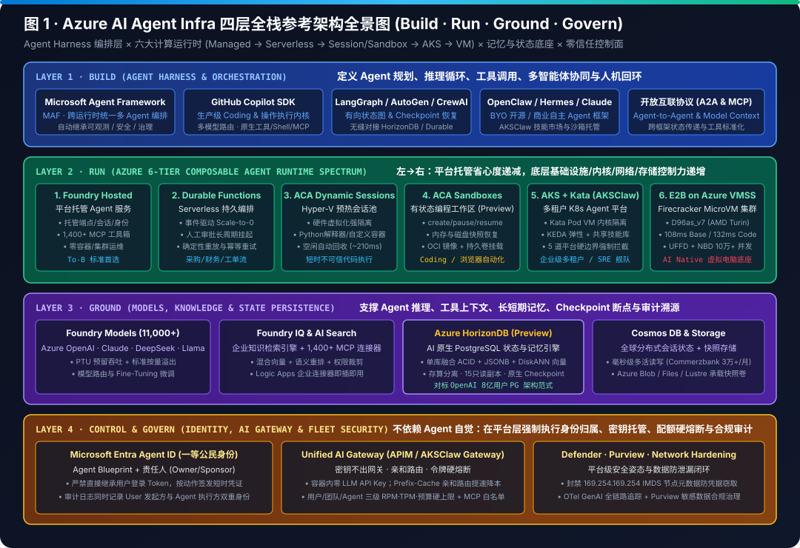

# Azure Infra Lab — Enterprise AI & Data Infrastructure Solution Architect Lab (`turbo998/Azure-Infra-Lab`)

> 🌐 **Language / 语言切换**: **[🇨🇳 中文主页 (`README.md`)](README.md)** | **🇬🇧 English (`README.en.md`)**  
> ⚡ **Quick Access**: **[💎 Diamond Enterprise Demo Hub](workshops/data-lab/demos/diamond-hub.en.html)** · **[📺 TCL × Fabric 6-Act Cockpit](workshops/data-lab/demos/tcl-fabric/index.en.html)** · **[🛒 Zava × Databricks & Fabric Demo](workshops/data-lab/demos/databricks-fabric/index.en.html)** · **[⚔️ Databricks vs Fabric 10-Dim Battlecard](workshops/data-lab/demos/databricks-fabric/battlecard.en.html)** · **[🔬 Data Lab 5-Cloud Workbench](workshops/data-lab/index.en.html)** · **[🤖 Azure Agent Infra (`AKSClaw × E2B`)](workshops/azure-agent-infra/index.html)** · **[🎬 FabCon 2026 Video Hub](workshops/fabcon-sqlcon-2026/index.html?lang=en)**

Practical reference architectures, executive live sandboxes, capacity/TCO calculators, and reproducible benchmarks built from an **AI Solution Architect (SA)** perspective across **Microsoft Fabric**, **Azure Databricks**, **Azure AI Agent Runtimes (`AKSClaw × E2B`)**, and **Azure Compute FinOps**.

---

## 💎 Featured: Diamond Enterprise Data & AI Live Demo Suite

Two **100% tenant-sanitized, browser-ready executive sandboxes** complete with dual-screen speaker scripts and competitive battlecards:

| Flagship Live Demo | Core Architecture Stack | Business Problem & Quantified Outcome | Live Links |
| :--- | :--- | :--- | :--- |
| **📺 Demo 01 · TCL Global Channel IQ** | **Microsoft Fabric End-to-End**<br>OneLake Shortcuts · Eventhouse KQL · Fabric IQ Ontology · Data & Operations Agents · Direct Lake | Resolves three Black Friday global channel crises: **`$629.7K`** EU GMV protected via 48h France→Germany rebalance, **`$582.1K`** margin saved via soundbar bundle guardrail, and **`$162.5K`** Vietnam channel-stuffing rebate blocked | [🚀 6-Act Cockpit](workshops/data-lab/demos/tcl-fabric/index.en.html) · [📖 SA Playbook](workshops/data-lab/demos/tcl-fabric/playbook.en.html) · [中文](workshops/data-lab/demos/tcl-fabric/index.html) |
| **🛒 Demo 02 · Zava Omnichannel Fresh Retail** | **Azure Databricks × Microsoft Fabric**<br>Lakeflow · Unity Catalog CLS & Metric Views · AI/BI Genie · Mirrored UC · Power BI Direct Lake | Quarantines dirty records via Lakeflow, masks PII dynamically (`mask_cn_phone()`), isolates East China's **`-3.1pp`** margin drop via 5-turn Genie (`17.3h` Kunshan hub bottleneck + **`1,460-case`** Jiaxing rebalance), and mirrors zero-copy into OneLake Direct Lake | [🚀 4-Act Workbench](workshops/data-lab/demos/databricks-fabric/index.en.html) · [⚔️ 10-Dim Battlecard](workshops/data-lab/demos/databricks-fabric/battlecard.en.html) · [中文](workshops/data-lab/demos/databricks-fabric/index.html) |

👉 **[Open Diamond Enterprise Demo Hub (`workshops/data-lab/demos/diamond-hub.en.html`)](workshops/data-lab/demos/diamond-hub.en.html)**

---

## 📚 Core Solution Architect Playbooks & Workshops

| Track | Architectural Scope | Interactive Assets & Visual Decks | Verification Baseline |
| :--- | :--- | :--- | :--- |
| **1. [Data Lab — 5-Cloud Enterprise Data & AI Selection Lab](workshops/data-lab/README.en.md)** · [中文](workshops/data-lab/README.md) | Benchmarks **Microsoft Fabric** against **Azure Databricks, Snowflake, GCP BigQuery & AWS** across **63 bilingual enterprise selection FAQs** (OneLake, Streaming, Zero-ETL Mirroring, Vector Search, OBO Governance, Retail/FSI/SAP/Healthcare) + **Diamond Demo Suite** | [5-Cloud TCO & Sim Workbench](workshops/data-lab/index.en.html) · [7-Card Benchmark Deck](workshops/data-lab/benchmark-cards.en.html) · [Diamond Demo Hub](workshops/data-lab/demos/diamond-hub.en.html) | `291 / 292 (99.66%)` routing matrix · `142 / 142` tests passing ([`tests/`](workshops/data-lab/tests)) |
| **2. [Azure AI Agent Infrastructure Playbook (`AKSClaw × E2B`)](workshops/azure-agent-infra/README.en.md)** · [中文](workshops/azure-agent-infra/README.md) | 6-Layer Agent Infra reference (`Build · Run · Ground · Govern`); **`80ms` Firecracker cold start / `108ms` UFFD restore** on `Standard_D96as_v7` scaling to **100,000 concurrent sandboxes** across 261 nodes; **34 Bicep blueprints** & **34 sizing tools** | [Architecture Hub](workshops/azure-agent-infra/index.html) · [Live Simulator](workshops/azure-agent-infra/demo.html) · [100K Fleet Sizer](workshops/azure-agent-infra/selector.html) · [7-Card Deck](workshops/azure-agent-infra/cards.html) | `30 / 30` unit tests passing ([`simulator/`](workshops/azure-agent-infra/simulator)) · [`blueprints/`](workshops/azure-agent-infra/blueprints) |
| **3. [FabCon & SQLCon Barcelona 2026 Briefing](workshops/fabcon-sqlcon-2026/README.en.md)** · [中文](workshops/fabcon-sqlcon-2026/README.md) | Deep dive into 6 strategic enterprise data pillars: Fabric IQ, Power BI Agentic App Creation, OneLake IQ Sharing, Osmos Data Engineering Agents, and Azure SQL Hyperscale DiskANN (18 GA/Preview items) | [Interactive Video Hub (`?lang=en`)](workshops/fabcon-sqlcon-2026/index.html?lang=en) · [中文展厅](workshops/fabcon-sqlcon-2026/index.html) | 5 embedded official product demo videos & transcripts |
| **4. [Azure VM Modernization & FinOps Workshop](workshops/azure-vm-modernization/README.md)** | Trilingual (Simplified/Traditional Chinese & English) 7-module partner course, 6 synthetic migration cases, and browser-local CSV/XLSX TCO & constraint calculator | [Live Demo](workshops/azure-vm-modernization/demo.html) · [Course](workshops/azure-vm-modernization/workshop.html) · [Calculator](workshops/azure-vm-modernization/calculator.html) | 100% offline-capable static suite |

---

## 🖼️ Core Reference Architecture Diagrams




---

## ✅ Local Verification

```bash
# 1. Data Lab benchmark & 136 unit tests
python -m unittest discover -s workshops/data-lab/tests -p "test_*.py"

# 2. Azure Agent Infra sizer & 30 unit tests
python -m unittest discover -s workshops/azure-agent-infra/simulator -p "test_*.py"
python workshops/azure-agent-infra/simulator/agent_infra_sizer.py --check
```
