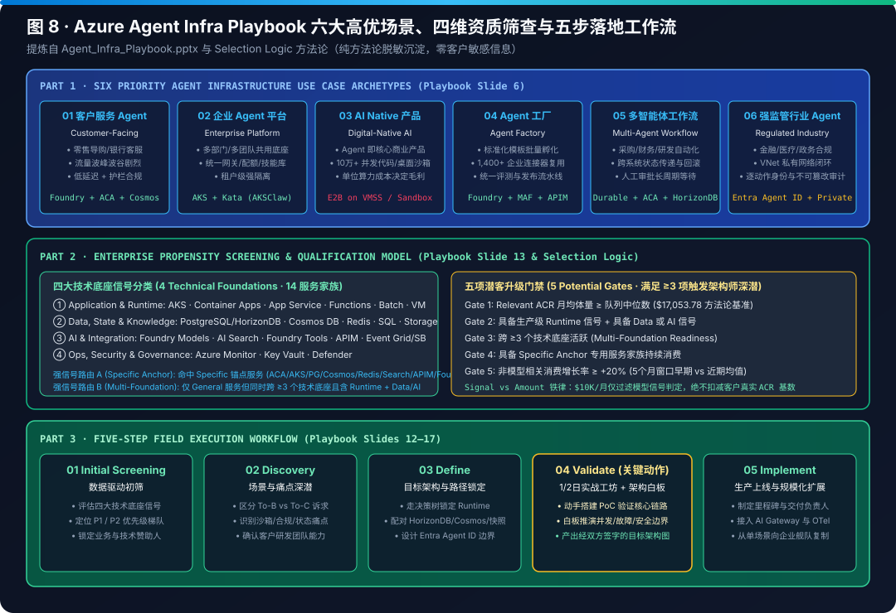

# Azure Infra Lab — Enterprise AI & Data Infrastructure Solution Architect Lab (`turbo998/Azure-Infra-Lab`)

> 🌐 **Language / 语言切换**: **[🇨🇳 中文主页 (`README.md`)](README.md)** | **🇬🇧 English (`README.en.md`)**  
> ⚡ **Quick Access**: **[💎 Diamond Enterprise Demo Hub](workshops/data-lab/demos/diamond-hub.en.html)** · **[📺 TCL × Fabric 6-Act Cockpit](workshops/data-lab/demos/tcl-fabric/index.en.html)** · **[🛒 Zava × Databricks & Fabric Demo](workshops/data-lab/demos/databricks-fabric/index.en.html)** · **[⚔️ Databricks vs Fabric 10-Dim Battlecard](workshops/data-lab/demos/databricks-fabric/battlecard.en.html)** · **[🔬 Data Lab 5-Cloud Workbench](workshops/data-lab/index.en.html)** · **[🤖 Azure Agent Infra (`AKSClaw × E2B`)](workshops/azure-agent-infra/index.html)** · **[🎬 FabCon 2026 Video Hub](workshops/fabcon-sqlcon-2026/index.html?lang=en)**

Practical reference architectures, executive live sandboxes, capacity/TCO calculators, and reproducible benchmarks built from an **AI Solution Architect (SA)** perspective across **Microsoft Fabric**, **Azure Databricks**, **Azure AI Agent Runtimes (`AKSClaw × E2B`)**, and **Azure Compute FinOps**.

---

## 💎 Featured: Diamond Enterprise Data & AI Live Demo Suite

Two **100% tenant-sanitized, browser-ready executive sandboxes** complete with dual-screen speaker scripts and competitive battlecards:

| Flagship Live Demo | Core Architecture Stack | Business Problem & Quantified Outcome | Live Links |
| :--- | :--- | :--- | :--- |
| **📺 Demo 01 · TCL Global Channel IQ** | **Microsoft Fabric End-to-End**<br>OneLake Shortcuts · Eventhouse KQL · Fabric IQ Ontology · Data & Operations Agents · Direct Lake | Resolves three Black Friday global channel crises: **`$629.7K`** EU GMV protected via 48h France→Germany rebalance, **`$582.1K`** margin saved via soundbar bundle guardrail, and **`$162.5K`** Vietnam channel-stuffing rebate blocked | [🚀 6-Act Cockpit](workshops/data-lab/demos/tcl-fabric/index.en.html) · [📖 SA Playbook](workshops/data-lab/demos/tcl-fabric/playbook.en.html) · [中文](workshops/data-lab/demos/tcl-fabric/index.html) |
| **🛒 Demo 02 · Zava Omnichannel Fresh Retail** | **Azure Databricks × Microsoft Fabric**<br>Lakeflow · Unity Catalog CLS & Metric Views · AI/BI Genie · Mirrored UC · Power BI Direct Lake | Quarantines dirty records via Lakeflow, masks PII dynamically (`mask_cn_phone()`), isolates East China's **`-3.1pp`** margin drop via 5-turn Genie (`17.3h` Kunshan hub bottleneck + **`1,460-case`** Jiaxing rebalance), and mirrors zero-copy into OneLake Direct Lake | [🚀 4-Act Workbench](workshops/data-lab/demos/databricks-fabric/index.en.html) · [⚔️ 10-Dim Battlecard](workshops/data-lab/demos/databricks-fabric/battlecard.en.html) · [中文](workshops/data-lab/demos/databricks-fabric/index.html) |

👉 **[Open Diamond Enterprise Demo Hub (`workshops/data-lab/demos/diamond-hub.en.html`)](workshops/data-lab/demos/diamond-hub.en.html)**

---

## 📚 Core Solution Architect Playbooks & Workshops

| Track | Architectural Scope | Interactive Assets & Visual Decks | Verification Baseline |
| :--- | :--- | :--- | :--- |
| **1. [Data Lab — 5-Cloud Enterprise Data & AI Selection Lab](workshops/data-lab/README.en.md)** · [中文](workshops/data-lab/README.md) | Benchmarks **Microsoft Fabric** against **Azure Databricks, Snowflake, GCP BigQuery & AWS** across **153 Triangular & Narcissistic (`306` bilingual docs) enterprise selection FAQs** (Microsoft IQ 4-Pillar Agent Context, OneLake, Streaming, Zero-ETL Mirroring, Vector Search, OBO Governance, Cybersecurity SOC/SIEM, Retail/Travel Centers, Highway Truck Stops, Convenience Store C-Store Retail, Forecourt Fuel Dispenser & Underground Storage Tank UST ATG Telemetry, Wet-Stock Reconciliation & EPA 40 CFR 280 Compliance/Wine, Spirits & Craft Beverage Three-Tier Wholesale Distribution, Barrel-House Proof-Gallon IoT, On-Off Premise Depletion & Menu AI, Cold-Keg Draft Telemetry & TTB-Tied-House Compliance/Commercial Greenhouse Horticulture, Controlled-Environment Agriculture CEA, Floriculture Pay-by-Scan & USDA APHIS-EPA WPS Compliance/Commercial Car Wash, Express Tunnel Franchises, LPR Unlimited Monthly Membership Clubs, Water-Reclamation IoT & EPA-FTC Compliance/Bottled Water, POU Filtration, Office Refreshment OCS & Returnable 5-Gallon Route Delivery/Commercial Furniture, Office Workspace Fit-Out, Mattress & Custom Upholstery, 3D CPQ, CNC Nesting & CPSC-STURDY Compliance/Self-Storage REITs, Smart Keypad Access, Dynamic ECRI & SCRA Lien Compliance/Corporate Relocation RMC, HHG Moving Van Lines & Expatriate Mobility/Retail Optical Chains, Freeform Lens Labs & Vision Insurance/Commercial Parking Garages, Mobility Hubs & Gateless LPR Yield/Commercial Industrial Bakery, Fresh Packaged Bread & DSD Route Networks/Health Clubs, Boutique Fitness Studios & Connected Wellness/Specialty Coffee Roasteries, Drive-Thru Beverage QSR & Mobile Order & Pay MOP/Aviation Ground Handling, Airport Ramp Turnaround, BRS Baggage & De-Icing/Automated Cold-Storage Warehousing, Port Blast-Freezing & 3PL Thermal Flywheel/Live Sports Broadcast, OTT SSAI & Media Rights/CPG Home & Personal Care, Retail Media RMN & Planogram Assortment/Luxury Watches, Fine Jewelry & Certified Pre-Owned CPO Salons/Home Improvement & Pro-Contractor CPQ/Automotive Aftermarket & Tire Service Chains/Foodservice Distribution & Tri-Temp Cold-Chain/Consumer Electronics & Smartphone-PC D2C/Retail Pharmacy & Specialty Infusion/Beauty & Cosmetics/Grocery/Sports Stadiums & Theme Parks/FSI/Title Insurance, Real Estate Escrow Settlement, Title Plants & Wire-Fraud Prevention/Auto Finance, Captive OEM Lending, Dealer Floorplan & Lease Remarketing/Commercial Real Estate Brokerage, Capital Markets & Property Valuation Advisory/Specialty Insurance, Lloyd's Syndicates & MGA Bordereaux/Corporate Travel Management TMC, GDS-NDC Booking & Expense Audit/Retirement 401(k) Recordkeeping & Workplace Wealth/Card Issuers & Co-Brand Loyalty/Sovereign Wealth & Pensions/SAP/Healthcare/Animal Health, Veterinary Pharmaceuticals, Vaccine Cold-Chain Telemetry, Companion-Animal Rebate Portals & USDA APHIS-FDA CVM Pharmacovigilance/Senior Living, Assisted Living, Memory Care & Post-Acute SNF Ambient Fall-Radar, Acuity Staffing & CMS PDPM Compliance/Early Childhood Education, Childcare Centers & Employer Back-Up Care/Outpatient Dialysis Clinics, Renal Care & ESRD Value-Based Care/Clinical Reference Laboratories, Anatomic Pathology & Molecular Diagnostics/Dental DSO & Vision/Veterinary Hospitals & Pet Care Retail/B2B Distribution/Higher Ed/B2B Enterprise SaaS & PLG Usage Billing/EPC/Legal PSA/Global Staffing EOR & VMS/CRE REITs/Commercial Paving, Hot-Mix Asphalt HMA Drum Plants, Highway Milling & Resurfacing, Mobile LiDAR PCI Telemetry, Thermal Screed IoT & FHWA Superpave-EPA Compliance/Commercial Fire & Life-Safety Systems ITM, NFPA 25 Fire-Sprinkler & Pump Telemetry, NFPA 72 Addressable Fire-Alarm Diagnostics, Kitchen Hood Suppression & AHJ Compliance/Commercial Roofing, Building Envelope Waterproofing, Hail-Wind Storm Restoration, Drone Thermal CPQ, Rooftop Crane Drop-Ship & OSHA 1926.501-FM Global Wind-Uplift Compliance/Commercial Equipment Rental, Heavy Construction Machinery, Aerial Work Platforms AWP, AEMP 2.0 Telematics & ANSI-OSHA Compliance/Commercial Printing, Corrugated Packaging, Flexible Label Converting, Inline Press Telemetry & FSC-FDA Compliance/Commercial Pool, Spa & Aquatic Facility Services, ORP-pH Water-Chemistry Telemetry, Wholesale Pool Supply & CDC MAHC Compliance/Commercial Landscaping, Utility ROW Vegetation LiDAR & Smart Irrigation/Commercial Janitorial, Building Sanitation, Hospital EVS & Smart Restrooms/Commercial HVAC/R, Plumbing & Electrical Field Service, Flat-Rate Pricebook CPQ & EPA 608/Commercial Security Guarding, UL 827 Central Stations & CIT Armored Vaults/Commercial Pest Control, IoT Trap Telemetry & Food-Plant IPM Auditing/Commercial Laundry, Uniform Rental & Healthcare Linen Sterilization/Integrated Facility Management IFM, Workplace & MEP Operations/MedTech/Hospitality/Commercial P&C/Fleet Leasing/Agribusiness/Precision Dairy & Feed Mill NIR/Airline IOC/Payment PayFac/Oil-Gas-LNG/Specialty Chemicals/Maritime Ports/Semiconductor Fab/Mining & Metals/EV Battery Gigafactory/Smart Water Utility/Rail Transit & Freight Railway/Renewable Wind-Solar-BESS Fleet/Global Freight Forwarding & Customs Brokerage/Smart Home & Connected White Goods-HVAC/Waste Management & Circular MRF/Smart Elevators & Vertical Mobility) + **Diamond Demo Suite** | [5-Cloud TCO & Sim Workbench](workshops/data-lab/index.en.html) · [7-Card Benchmark Deck](workshops/data-lab/benchmark-cards.en.html) · [Diamond Demo Hub](workshops/data-lab/demos/diamond-hub.en.html) | `651 / 652 (🏆 Historic R265 Dual Latency Breakthrough! · 273 SVG · 153=T_17 FAQs=306 Docs · 99.85% Record Accuracy · 457 Prime Auto & 193 Prime Confirm · Sub-115ms Route 114.3ms! · 159 Sims Sub-101ms 100.94ms! · 1.005B Vectors · Exact $94.00M SLA!)` routing matrix · `322 / 322` tests passing ([`tests/`](workshops/data-lab/tests)) |
| **2. [Azure AI Agent Infrastructure Playbook (`AKSClaw × E2B`)](workshops/azure-agent-infra/README.en.md)** · [中文](workshops/azure-agent-infra/README.md) | 6-Layer Agent Infra reference (`Build · Run · Ground · Govern`); **`80ms` Firecracker cold start / `108ms` UFFD restore** on `Standard_D96as_v7` scaling to **100,000 concurrent sandboxes** across 261 nodes; **34 Bicep blueprints** & **34 sizing tools** | [Architecture Hub](workshops/azure-agent-infra/index.html) · [Live Simulator](workshops/azure-agent-infra/demo.html) · [100K Fleet Sizer](workshops/azure-agent-infra/selector.html) · [7-Card Deck](workshops/azure-agent-infra/cards.html) | `30 / 30` unit tests passing ([`simulator/`](workshops/azure-agent-infra/simulator)) · [`blueprints/`](workshops/azure-agent-infra/blueprints) |
| **3. [FabCon & SQLCon Barcelona 2026 Briefing](workshops/fabcon-sqlcon-2026/README.en.md)** · [中文](workshops/fabcon-sqlcon-2026/README.md) | Deep dive into 6 strategic enterprise data pillars: Fabric IQ, Power BI Agentic App Creation, OneLake IQ Sharing, Osmos Data Engineering Agents, and Azure SQL Hyperscale DiskANN (18 GA/Preview items) | [Interactive Video Hub (`?lang=en`)](workshops/fabcon-sqlcon-2026/index.html?lang=en) · [中文展厅](workshops/fabcon-sqlcon-2026/index.html) | 5 embedded official product demo videos & transcripts |
| **4. [Azure VM Modernization & FinOps Workshop](workshops/azure-vm-modernization/README.md)** | Trilingual (Simplified/Traditional Chinese & English) 7-module partner course, 6 synthetic migration cases, and browser-local CSV/XLSX TCO & constraint calculator | [Live Demo](workshops/azure-vm-modernization/demo.html) · [Course](workshops/azure-vm-modernization/workshop.html) · [Calculator](workshops/azure-vm-modernization/calculator.html) | 100% offline-capable static suite |

---

## 🖼️ Core Reference Architecture Diagrams




---

## ✅ Local Verification

```bash
# 1. Data Lab benchmark & 322 unit tests
python -m unittest discover -s workshops/data-lab/tests -p "test_*.py"

# 2. Azure Agent Infra sizer & 30 unit tests
python -m unittest discover -s workshops/azure-agent-infra/simulator -p "test_*.py"
python workshops/azure-agent-infra/simulator/agent_infra_sizer.py --check
```
