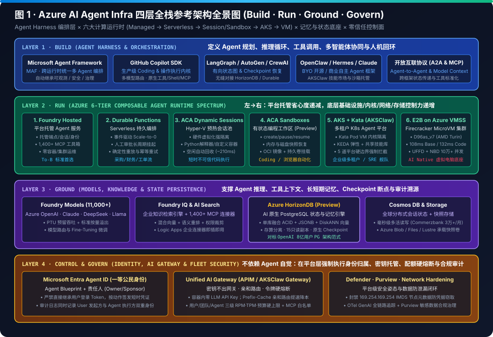
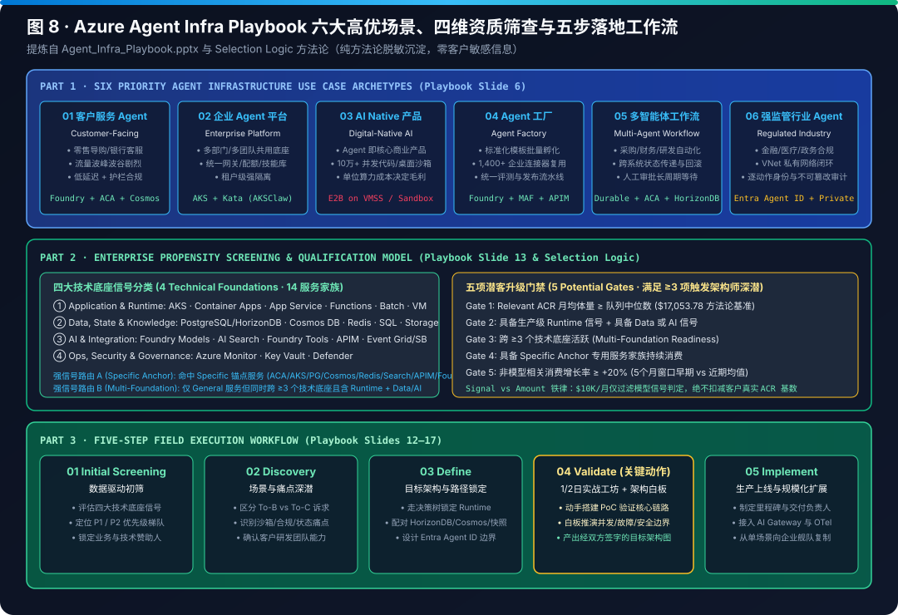

# AI Infra Lab (`turbo998/ai-infra-lab`) — English Edition

> 🌐 **Language / 语言版本切换**: **[🇬🇧 English Homepage (README.en.md)](README.en.md)** | **[🇨🇳 中文主页 (README.md)](README.md)** | **[📘 Azure Agent Infra Playbook (English)](workshops/azure-agent-infra/README.en.md)** | **[📘 Azure Agent Infra Playbook (中文)](workshops/azure-agent-infra/README.md)**

> **📌 Executive Overview Summary**
> - **AI Agent Infrastructure on Azure (`AKSClaw × E2B`)**: Defines a 6-Layer Agent Infra Reference Architecture (`Build · Run · Ground · Govern`), empirical **100K Sandbox Scale Benchmarks** (**`80 ms` Firecracker microVM cold start / `108 ms` UFFD restore** on 5th-Gen AMD EPYC Turin `Standard_D96as_v7` vs **`1,420 ms` Kata VM cold boot**, **`~$148K/mo` optimized TCO** across 261 client nodes at 100K sandboxes, and Nomad heartbeat drain resilience), a **Runtime & Storage Decision Matrix** (ACA Dynamic Sessions vs AKS + Kata vs E2B vs Daytona; Azure Files NFS v4.1 vs Managed Lustre vs Blob FUSE2), and a **316-Chapter Semiconductor/AI Factory & Agent Infrastructure Encyclopedia** ([`workshops/azure-agent-infra/docs/full-monograph-archive.en.md`](workshops/azure-agent-infra/docs/full-monograph-archive.en.md)).
> - **Alibaba Cloud AI Infrastructure (`Tong-Yun-Ge` Full-Stack Analysis)**: Covers T-Head PPU accelerators (Zhenwu 810E → J900), Panjiu AL128 supernode 5-chip datapath, HPN 7.0 dual-plane networking (SIGCOMM 2024), and PAI Lingjun tidal scheduling.

### Core Architecture Diagrams

Full-stack AI Infrastructure architecture evaluations, runtime benchmarks, and visual atlases for **Principal AI Infrastructure Architects**, covering **AI Silicon (GPU / PPU / ASIC / CPU / Switch / SmartNIC)**, **Scale-Up & Scale-Out Cluster Networking (RDMA / RoCE / CXL / ICN)**, **Heterogeneous Scheduling**, and **Enterprise AI Agent Runtimes & Hardware-Virtualized Sandbox Infrastructure (`Azure AI Agent Infra`)**.

---

## 📚 Research & Architecture Evaluations (Bilingual EN / 中文)

| Research Deliverable | Core Scope | Visual Assets (`SVG` + `H5` + `7-Card`) | Evidence Ledger | Review Log | Updated |
|---|---|---|---|---|---|
| **[Azure AI Agent Infrastructure Playbook (English Edition)](workshops/azure-agent-infra/README.en.md)** · **[中文版](workshops/azure-agent-infra/README.md)** | **L1–L6 Full-Stack Reference** (MAF · GitHub Copilot SDK · LangGraph · OpenClaw · Hermes · MCP/A2A) · **6-Tier Runtime Spectrum** (Foundry Hosted Agents · Durable Functions · ACA Dynamic Sessions · ACA Sandboxes Preview · AKS + Kata `AKSClaw` · E2B on Azure VMSS `Standard_D96as_v7` `80ms/108ms`) · **Storage & State** (Azure Files NFS v4.1 + Managed Lustre + Blob FUSE2 + HorizonDB + Firecracker UFFD/NBD Snapshot) · **Zero-Trust Control Plane** (Entra Agent ID · Unified AI Gateway · `169.254.169.254` IMDS Block · 5 Hard Boundaries) · **316 Chapters, 309 IaC Blueprints & 308 Physics Simulators (`317/317` Unit Tests Passing)** | 8 Verified SVG Diagrams + [7-Card Benchmark Report (EN)](workshops/azure-agent-infra/test-report.en.md) / [中文](workshops/azure-agent-infra/test-report.md) + [4-Page Bilingual H5 Suite](workshops/azure-agent-infra/index.html) + [316-Chapter Archive](workshops/azure-agent-infra/docs/full-monograph-archive.en.md) + [Live Demo](workshops/azure-agent-infra/demo/run_live_demo.py) | [`evidence.json`](workshops/azure-agent-infra/evidence.json) | [`review.md`](workshops/azure-agent-infra/review.md) | 2026-10-28 |
| **[Alibaba Cloud AI Infra Full-Stack Evaluation](docs/alibaba-cloud-ai-infra/README.md)** | **L0 T-Head Silicon** (Hanguang 800, Zhenwu PPU, Yitian 710/750, ICN Switch) · **L1 Panjiu AL128 Supernode, CIPU & HPN 7.0 Dual-Plane RDMA** · **L2 PAI Platform** · **L3 Model Studio (Bailian)** | 6 SVG Diagrams + 2 Mermaid Decision Trees | [`evidence.json`](docs/alibaba-cloud-ai-infra/evidence.json) | [`review.md`](docs/alibaba-cloud-ai-infra/review.md) | 2026-10-14 |

---

## 📊 Quick Links — Azure AI Agent Infrastructure Playbook

- **Documentation (Bilingual)**: [English Playbook (`README.en.md`)](workshops/azure-agent-infra/README.en.md) · [中文 Playbook (`README.md`)](workshops/azure-agent-infra/README.md) · [Full 316-Chapter Archive (`docs/full-monograph-archive.md`)](workshops/azure-agent-infra/docs/full-monograph-archive.md) · [English 7-Card Report (`test-report.en.md`)](workshops/azure-agent-infra/test-report.en.md) · [中文 7-Card 报告 (`test-report.md`)](workshops/azure-agent-infra/test-report.md) · [Cycle #410 Deck (`benchmark-cards.en.html`)](workshops/azure-agent-infra/benchmark-cards.en.html) · [Cycle #410 Chinese Deck (`benchmark-cards.html`)](workshops/azure-agent-infra/benchmark-cards.html) · [Cycle #410 Workbench (`workbench-cycle-410.html`)](workshops/azure-agent-infra/workbench-cycle-410.html) · [Cycle #410 Daily Report](workshops/azure-agent-infra/daily-report-2026-11-14.en.md) · [Agent Retrieval Cache Invalidation FAQ (EN)](workshops/azure-agent-infra/agent-retrieval-cache-invalidation-selection-faq.en.md) · [Agent 检索缓存失效策略选型 FAQ（中文）](workshops/azure-agent-infra/agent-retrieval-cache-invalidation-selection-faq.md) · [CSP-Locked 7-Card HTML (`cards.html`)](workshops/azure-agent-infra/cards.html)
- **Interactive Bilingual H5 Workbench (`EN / 中文`)**: [Playbook Atlas (`index.html`)](workshops/azure-agent-infra/index.html) · [Live Simulator (`demo.html`)](workshops/azure-agent-infra/demo.html) · [Decision Engine, 100K Sizer & 280 Simulators (`selector.html`)](workshops/azure-agent-infra/selector.html) · [281 Production Blueprints (`blueprints/`)](workshops/azure-agent-infra/blueprints)

