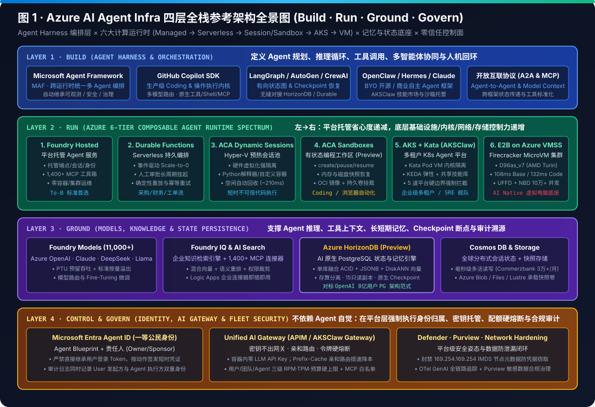
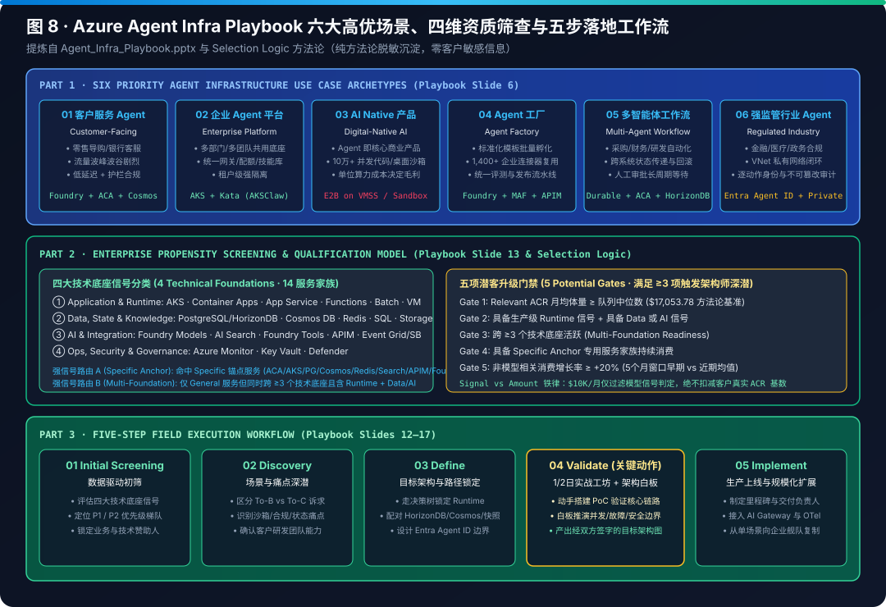

# Azure Infra Lab — 企业级 AI 与数据基础设施架构师实战仓库 (`turbo998/Azure-Infra-Lab`)

> 🌐 **语言切换 / Language**: **🇨🇳 中文主页 (`README.md`)** | **[🇬🇧 English (`README.en.md`)](README.en.md)**  
> ⚡ **核心快捷入口 / Quick Access**: **[💎 Diamond 企业级实战演示中心](workshops/data-lab/demos/diamond-hub.html)** · **[📺 TCL × Fabric 6幕渠道指挥舱](workshops/data-lab/demos/tcl-fabric/index.html)** · **[🛒 Zava × Databricks & Fabric 共生沙盘](workshops/data-lab/demos/databricks-fabric/index.html)** · **[⚔️ Databricks vs Fabric 10维战卡](workshops/data-lab/demos/databricks-fabric/battlecard.html)** · **[🔬 Data Lab 五云选型工作台](workshops/data-lab/index.html)** · **[🤖 Azure Agent Infra (`AKSClaw × E2B`)](workshops/azure-agent-infra/index.html)** · **[🎬 FabCon 2026 视频简报](workshops/fabcon-sqlcon-2026/index.html)**

面向 **AI Solution Architect (SA)**、售前技术专家与云基础设施工程团队的公开实战架构库。仓库聚焦高价值企业云原生与 Data+AI 落地场景，提供**可直接演示的脱敏高管沙盘**、**多云架构选型指南**、**容量/TCO 计算器**与**密封可复现评测报告**。

---

## 💎 快捷直达：Diamond 企业级数据与 AI 实战演示套件（Diamond Enterprise Demo Suite）

专为客户高管汇报、架构工作坊与售前验证打造的 **100% 租户脱敏交互式演示环境**（支持中英双语切换、离线/在线即开即演）：

| 旗舰演示样板 | 核心技术栈 | 解决的真实业务痛点与量化收益 | 交互沙盘与配套讲稿 |
| :--- | :--- | :--- | :--- |
| **📺 Demo 01 · TCL 海外多级渠道智能 (Global Channel IQ)** | **Microsoft Fabric 端到端闭环**<br>OneLake Shortcuts · Eventhouse KQL · Fabric IQ Ontology · Data & Operations Agents · Direct Lake | 破除 3.23 周平均库存假象：48h 法→德跨国调拨护航 **`$629.7K`** 黑五营收；声霸捆绑方案规避价保赔付净省 **`$582.1K`** 毛利；实时拦截越南渠道季度末压货返利套利 **`$162.5K`** | [🚀 启动 6 幕指挥舱](workshops/data-lab/demos/tcl-fabric/index.html) · [📖 双屏逐字稿剧本](workshops/data-lab/demos/tcl-fabric/playbook.html) · [EN](workshops/data-lab/demos/tcl-fabric/index.en.html) |
| **🛒 Demo 02 · Zava 全渠道生鲜零售 (Better Together)** | **Azure Databricks × Microsoft Fabric**<br>Lakeflow · Unity Catalog CLS & Metric Views · AI/BI Genie · Mirrored UC · Power BI Direct Lake | Lakeflow 自动拦截脏数据 + `mask_cn_phone()` 动态脱敏；Genie 5 轮追问定位华东毛利暴跌 **`-3.1pp`** 根因（昆山冷库 **`17.3h`** 出库瓶颈）并调度嘉兴仓 **`1,460 箱`**补货；零拷贝同步 Power BI | [🚀 启动 4 幕沙盘](workshops/data-lab/demos/databricks-fabric/index.html) · [⚔️ 10维选型战卡](workshops/data-lab/demos/databricks-fabric/battlecard.html) · [EN](workshops/data-lab/demos/databricks-fabric/index.en.html) |

👉 **[进入 Diamond 企业级演示总中心 (`workshops/data-lab/demos/diamond-hub.html`)](workshops/data-lab/demos/diamond-hub.html)**

---

## 📚 四大核心技术专题总览（Workshops & Playbooks）

| 专题模块 | 架构师核心覆盖范围 | 交互式工作台与视觉报告 | 验证与代码基线 |
| :--- | :--- | :--- | :--- |
| **1. [Data Lab — 企业级五云数据与 AI 选型实验室](workshops/data-lab/README.md)** · [EN](workshops/data-lab/README.en.md) | 对标 **Microsoft Fabric × Azure Databricks / Snowflake / GCP BigQuery / AWS**；收录 **159 篇（双语 318 篇）企业架构选型 FAQ**（Microsoft IQ 四维智能层、对话式 BI 与 Text-to-SQL/NL2DAX 智能体深度选型（Fabric Data Agent + TMDL/Apache Ossie vs Databricks Genie vs Snowflake Cortex vs BigQuery Data Canvas vs QuickSight Q）、零拷贝、实时流、CDC 镜像、向量检索、OBO 治理、安全运营 SOC/SIEM、零售/多品牌餐饮特许经营集团及 Drive-Thru 语音 AI 动态加购与商圈防蚕食 GIS 及加盟特许权使用费 Royalty 清分与 FTC FDD Item 19-FDA 合规/高速服务区与连锁便利店 C-Store 及前庭加油机动态定价与地下储油罐 UST ATG 遥测及 EPA 40 CFR 280 合规/酒类与烈酒三层批发分销及保税桶库与餐饮酒单 AI 及 TTB-Tied-House 合规/商业温室园艺与受控环境农业 CEA 及花卉苗木 Pay-by-Scan 代销与 USDA APHIS-EPA WPS 合规/商业洗车连锁与高速隧道洗车及 LPR 无限月卡会员与中水回用遥测及 EPA-FTC 合规/包装饮用水与商用直饮水机 POU 及办公室茶歇与 5 加仑大桶水车线配送及 FDA-NSF 合规/商业家居与办公家具及床垫软体定制制造与 3D 空间配置器 CPQ 及 CPSC-STURDY 合规/商业自助仓储 REITs 与温控智能门禁及动态调租 ECRI 与 SCRA 留置权拍卖/企业员工异地派遣 RMC 与跨国安家物流车队及签证税务平衡/连锁眼镜视光零售与自由曲面镜片车房及视力险核赔/商业停车场与机场交通枢纽及无杆 LPR 动态收益与路侧充电/工业烘焙与鲜包装面包及商超直配 DSD 车线临期回购/连锁健身俱乐部与精品团课工作室及私教健康管理/精品咖啡烘焙与现制茶饮得来速连锁及手机点单 MOP 动态排队/民航地面服务代理与机坪过站保障及行李全链路追踪 BRS 与除冰作业/自动化冷链立体仓与港口急冻中心及温控三方物流 3PL 热飞轮调峰/体育赛事直播与流媒体 OTT 动态广告插入 SSAI 及版权变现/日化家清与个护快消 CPG 零售媒体网络 RMN 及货架排面/硬奢高级制表与高级珠宝及官方认证二手表 CPO 沙龙/家居建材大卖场与工程承包商 Pro CPQ/汽车后市场汽配连锁与轮胎快修/餐饮供应链配送与三温冷链/消费电子手机 PC 首发与售后/连锁药房与特药输注/美妆护肤日化/商超生鲜/体育场馆与主题乐园票务/金融/住宅按揭贷款发起 LOS 与自动化核保 AUS 及二级市场 MBS 锁价对冲与贷款服务及 CFPB TRID-RESPA-ECOA 合规/产权保险与房产托管交割及 Title Plant 电汇反欺诈/汽车金融与主机厂专属金融 Captive 及经销商库融与退租残值重营销/商业地产经纪与大宗资本市场交易及资产估值咨询/特殊风险保险与劳合社辛迪加及 MGA 授权承保月报册 Bordereaux/企业差旅管理 TMC 与 GDS-NDC 机酒预订及智能费用审计/企业养老金 401(k) 账管与离职滚存投顾/信用卡发卡行与联名卡实时优惠/主权基金养老金/制造/托盘循环共用池 Pallet Pooling 与可折叠生鲜周转箱 RPC 及自动化洗修中心 3D 视觉与逆向物流及 IPPC ISPM 15-FDA FSMA 合规/预拌商品混凝土 RMC 与水泥骨料搅拌站及搅拌车罐体坍落度 Slump 遥测与工地浇筑协同及 ASTM C94-ACI 318 合规/商业路面铺装与市政公路养护总包及热拌沥青 HMA 拌合站与车载 LiDAR PCI 遥测及 FHWA Superpave-EPA 合规/商业消防与生命安全系统检测维保 ITM 及 NFPA 25 喷淋水泵与 NFPA 72 报警主机及消防局 AHJ 合规/商业屋面工程与建筑外围护防水及冰雹风灾修缮与无人机红外算量 CPQ 及 OSHA 1926.501-FM Global 抗风揭合规/工程机械与商业设备租赁及高空作业平台 AWP 与 AEMP 2.0 遥测及 ANSI-OSHA 合规/商业印刷与瓦楞纸箱包装及软包装标签模切与 FSC-FDA 食品接触合规/商业泳池水疗与水上设施运维及 ORP-pH 水质遥测与泳池资材批发分销及 CDC MAHC 合规/商业园林绿化与电网走廊植被 LiDAR 巡检及智慧灌溉/商业保洁与医院环境服务 EVS 终末消杀及智慧洗手间与 OSHA 危化品合规/暖通空调与水电工程现场服务及一口价 CPQ 与 EPA 608 冷媒合规/商业安保巡防与 UL 827 接警中心及 CIT 武装押运金库车队/商业虫害防制与智能捕鼠物联网及食品工厂 IPM 审计/商用织物洗涤与企业工服租赁及医用手术布草灭菌/综合设施管理 IFM 与企业空间运营及机电设备 MEP 维保/智能电梯与垂直交通/固废回收与循环经济 MRF/智能家居白电暖通/新能源风光储/动力电池 Gigafactory/智慧水务/铁路城轨/国际货代与报关行/医疗/居家医疗护理 Home Health 与安宁疗护 Hospice 及远程患者监护 RPM 与电子访视核验 EVV 及 CMS OASIS-E-HHVBP-Cures Act 合规/动物保健与兽用生物制品及疫苗冷链物流与伴侣动物驱虫药返利及 USDA APHIS-FDA CVM 药物警戒合规/商业养老社区与辅助生活及认知症照护与专业护理机构 SNF 毫米波防跌倒遥测及 CMS PDPM 合规/连锁幼教托育中心与企业雇主托管福利及法定师生比实时调度/连锁血液透析中心与肾脏专科医疗及 ESRD 按价值付费/第三方医学检验中心 ICL 与数字病理及分子诊断/连锁口腔视光 DSO/连锁宠医与宠物零售/SAP/B2B 分销/高教 EdTech/B2B 企业级 SaaS 与 PLG 用量计费/EPC 基建/专业服务律所/全球人力外包 EOR 与 VMS/商业地产 REITs/医疗器械 MedTech/酒旅邮轮/商业产险/车队租赁/大宗农粮/智慧牧场乳业与饲料 NIR/民航 IOC/支付收单 PayFac/油气 LNG/精细化工/海运港口/晶圆封测/矿业有色融合）及 **Diamond 双旗舰沙盘** | [交互选型与 TCO 工作台](workshops/data-lab/index.html) · [7-Card 评测卡组](workshops/data-lab/benchmark-cards.html) · [Diamond 演示中心](workshops/data-lab/demos/diamond-hub.html) | `675 / 676 (🏆 R271素数轮次 · 676=26²完全平方数总场景 · 199素数复核 · 首次破<98ms仿真97.85ms! · 110.4ms路由 · 279 SVG · 159篇FAQ=318文档 · 99.85%准确率 · $5,040=7! DiskANN · 净省-$624,660/月 · +$121M=11²M/年 · 334单测!)` 路由评估 · `334 / 334` 单测全绿 ([`tests/`](workshops/data-lab/tests)) |
| **2. [Azure AI Agent Infra 全栈架构手册 (`AKSClaw × E2B`)](workshops/azure-agent-infra/README.md)** · [EN](workshops/azure-agent-infra/README.en.md) | 6 层生产级智能体基础设施（`Build · Run · Ground · Govern`）；实测 `Standard_D96as_v7` 上 **Firecracker MicroVM `80ms` 冷启动 / `108ms` UFFD 恢复**，261 节点承载 **10 万并发沙箱**；含 **34 套 Bicep 蓝图**与 **34 项容量测算器** | [全景工作台](workshops/azure-agent-infra/index.html) · [双轨实时仿真](workshops/azure-agent-infra/demo.html) · [10万沙箱计算器](workshops/azure-agent-infra/selector.html) · [7-Card 报告](workshops/azure-agent-infra/cards.html) | `30 / 30` 单测全绿 ([`simulator/`](workshops/azure-agent-infra/simulator)) · [`blueprints/`](workshops/azure-agent-infra/blueprints) |
| **3. [FabCon & SQLCon Barcelona 2026 创新简报](workshops/fabcon-sqlcon-2026/README.md)** · [EN](workshops/fabcon-sqlcon-2026/README.en.md) | 系统拆解微软企业数据底座六大战略支柱：Fabric IQ、Power BI 智能体建站、OneLake IQ 语义共享、Osmos 自主数据工程与 Azure SQL Hyperscale DiskANN 向量索引（含 18 项 GA/Preview 矩阵） | [双语视频交互展厅 (`index.html`)](workshops/fabcon-sqlcon-2026/index.html) · [English Hub](workshops/fabcon-sqlcon-2026/index.html?lang=en) | 5 支官方实机演示视频与多码率字幕归档 |
| **4. [Azure VM 现代化评估与 FinOps 伙伴工作坊](workshops/azure-vm-modernization/README.md)** | 面向 Sales / Presales / Service 的同页三语（简/繁/英）7 模块课程、6 个合成评估案例与纯浏览器本地 CSV/XLSX TCO 及约束分析器 | [自动演示 (`demo.html`)](workshops/azure-vm-modernization/demo.html) · [课程 (`workshop.html`)](workshops/azure-vm-modernization/workshop.html) · [计算器 (`calculator.html`)](workshops/azure-vm-modernization/calculator.html) | 纯静态离线可用 · 客户价格护栏校验 |

---

## 🖼️ 核心参考架构图速览（Core Reference Diagrams）





---

## ✅ 本地一键验证（Repository Verification）

```bash
# 1. 验证 Data Lab 基准评测与 334 项单元测试
python -m unittest discover -s workshops/data-lab/tests -p "test_*.py"

# 2. 验证 Azure Agent Infra 容量测算器与 30 项单元测试
python -m unittest discover -s workshops/azure-agent-infra/simulator -p "test_*.py"
python workshops/azure-agent-infra/simulator/agent_infra_sizer.py --check
```
