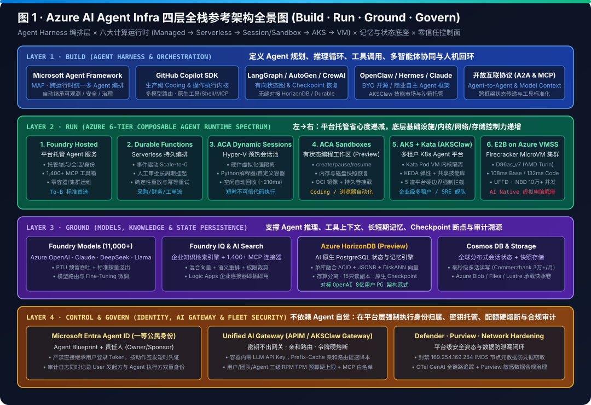
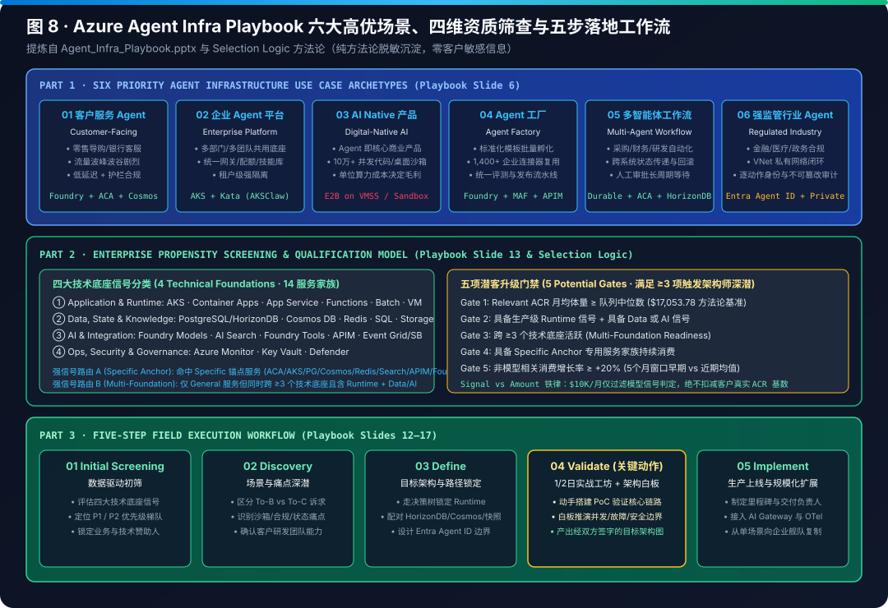

# AI Infra Lab (`turbo998/ai-infra-lab`) · 中英双语版 (Bilingual Edition)

> 🌐 **Language / 语言版本切换**: **[🇨🇳 中文主页 (README.md)](README.md)** | **[🇬🇧 English Homepage (README.en.md)](README.en.md)** | **[📘 Azure Agent Infra Playbook (中文)](workshops/azure-agent-infra/README.md)** | **[📘 Azure Agent Infra Playbook (English)](workshops/azure-agent-infra/README.en.md)**

> **📌 Executive Overview Summary / 核心架构总览**
> - **Azure AI Agent Infra 全栈参考架构与 100K 沙箱压测 (`AKSClaw × E2B`)**：定义 6 层生产级智能体工程栈（`Build · Run · Ground · Govern`），基于第五代 AMD EPYC Turin (`Standard_D96as_v7`) 实测 **Firecracker MicroVM `80 ms` 冷启动 / `108 ms` UFFD 快照恢复**（对比 Kata Pod VM `1,420 ms` 冷启动），单集群 **261 台 Client 节点稳态承载 100,000 并发沙箱**（优化后月度 TCO **`~$148K/mo`**，结合 Nomad 心跳监控与优雅 Drain 实现 `99.4%+` 会话存活率），配套运行时与存储选型矩阵（ACA Dynamic Sessions vs AKS+Kata vs E2B vs Daytona；Azure Files NFS v4.1 vs Managed Lustre vs Blob FUSE2）及 **316 章半导体/AI Factory 与智能体工程百科**（[`workshops/azure-agent-infra/docs/full-monograph-archive.md`](workshops/azure-agent-infra/docs/full-monograph-archive.md)）。
> - **阿里云“通-云-哥”（通义大模型 × 阿里云 AI Infra × 平头哥芯片）全栈工程体系**：覆盖平头哥真武 PPU 四代演进、磐久 AL128 超节点五芯自研通路、HPN 7.0 双平面网络、PAI 灵骏潮汐调度与百炼 Serverless 算力选型矩阵。

### 核心架构图谱速览（Core Agent Infra Reference Visuals）

面向 **AI Infra 架构师** 的云厂商与智算基础设施全栈技术深度测评与可视化图谱仓库，覆盖 **AI 算力芯片（GPU / PPU / ASIC / CPU / Switch / SmartNIC / SSD 主控）**、**超节点与 Scale-Up/Scale-Out 智算网络（RDMA / RoCE / CXL / ICN）**、**异构算力调度平台**、**云原生分布式训推平台** 与 **企业级 MaaS / AI Agent 运行时与安全沙箱基础设施（Azure AI Agent Infra）**。

---

## 📚 深度测评报告目录（Research & Architecture Evaluations · Bilingual EN/中文）

| 专题报告 | 核心覆盖范围 | 可视化图表 (`SVG` + `H5` + `7-Card`) | 证据台账 | 审校记录 | 更新日期 |
|---|---|---|---|---|---|
| **[Azure AI Agent Infra 全栈方案设计、技术选型与架构师 Playbook (中文)](workshops/azure-agent-infra/README.md)** · **[English Edition](workshops/azure-agent-infra/README.en.md)** | **L1–L6 全栈参考架构**（MAF · GitHub Copilot SDK · LangGraph · OpenClaw · Hermes · MCP/A2A）· **六大运行时光谱**（Foundry Hosted Agents · Durable Functions · ACA Dynamic Sessions · ACA Sandboxes Preview · AKS + Kata `AKSClaw` · E2B on Azure VMSS `D96as_v7` `80ms/108ms`）· **状态与存储底座**（Azure Files NFS v4.1 + Managed Lustre + Blob FUSE2 + HorizonDB + Firecracker UFFD/NBD Snapshot）· **零信任控制面**（Entra Agent ID · Unified AI Gateway · 169.254.169.254 IMDS 封禁 · 5 道平台硬边界）· **316 章行业物理模型、309 套 IaC 蓝图与 308 项交互式测算器（317/317 单测全绿）** | 8 张高清矢量架构图 + [7-Card 基准报告 (中文)](workshops/azure-agent-infra/test-report.md) / [English](workshops/azure-agent-infra/test-report.en.md) + [4 页交互式双语 H5 套件](workshops/azure-agent-infra/index.html) + [316章完整归档](workshops/azure-agent-infra/docs/full-monograph-archive.md) + [可运行 Demo](workshops/azure-agent-infra/demo/run_live_demo.py) | [`evidence.json`](workshops/azure-agent-infra/evidence.json)（5 份核心工程资产 + 官方信源） | [`review.md`](workshops/azure-agent-infra/review.md) | 2026-10-28 |
| **[阿里云 AI Infra 全栈架构深度测评报告](docs/alibaba-cloud-ai-infra/README.md)** | **L0 平头哥芯片**（含光 800、真武 810E / M890 / V900 / J900、倚天 710/750、ICN Switch 1.0、磐脉 920、镇岳 510）· **L1 智算底座与网络**（磐久 AL128 超节点、CIPU、HPN 7.0 双上联×多轨×双平面、Solar-RDMA、eRDMA、ACCL、CPFS）· **L1.5 灵骏智算**（`hz` 亲和性调度、双平面网卡）· **L2 人工智能平台 PAI（“Pi平台”）**（DSW / DLC AIMaster+EasyCKPT / EAS Prefix-Cache 路由+EP/PD 分离 / 父子配额潮汐抢占）· **L3 百炼平台（Model Studio）**（Token / PTU / DTU / MU 四大算力阶梯与后训练流水线） | 6 张高清矢量架构图 + 2 幅交互式 Mermaid 决策图 | [`evidence.json`](docs/alibaba-cloud-ai-infra/evidence.json)（21 篇一手信源） | [`review.md`](docs/alibaba-cloud-ai-infra/review.md) | 2026-10-14 |

---

## 📊 Azure AI Agent Infra 核心可视化图谱速览（Visual Atlas）

- **核心技术资产入口（中英双语 / Bilingual）**：[Playbook 中文版 (`README.md`)](workshops/azure-agent-infra/README.md) · [English Playbook (`README.en.md`)](workshops/azure-agent-infra/README.en.md) · [316章完整百科归档 (`docs/full-monograph-archive.md`)](workshops/azure-agent-infra/docs/full-monograph-archive.md) · [7-Card 4:5 基准评测报告 (中文)](workshops/azure-agent-infra/test-report.md) · [7-Card Benchmark Report (EN)](workshops/azure-agent-infra/test-report.en.md) · [Cycle #413 卡组 (`benchmark-cards.html`)](workshops/azure-agent-infra/benchmark-cards.html) · [Cycle #413 English Deck (`benchmark-cards.en.html`)](workshops/azure-agent-infra/benchmark-cards.en.html) · [Cycle #413 工作台 (`workbench-cycle-413.html`)](workshops/azure-agent-infra/workbench-cycle-413.html) · [Cycle #413 日报](workshops/azure-agent-infra/daily-report-2026-11-14.md) · [Agent 大型工具结果外置策略选型 FAQ（中文）](workshops/azure-agent-infra/agent-large-tool-result-offload-selection-faq.md) · [Agent Large Tool Result Offload FAQ (EN)](workshops/azure-agent-infra/agent-large-tool-result-offload-selection-faq.en.md) · [交互式 H5 全景手册 (`index.html`)](workshops/azure-agent-infra/index.html) · [AKSClaw × E2B 实时仿真台 (`demo.html`)](workshops/azure-agent-infra/demo.html) · [选型决策与 10万沙箱计算器 (`selector.html`)](workshops/azure-agent-infra/selector.html) · [309 套 IaC 与网关策略蓝图 (`blueprints/`)](workshops/azure-agent-infra/blueprints)

### 1. Azure AI Agent Infra 四层全栈参考架构全景图（Build · Run · Ground · Govern）

### 2. Azure 六大 Agent Runtime 责任边界、隔离机制与恢复延迟对比矩阵

### 3. AI Agent Infra on Azure 双阶段架构选型决策树与数据底座配对图

### 4. AKSClaw 多租户 Kubernetes Agent 平台参考架构（六大支柱与五道平台硬边界）

### 5. E2B on Azure VMSS 生产级参考架构图（Manus × E2B 10万+ 并发云端沙箱底座）

### 6. Firecracker MicroVM 沙箱内部机理（UFFD + NBD）与 Azure v6/v7 实测启动延迟对比

### 7. 多智能体协同工作流（MAF × Copilot SDK × Durable）与状态持久化选型矩阵

### 8. Azure Agent Infra Playbook 六大高优场景、四维资质筛查与五步落地工作流

---

## 📊 阿里云 AI Infra 核心可视化图谱速览（Visual Atlas）

### 1. “通-云-哥” L0–L3 全栈垂直整合架构与三大跨层协同闭环

### 2. 平头哥真武 PPU 四代演进（810E → M890 → V900 → J900）与主流 GPU 关键指标对比

### 3. 磐久 AL128 高密超节点“算-存-网”平头哥五芯全自研数据通路图

### 4. 阿里云 HPN 7.0（SIGCOMM 2024）双上联 × 多轨 × 双平面网络架构与实测收益

### 5. PAI 训推一体潮汐配额树与 PAI-EAS Prefix-Cache 智能路由官方实测加速比

### 6. 百炼平台四大算力阶梯对比与 AI Infra 架构师 6 大核心场景选型矩阵

