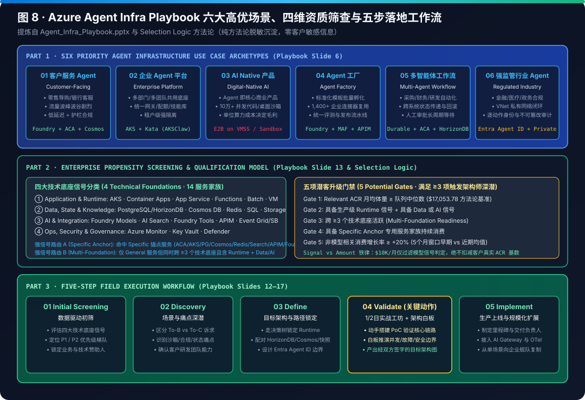
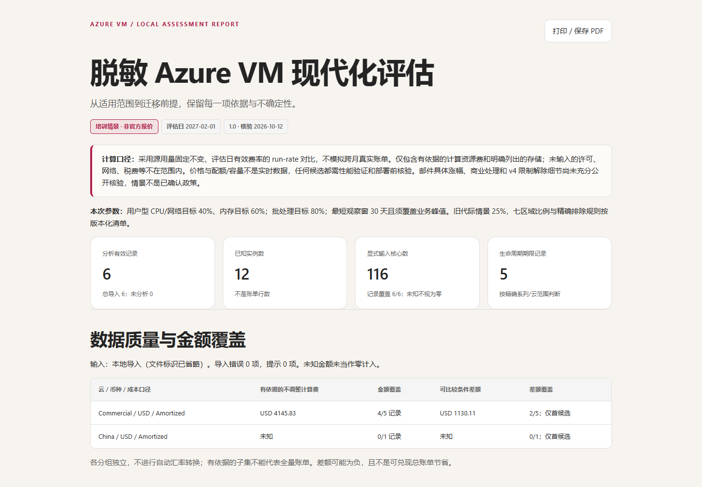

# Azure Infra Lab

> 🌐 **Language / 语言版本切换**: **[🇨🇳 中文主页 (README.md)](README.md)** | **[🇬🇧 English Homepage (README.en.md)](README.en.md)** | **[📘 Azure Agent Infra Playbook (中文)](workshops/azure-agent-infra/README.md)** | **[📘 Azure Agent Infra Playbook (English)](workshops/azure-agent-infra/README.en.md)** | **[📊 7-Card Report (EN)](workshops/azure-agent-infra/test-report.en.md)** | **[🎬 FabCon & SQLCon 2026 视频简报 H5](https://turbo998.github.io/Azure-Infra-Lab/workshops/fabcon-sqlcon-2026/index.html)**

> **📌 Executive Overview Summary / 核心架构总览**
> - **AI Agent Infrastructure on Azure (`AKSClaw × E2B`)**：构建生产级 6 层 Agent 基础设施参考架构（`Build · Run · Ground · Govern`），实测 **`80 ms` Firecracker MicroVM 冷启动 / `108 ms` UFFD 快照恢复**（对比 Kata Pod VM `1,420 ms` 冷启动），单集群 **261 台 `Standard_D96as_v7`（AMD EPYC Turin）** 稳态承载 **100,000 并发沙箱**（优化后月度 TCO **`~$148K/mo`**，结合 Nomad 心跳监控与优雅 Drain 实现 `99.4%+` 会话存活），配套运行时与存储选型矩阵（ACA Dynamic Sessions vs AKS+Kata vs E2B vs Daytona；Azure Files NFS v4.1 vs Managed Lustre vs Blob FUSE2）及 **293 章半导体/AI Factory 与智能体工程百科**（[`docs/full-monograph-archive.md`](workshops/azure-agent-infra/docs/full-monograph-archive.md)）。
> - **FabCon & SQLCon Barcelona 2026 Briefing & Interactive Video Hub**：收录 5 支微软官方 1080p/720p 实机演示视频、六大战略技术支柱与 18 项 GA/Preview 状态矩阵（Fabric IQ、Power BI Agentic App Creation、OneLake IQ Sharing、Osmos、SQL Hyperscale DiskANN）。
> - **Azure VM Modernization & FinOps Partner Workshop**：同页三语（简/繁/英）7 模块课程、6 个模拟案例与浏览器本地 TCO/约束评估器。

### 核心架构图谱速览（Core Architecture Visuals）

面向伙伴、架构师与技术团队的公开 Azure 基础设施实战 Workshop 与技术手册。当前收录三大核心专题：
1. **[AI Agent Infrastructure on Azure Playbook & Interactive Simulator (`AKSClaw × E2B on Azure`)](workshops/azure-agent-infra/README.md)**：从六层全栈参考架构（Build · Run · Ground · Govern）、六大计算运行时光谱到 AKS 多租户 Kata 隔离与 10 万+ 并发 Firecracker MicroVM 云端沙箱底座。
2. **[Data & AI / FabCon & SQLCon Barcelona 2026 Briefing & Interactive Video Hub](workshops/fabcon-sqlcon-2026/README.md)**：Microsoft Fabric 与 SQL 2026 巴塞罗那峰会全量创新解析、5 支微软官方 1080p/720p 实机演示视频内嵌播放器与直链、六大技术支柱及 18 项 GA/Preview 状态速查矩阵（中英双语切换）。
3. **[Compute / Azure VM Modernization & FinOps](workshops/azure-vm-modernization/README.md)**：从联合课程、六个模拟案例到浏览器本地评估与可分享报告。

Public Azure infrastructure workshops and architectural playbooks for partners, architects, and technical teams:
1. **AI Agent Infrastructure on Azure (`AKSClaw × E2B on Azure`)** — Four-layer reference architecture, 6-tier runtime spectrum, interactive live simulator, 100K sandbox VMSS sizer, and 7-card 4:5 benchmark deck.
2. **Data & AI / FabCon & SQLCon Barcelona 2026 Briefing & Interactive Video Hub** — Bilingual interactive H5 briefing with 5 embedded official 1080p/720p product demo videos, 6 strategic pillars, and an 18-item GA/Preview release matrix covering Fabric IQ, Power BI Agentic App Creation, Rayfin, OneLake IQ Sharing, Data Engineering Agents (Osmos), and Azure SQL Hyperscale.
3. **Compute / Azure VM Modernization & FinOps** — Trilingual course, six synthetic cases, browser-local calculator, and standalone reports.

---

## 专题一：AI Agent Infrastructure on Azure Playbook & Interactive Simulator (`AKSClaw × E2B on Azure`)

- **[全景 Playbook H5 / Interactive Playbook](https://turbo998.github.io/Azure-Infra-Lab/workshops/azure-agent-infra/index.html)** · **[实时仿真 Demo / Live Simulator (AKSClaw × E2B)](https://turbo998.github.io/Azure-Infra-Lab/workshops/azure-agent-infra/demo.html)** · **[架构选型与 10万沙箱计算器 / Decision & Sizer](https://turbo998.github.io/Azure-Infra-Lab/workshops/azure-agent-infra/selector.html)** · **[7-Card 4:5 基准报告 / 7-Card Deck](https://turbo998.github.io/Azure-Infra-Lab/workshops/azure-agent-infra/cards.html)** · **[完整技术手册 / Markdown Playbook](workshops/azure-agent-infra/README.md)** · **[源码与测试 / Simulator & Tests](workshops/azure-agent-infra/simulator)**

围绕 **“计算与状态解耦（Compute-State Decoupling）”** 与 **“平台级零信任硬边界（Never Trust the Prompt）”** 两大核心公理，系统拆解在 Azure 上构建生产级 AI Agent 的全栈方案设计、代际实测基准与现场五步落地法：

| 模块 / Module | 核心内容与技术资产 / Capabilities & Assets |
| --- | --- |
| **1. 四层全栈架构 & 8 张高清 SVG 图谱** | 覆盖 **Build**（MAF / Copilot SDK / LangGraph / OpenClaw / MCP & A2A）、**Run**（6 级运行时光谱）、**Ground**（HorizonDB Preview + Cosmos DB + `UFFD/NBD` 沙箱快照）、**Govern**（Entra Agent ID + Unified AI Gateway APIM）；内嵌 8 张通过 XML 严格校验的高清矢量架构图与工作流图（[`workshops/azure-agent-infra/assets/`](workshops/azure-agent-infra/assets)） |
| **2. 实时仿真 Demo (`AKSClaw × E2B`)** | 浏览器本地双轨状态机仿真：支持一键自动回放与单步推进 **AKSClaw 多租户 K8s Agent**（Entra Agent ID 签发 → Kata Pod VM 280ms 隔离 → APIM 零密钥注入与 IMDS `169.254.169.254` 阻断 → HorizonDB 11ms Checkpoint）与 **Manus × E2B 10万并发云端电脑**（`Standard_D96as_v7` + `UFFD` 缺页流式恢复 108ms → `NBD` 增量块快照 → L1/L2 热冷分层回收） |
| **3. 双阶段架构选型决策器 & 10万沙箱计算器** | 覆盖 6 大企业与原生场景预设（知识助手、跨天审批、不可信代码池、Coding/Browser 沙箱、AKSClaw 多租户舰队、10万并发云端电脑）；实时联动 Azure `D96as_v7`（AMD Turin，`108ms` Base / `132ms` Code-Interpreter，`$4.608/hr`）vs `D96as_v6` vs `D96s_v6` 实测数据，动态测算 `85% HugePages` 与 `60% CPU` 水位下的 VMSS 节点数与月度 TCO（10万并发 = **261 台 `D96as_v7`**） |
| **4. 7-Card 4:5 基准评测卡片 (`cards.html`)** | 严格遵循 7-Card 4:5 视觉报告规范，自包含 CSP 锁定（`default-src 'none'; style-src 'unsafe-inline'`），呈现 8 场景路由准确率（`8/8 = 100%`）、协议/评分机理、翻转与扰动鲁棒性检验、代际启动延迟对比与适用边界（同步提供 [Markdown 版](workshops/azure-agent-infra/test-report.md) 与 [`report.json`](workshops/azure-agent-infra/report.json)） |
| **5. 现场五步落地法 (Field Playbook)** | 完整的四大技术底座（14 个 Azure 服务家族）资质筛查评分卡、`$10,000` 模型消费信号门禁，以及 **Screening → Discovery → Define → Validate → Implement** 五步交付清单与 Bicep/YAML 生产模板 |

---

## 专题二：Data & AI / FabCon & SQLCon Barcelona 2026 Briefing & Interactive Video Hub

- **[🎬 交互式双语视频简报 H5 (中文默认)](https://turbo998.github.io/Azure-Infra-Lab/workshops/fabcon-sqlcon-2026/index.html)** · **[🎬 Interactive Video Hub (English)](https://turbo998.github.io/Azure-Infra-Lab/workshops/fabcon-sqlcon-2026/index.html?lang=en)** · **[📘 双语总入口 (`README.md`)](workshops/fabcon-sqlcon-2026/README.md)** · **[🇨🇳 中文完整简报 (`README.zh-CN.md`)](workshops/fabcon-sqlcon-2026/README.zh-CN.md)** · **[🇬🇧 English Briefing (`README.en.md`)](workshops/fabcon-sqlcon-2026/README.en.md)**

围绕微软 Azure Data 执行副总裁 Arun Ulag 发布的 **[FabCon and SQLCon 2026: Explore Microsoft Fabric and SQL innovations](https://azure.microsoft.com/en-us/blog/fabcon-and-sqlcon-2026-in-barcelona-building-the-data-foundation-for-microsoft-copilot-and-agents/)**，完整梳理“为 Microsoft Copilot 与智能体构建可信企业数据底座”的全栈创新：

| 模块 / Module | 核心内容与技术资产 / Capabilities & Assets |
| --- | --- |
| **1. 5 支微软官方 1080p/720p 实机演示视频中心** | 页面内嵌 `<video>` 直接播放并提供多码率 MP4（1080p/720p/540p/360p）、TTML 字幕与文稿下载：① **Fabric IQ in M365 Copilot (GA)**、② **Power BI Agentic App Creation (Preview)**、③ **Fabric Apps & Rayfin SDK (Available)**、④ **OneLake IQ Sharing (Preview)**、⑤ **End-to-End Observability in Fabric (Preview)** |
| **2. 六大战略技术支柱深度拆解** | 覆盖 **Fabric IQ 赋能 Copilot（零额外 AI Token 成本）**、**Power BI 自然语言构建支持 Write-back 与 1GB 免费 Fabric SQL 的全栈应用**、**OneLake IQ Sharing 跨组织共享 Markdown 指令与 RDF 本体**、**Osmos 自主数据工程智能体**、**Apache Ossie 开放语义标准与按需计费**、**Database Hub 与 SQL Hyperscale 192 vCore / DiskANN 向量索引 GA** |
| **3. 18 项特性 GA / Preview 交互式矩阵** | 支持按 **全部 (18)** / **正式可用 GA (7)** / **预览与即将推出 (11)** 实时筛选，并提供全部 8 篇微软官方配套深度博客直达索引 |

---

## 专题三：Compute / Azure VM Modernization & FinOps

**[立即体验 / Live Demo](https://turbo998.github.io/Azure-Infra-Lab/workshops/azure-vm-modernization/demo.html)** · **[课程 / Course](https://turbo998.github.io/Azure-Infra-Lab/workshops/azure-vm-modernization/workshop.html)** · **[计算器 / Calculator](https://turbo998.github.io/Azure-Infra-Lab/workshops/azure-vm-modernization/calculator.html)** · **[下载离线包 / Download ZIP](https://turbo998.github.io/Azure-Infra-Lab/workshops/azure-vm-modernization/Azure-VM-Partner-Workshop.zip)** · **[源码 / Source](workshops/azure-vm-modernization/source)**

## Azure VM 伙伴 Workshop / Partner Workshop

不是只有幻灯片：把生命周期与迁移讨论、用量与价格校验、候选约束和报告导出串成一个可离线使用的体验。

| 内容 / Experience | 能力 / Capabilities |
| --- | --- |
| 联合课程 / Course | 7 个模块、角色分工、互动案例、6 道测验、讲师模式与打印讲义 / Seven modules, role-based discussion, interactive cases, quizzes, presenter mode, and printable handouts |
| 同页三语 / Three languages | 简体中文、繁體中文、English 原地切换，保留课程进度、答案、数据与结果 / Switch languages on the same page without losing progress or results |
| 本地评估 / Local analysis | CSV/XLSX 导入、列映射、补充资料、校验、D/E 候选与约束分析 / Browser-local imports, mapping, enrichment, validation, and constrained candidate analysis |
| 教学案例 / Demo cases | 六个虚构案例与模拟价格，覆盖有条件缩容、RI/临时盘、EA 上限、排除项、HPC 和指标缺失 / Six synthetic cases, not customer records |
| 可分享输出 / Exports | 标准 CSV、建议明细、自包含 HTML 报告；通过浏览器打印保存 PDF / CSV exports, standalone HTML reports, and print-to-PDF |
| 离线使用 / Offline use | 解压后直接打开 HTML，无需服务器、登录、Azure 权限或联网 / Open the extracted HTML files without a server, sign-in, Azure permissions, or network access |

### 谁适合参加 / Role audiences

| 角色 / Role | Workshop 关注点 / Focus |
| --- | --- |
| Sales / 销售 | 识别现代化机会、澄清客户目标与商务假设 / Identify modernization opportunities and clarify business assumptions |
| Presales / 售前 | 核验适用范围、指标与价格依据，解释候选和约束 / Validate scope, metrics, pricing evidence, and candidate constraints |
| Service / 服务交付 | 制定验证、迁移与回退安排，交付可审查报告 / Plan validation, migration, rollback, and reviewable outputs |

## 三分钟 Demo 路线 / A short Demo journey

1. 打开 **[Demo](https://turbo998.github.io/Azure-Infra-Lab/workshops/azure-vm-modernization/demo.html)**，选择简体 / 繁體 / English，点击“开始自动演示” / “Start automatic demo”。
2. 自动载入六个模拟案例与价格并分析；依次观察 A 的有条件缩容、B 的 RI/临时盘、C 的 EA 上限、D 的排除项、E 的 HPC 专项与 F 的指标缺失。
3. 在结果页切换语言，展开候选和约束；切换“客户价格依据”模式可看到模拟价格被拒绝，而不是被当作合同净价。
4. 下载 HTML 报告并独立打开，或打印保存 PDF；需要动手练习时，使用 [三语样例](workshops/azure-vm-modernization/sample-data) 和 [CSV/XLSX 模板](workshops/azure-vm-modernization/templates)。

Start the Demo, inspect the six cases and their constraints, switch languages without resetting the analysis, then export a standalone report. Customer-pricing mode rejects synthetic demo prices.

## 实际界面 / Real screenshots

以下图片来自交付包的真实浏览器截图，使用虚构教学数据；不是设计稿或实测客户节省证明。

### Demo：从入口直接进入六案例分析

*Demo entry: choose a language and launch the synthetic-case analysis.*

### Workshop：Sales / Presales / Service 联合课程

*Role-based course: align commercial discovery, technical assessment, and delivery.*

### Calculator：结果、候选与约束一起看

*Local calculator: inspect the evidence and constraints behind each recommendation.*

### Report：可独立打开与打印的报告

*Standalone HTML report: review before sharing, or print to PDF.*

## 数据、价格与建议边界 / Important boundaries

**所有案例中的客户名称、价格和用量均为虚构教学数据，不是 Azure 官方报价，也不代表已实现的节省。** 原邮件材料涉及的具体涨幅、日期与商务处理规则仍是**未经充分公开佐证的培训情景，不是已确认的 Azure 政策**。客户评估应使用适用合同、购买安排和评估日期的有效价格依据。

**All names, prices, and usage in the examples are synthetic. Detailed price increases, dates, and commercial rules derived from the original mail remain unverified training scenarios, not confirmed Azure policy or official quotes.** Conditional compute-cost differences are not measured savings or total-bill savings.

CSV/XLSX 在浏览器本地解析，数据不上传、不默认写入 localStorage/IndexedDB，也没有保存客户数据的后端。刷新或关闭页面会丢失未导出的状态；外部资料仅在主动点击时联网。报告默认省略客户/VM 名称、资源/订阅标识、文件名与原始价格依据标题，但保留 SKU、区域等技术信息，外发前仍需审查。

Imported data stays in the browser and is not uploaded or persisted by default. Review reports before sharing. Missing prices, metrics, or commitment information remain unknown rather than being treated as zero; region/zone availability, quota, capacity, application performance, and rollback still require validation.

完整口径、容量限制、价格模式、RI/EA 约束与维护说明见 **[Workshop 使用说明 / Detailed guide](workshops/azure-vm-modernization/README.md)**。

## 离线包与源码 / Offline package and source

下载 [原始 ZIP](https://turbo998.github.io/Azure-Infra-Lab/workshops/azure-vm-modernization/Azure-VM-Partner-Workshop.zip)，解压后打开 `demo.html`、`workshop.html` 或 `calculator.html`，保留目录结构即可。运行交付页面不需要 Node.js；源码和维护命令位于 [source](workshops/azure-vm-modernization/source) 与 [使用说明](workshops/azure-vm-modernization/README.md)。

The public directory preserves all 256 original package files and the original ZIP unchanged. Its 37 PNG screenshots, language-specific samples, templates, HTML/PDF reports, source, and tests remain together.

ZIP SHA-256: `ba996b06697fcf0c926d9fdbf14ec67c5d76a2729cac291a2bd65648391332b5`

第三方声明与许可证原样保留：[THIRD_PARTY_NOTICES.txt](workshops/azure-vm-modernization/THIRD_PARTY_NOTICES.txt) · [third-party-licenses](workshops/azure-vm-modernization/third-party-licenses)。公开发布不新增或变更许可证。

Third-party notices and licenses are retained as supplied. Publication does not add or change a license.
