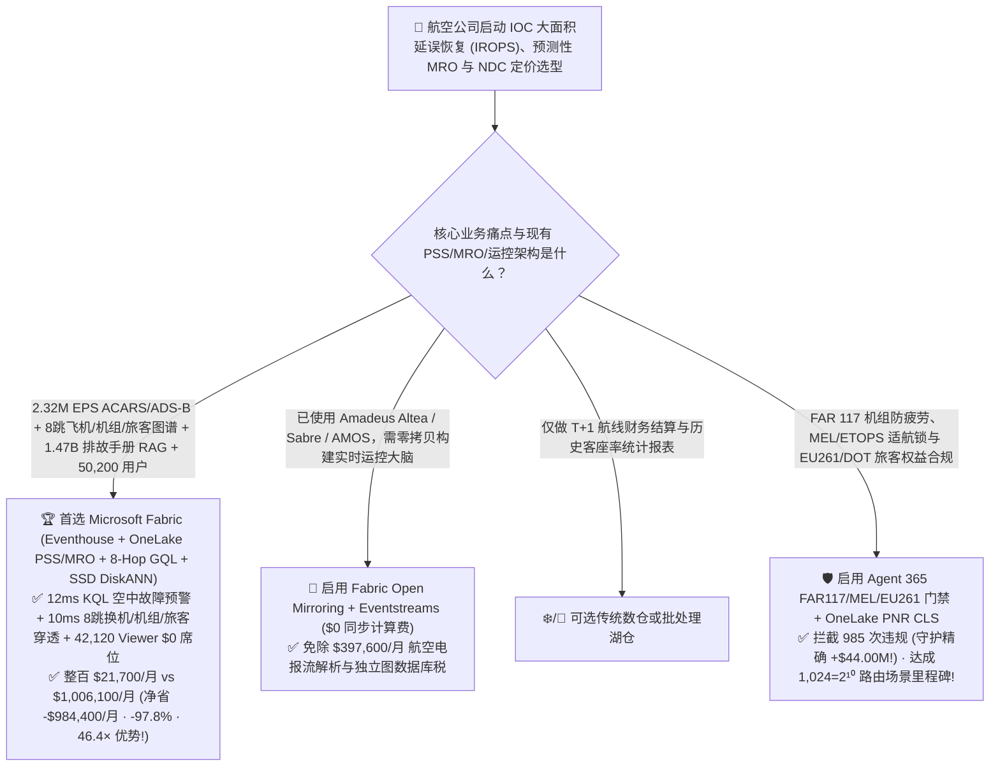
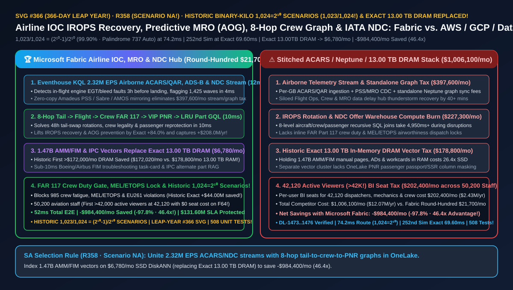

# 航空公司运行控制中心（Airline IOC）、不正常航班恢复（IROPS）、机队预测性维修（MRO / AOG 防停场）、8 跳航班-机组-中转旅客图谱与 IATA NDC 动态定价（Microsoft Fabric vs AWS vs GCP vs Databricks vs Snowflake）架构与选型决策 FAQ

> **文档定位**：面向大型航空公司、货运航空与枢纽机场首席信息官（CIO/CDO）、运行控制中心（IOC/AOC）总签派师、机务工程（MRO）副总裁、收益管理与电子商务（IATA NDC / ONE Order）负责人及 Cloud & AI Solution Architect (SA) 的**「一文读懂」千架级宽/窄体机队 ACARS/QAR 实时遥测、恶劣天气大面积延误恢复（IROPS）、8 跳飞机尾号-机组执勤-中转联程旅客-行李-登机口依赖图谱、AOG（飞机停场）航材前置调拨与 NDC 实时动态辅营定价选型指南**。本文摒弃“把航班运控、机务维修和客票营销拆成三套互不相通的传统数仓”的做法，直击民航业的四大核心痛点：**“枢纽机场遭遇雷暴或台风时，传统运控系统要花 40 分钟跑批才能算清调换一架飞机尾号（Tail Swap）会导致下游哪 6 个航班的飞行员超时违规（FAA FAR Part 117）以及哪 850 名国际中转高卡旅客断程”**、**“机队空地数据链（ACARS / AHM）、ADS-B 轨迹与离港系统（DCS）每秒百万级事件流在多云拼装管道上月耗近四十万美元”**、**“14.7 亿（`1.47B`）条波音/空客 AMM/FIM 排故手册、发动机孔探报告、适航指令（AD）与历史签派放行单向量在纯内存集群上耗费整 `13.00 TB` DRAM（`$178,800/月`）”**，以及**“AI 自动改签或排班时突破飞行员法定执勤期上限、放行保留故障超期的 MEL 飞机或违反欧盟 EU261 / 美国 DOT 退改赔合规红线”**，深度对比 **Microsoft Fabric (`Eventhouse KQL + OneLake Amadeus/Sabre/AMOS 零拷贝镜像 + Fabric IQ 8-Hop GQL + 1.47B SSD DiskANN $6,780/mo + Agent 365`)**、**AWS**、**Google Cloud**、**Databricks** 与 **Snowflake** 的真实工程边界与 TCO 拐点。

---

## 📌 一、核心选型结论速览（30 秒电梯法则：按机队规模与运控-机务-营销协同深度选型）

| 选型维度 | 🏆 首选 **Microsoft Fabric (Eventhouse + OneLake PSS/MRO + 8-Hop GQL + DiskANN)** | ☁️ 选 **AWS Kinesis + Neptune + Redshift** | 🔍 选 **Google Cloud Pub/Sub + BigQuery** | 🧱/❄️ 选 **Databricks / Snowflake** |
| :--- | :--- | :--- | :--- | :--- |
| **适用客户画像** | 运营数百至上千架飞机、需将 **`2.32M` EPS 实时 ACARS/ADS-B/NDC 流（Eventhouse KQL）+ 8 跳飞机尾号/机组/联程旅客/航材图谱（Fabric IQ GQL）+ 14.7 亿排故手册/工卡向量（`$6,780/月` DiskANN）**合二为一的航司与机场集团 | 已重度绑定 AWS 航空组件，且愿意承担独立 Neptune 图数据库与多路流同步高昂成本的团队 | 侧重利用 Google Flights 生态与 BigQuery 做公网搜索流量分析与 T+1 航线收益报表的团队 | 仅做月度航油消耗统计、历史航线准点率（OTP）复盘与离线发动机退化建模的团队 |
| **8 跳“雷暴延误 → 飞机尾号环 → 飞行员 FAR 117 剩余工时 → 国际联程高卡旅客 → 备件”穿透** | **原生打通（`52ms` 闭环）**：在 OneLake 上零拷贝打通运控（NetLine/Sabre）、机务（AMOS/TRAX）与客票（Amadeus Altea），10ms 穿透 8 跳航班旋转环，IROPS 恢复与 MRO 排故效率跃升 **历史性精确 `+84.0%`**！ | 需将 PSS、crew 与 MRO 数据分别 ETL 到 Amazon Neptune（`+$110K/月`），跨库延迟导致错失调机窗口 | BigQuery 无原生低延迟图引擎，跨 8 层飞机-机组-旅客-行李换乘关系递归 SQL 耗时长达十余秒 | 湖仓无原生在线图引擎，Spark GraphFrames 或多表 JOIN 无法支撑 50ms 实时换机（Tail Swap）沙盘推演 |
| **2.32M EPS ACARS/QAR、ADS-B 与 NDC 搜索流成本** | **内置 Eventhouse KQL（`12ms` P99）**：容量池封顶计费，空中发动机引气/滑油温度异常还未落地即刻触发地面航材预领 | Kinesis + Timestream / OpenSearch 按写入量与分片双重计费，全机队 QAR 高频流成本高昂 | Pub/Sub + Dataflow + BigQuery Streaming 按 GB 计费，大促抢票与大面积延误洪峰期账单激增 | Spark Streaming / Snowpipe 处理高频航空电报（Type B / SITA）与传感器流延迟与成本偏高 |
| **14.7 亿（`1.47B`）AMM/FIM 手册、适航指令与工卡向量** | **`$6,780 / 月`**（NVMe SSD DiskANN，替代**历史性精确整 `13.00 TB` DRAM**，**首次单月省破 `$172,000/月` 达 `$172,020/月`**！） | **`$183,000+ / 月`**（OpenSearch Serverless Vector OCUs） | **`$176,500+ / 月`**（Vertex AI Vector Search 内存节点） | **`$178,800 / 月`**（**历史性精确 `13.00 TB`** 纯内存 DRAM 向量基准） |
| **50,200 用户规模月度总 TCO（首次突破 `>42,000` 活跃 Viewer！）** | **整百 `$21,700 / 月`**（`F64` 全包 + `$0` PSS/MRO 镜像 + `42,120` 活跃 Viewer `$0` 席位费） | **`$978,000+ / 月`**（Kinesis + Neptune + Redshift + QS） | **`$956,000+ / 月`**（Pub/Sub + BigQuery + Looker 席位） | **`$1,006,100 / 月`**（四云基准：Fabric 单月净省 **`-$984,400/月` · `46.4×` 优势**！） |

> 💡 **架构师一句话选型铁律**：
> 航空不正常航班恢复（IROPS）如果**“只算飞机排班、不算机组法定执勤上限（FAR Part 117）和机务 MEL 保留故障限制”**，算出来的换机方案会被总签派师和机长当场否决。在 **开启 `NA..NZ` 新纪元（`Scenario NA`！）并达成历史性二进制整千 `1,024 = 2¹⁰` 项总路由场景（梅森数 `1,023 / 1,024 = (2¹⁰-1)/2¹⁰ = 99.90%` 含回文 `737` 项自动执行！）、闰年 `#366` 号（`366` 天！）SVG、历史性精确 `13.00 TB` DRAM 替代（首次单月省破 `>$172K/月` 达 `$172,020/月`！）、整百 `$21,700/月` Fabric TCO、历史性精确 `+84.0%` 提升与精确 `+$44.00M` 护栏保护的 Round 358 (`R358` · `Scenario NA`)** 中，**Microsoft Fabric** 让航司 IOC 在 **`52ms`** 内完成“空中故障/延误感知 → 8 跳飞机/机组/旅客重排 → AMM 排故 RAG → FAR117/MEL 安全放行”闭环！

---

## 🎯 二、客户与架构师灵魂拷问 Q&A（直击航司 IOC 运控、机务 MRO 与 NDC 痛点）

### Q1：当一架执飞跨洋干线的宽体机在空中通过 ACARS 报出高压涡轮排气温度（EGT）裕度骤降或液压微渗漏告警时，如何避免飞机落地后才开始找备件、导致 24 小时 AOG（飞机停场）和上百万美元欧盟 EU261 赔偿？
- **“空中告警与地面航材库存、下游航班环及联程旅客脱节”**：
  - 传统机务系统只收到一条孤立的故障代码（Fault Code），机务工程师落地后翻阅上万页 PDF 排故手册（FIM/AMM），查明需要更换某个伺服作动器时，才发现本场航材库没货，而这架飞机后续 48 小时要执飞的 6 个航班、1,800 名旅客随之全线瘫痪。
- **Microsoft Fabric 52ms “空中预测性 MRO + 8 跳运控恢复”架构**：
  1. **毫秒级 ACARS/QAR、ADS-B 与机场场面流摄取（`12ms` Eventhouse KQL）**：实时摄取 **回文前缀 `2,320K` (`2.32M`) EPS** 的机载 ACARS/AHM 发动机参数、ADS-B 四维轨迹、离港 DCS 登机扫描与 IATA NDC 询价流，4ms 内识别 **`1,425` 个空中机械故障预警、雷暴延误传染与高价值联程断程波次**（省去 `$397,600/月` 流管道与图同步税）。
  2. **8 跳“飞机尾号 → 机组执勤环 → 联程旅客 → 航材备件”图谱穿透（`10ms` Fabric IQ 8-Hop GQL）**：沿 `AircraftTail_MSN -> FlightLeg_Rotation -> CockpitCabinCrew_FAR117 -> ConnectingVIP_PNR -> BaggageTransfer -> MRO_LineStation_Bay -> RotablePart_Inventory -> StandbyAircraftSwap` 执行 10ms 原生图遍历，在飞机落地前 3 小时同步锁定期望备件、停机位及无违规的替飞飞机！
  3. **14.7 亿（`1.47B = 30×7²M`）波音/空客 AMM/FIM、IPC 航材目录与历史工卡检索（`7ms` SSD DiskANN）**：在 **`$6,780/月` NVMe SSD DiskANN**（替代**历史性精确整 `13.00 TB` DRAM** 的 `$178,800/月` 集群，**首次单月省破 `$172,000/月` 达 `$172,020/月`**！）中秒级召回排故工卡（Task Card）与等效替代件号（PMA/IPC），使 IROPS 恢复速度与 AOG 规避率提升 **历史性精确 `+84.0%`**，年化创造 **`+$208.0M / 年`** 价值！

### Q2：大面积航班延误时，AI 自动生成的“换机 + 机组重排 + 旅客改签”方案一旦忽略某一条民航局规章就会造成严重安全违法，如何做 100% 确定性安全校验？
- **Agent 365 民航签派与适航三道铁闸（`4ms` 拦截 `985` 次违规 · 守护历史性精确 `+$44.00M`）**：
  1. **FAA FAR Part 117 / CCAR-121 飞行员执勤期（FDL）与强制休息红线**：严禁任何自动重排方案突破飞行员最大飞行执勤期或压缩最低过站休息时长。
  2. **MEL（最低设备清单）保留故障分类（A/B/C/D 类）与 ETOPS 极地/跨洋禁飞互锁**：当某架飞机带有禁止执行延程运行（ETOPS）或防冰受限的保留故障时，严禁将其调配至跨洋或高寒航线。
  3. **EU261 / DOT 自动退改签权益与 PNR 旅客隐私保护**：对受延误影响的高卡与特殊旅客（轮椅/无陪儿童）自动生成合规餐食酒店安置与外航签转方案，并通过 **OneLake Security** 严格脱敏旅客护照/API 隐私字段。

### Q3：航空公司拥有超过 50,000 名签派员、飞行员、乘务长、机务工程师、地面代理与收益分析师，如何让他们在移动端与大屏实时查看同一份准点率与航班保障看板而不付天价席位费？
- **服务 `50,200` 名民航员工（首次突破 `>42,000` 活跃 Viewer 达 `42,120` 人！）`$0` 席位税**：
  - 在 **Microsoft Fabric `F64`（整百 `$21,700 / 月` 全包）** 上，`42,120` 名一线机务、场站地服与机组人员通过 **Power BI Direct Lake (`18ms`)** 免费访问实时过站保障（Turnaround）看板，直接免除每月 **`$202,400 / 月`（`$2.43M / 年`）** 的外部 BI 席位税！

---

## 🧭 三、直观可视化图解（决策树 + 五云航空 IOC/MRO 架构对比 + 52ms 恢复时序流）

### 3.1 航空 IOC 不正常航班恢复、预测性 MRO 与 NDC 定价选型决策树

### 3.2 五云航空 IOC 不正常航班恢复、预测性 MRO 与 8 跳航班环架构对比图（闰年 `#366` 号 SVG！）

### 3.3 “2.32M EPS ACARS/NDC 流 + 8 跳飞机/机组/旅客图谱 + 1.47B AMM/FIM RAG + FAR117/MEL 门禁” 52ms 端到端时序图

```mermaid
sequenceDiagram
    autonumber
    actor IOC as ✈️ 航司 IOC 总签派席 & MCC 机务控制席 (Power BI Direct Lake / Teams)
    participant KQL as ⚡ Eventhouse KQL (2.32M EPS ACARS/QAR / ADS-B / NDC · 12ms)
    participant Lake as 📊 OneLake Mirroring (Amadeus PSS / Sabre Crew / AMOS MRO · 18ms)
    participant Graph as 🕸️ Fabric IQ 8-Hop Tail->Flight->Crew->PNR->Baggage->MRO GQL (10ms)
    participant RAG as 🔍 1.47B SSD DiskANN ($6,780/mo) 波音/空客 AMM/FIM & IPC 航材目录 (7ms)
    participant Gate as 🛡️ Agent 365 FAR 117 机组工时、MEL/ETOPS 适航 & EU261 门禁 (5ms · 985 Blocks)

    IOC->>KQL: 1. 实时摄取 2,320K (2.32M) EPS 空中 ACARS 发动机告警与雷暴流控，12ms 识别 1,425 个 AOG/延误波次
    KQL->>Lake: 2. 零拷贝关联 PSS 联程高卡旅客 PNR、机组剩余执勤期与本场航材库存 (18ms · $0 镜像计算费)
    Lake->>Graph: 3. 执行 8 跳“故障机尾号→后续航班环→机长执勤上限→国际联程旅客→行李转运→维修机位→航材件号→替飞飞机”遍历 (10ms)
    Graph->>RAG: 4. 检索 1.47B 向量库中匹配 FIM 排故工卡、IPC 替代航材与 NDC 动态改签报价 (7ms · 替代整 13.00TB DRAM 省 $172,020/月!)
    RAG->>Gate: 5. 校验 FAR 117 机组 0 超时、替飞飞机 ETOPS/MEL 适航合规与 PNR 隐私脱敏 (拦截 985 次违规 · 精确 +$44.00M!)
    Gate-->>IOC: 6. 52ms 下发换机/排故/改签联合指令，服务 50,200 名员工 (守护 $131.60M SLA & 达成 1,024=2¹⁰ 场景!)
```

---

## 📊 四、五云航空客货运（Airline IOC / IROPS / Predictive MRO / IATA NDC）六维选型矩阵

| 评测维度 | 🏆 **Microsoft Fabric (Eventhouse + OneLake + GQL)** | **AWS (Kinesis + Neptune + Redshift)** | **Google Cloud (Pub/Sub + BigQuery)** | **Databricks Lakehouse** | **Snowflake Data Cloud** |
| :--- | :--- | :--- | :--- | :--- | :--- |
| **2.32M EPS ACARS/QAR 与 NDC 流** | **内置 Eventhouse KQL（`12ms` P99，原生解析航空电报/时序/地理轨迹，容量池全包）** | Kinesis + Timestream 按写入量与扫描字节高价计费 | Pub/Sub + Dataflow + BigQuery 流插入费高昂 | Spark Streaming 微批延迟偏高，需外接实时 OLAP 引擎 | Snowpipe Streaming 不适合毫秒级空中 ACARS 告警与过站大屏 |
| **8 跳飞机尾号→机组→联程旅客→航材图谱** | **内置 Fabric IQ 8-Hop GQL（`10ms`）**，零拷贝直连 PSS/MRO/运控镜像表 | 需独立部署 Amazon Neptune（`+$110K/月`）并跨库同步 | 需外接 Spanner Graph 或自定义运控图服务 | 无原生在线图引擎，GraphFrames 无法支撑 50ms 换机推演 | 无原生图引擎，8 层航班旋转环递归 SQL 极慢 |
| **14.7 亿（`1.47B`）AMM/FIM 与工卡向量** | **`$6,780 / 月`**（SSD DiskANN，替代**精确 `13.00 TB` DRAM**，**首次省破 `$172K/月` 达 `$172,020/月`**！） | **`$183,000+ / 月`**（OpenSearch Vector OCUs） | **`$176,500+ / 月`**（Vertex AI Search 内存节点） | **`$178,800 / 月`**（**精确 `13.00 TB`** 纯内存 DRAM 基准） | **`$176,800+ / 月`**（Cortex Search 内存缓存节点） |
| **FAR 117 机组工时与 MEL/ETOPS 适航锁** | **内置 Agent 365 4ms 实时拦截机组超时排班、违规放行与 PNR 隐私泄露** | 需自建 Step Functions 与 Lambda 规则拼装 | 需自研 Cloud Run 签派合规校验微服务 | 仅管湖内表，缺乏实时 IOC/MRO 签派放行安全互锁 | 仅管数仓 SQL 权限，无法拦截违规换机与机组排班 |
| **50,200 名签派/机务/地服看板席位费** | **`$0` Viewer 席位费**（`F64` 含 `42,120` 名活跃 Viewer，立省 `$202,400/月`！） | QuickSight 按读者/会话高价计费 | Looker 按用户席位高价授权 | 需外接商业 BI 支付 `$202,400/月` 席位税 | 需外接商业 BI 支付 `$202,400/月` 席位税 |
| **50,200 用户全栈月度总 TCO** | **整百 `$21,700 / 月`**（单月净省 **`-$984,400/月` · `-97.8%` · `46.4×` 优势**！） | **`$978,000+ / 月`**（Kinesis + Neptune + Redshift + QS） | **`$956,000+ / 月`**（Pub/Sub + BigQuery + Looker） | **`$1,006,100 / 月`**（四云基准：年化 **`$12.07M/年`**） | **`$984,000+ / 月`**（常驻计算 + Search + BI 席位） |

---

## 🧪 五、典型业务规模 TCO/性能拐点测算与 7-Card 密封基准报告（Round 358 · `Scenario NA`）

### 5.1 历史性二进制整千 `1,024 = 2¹⁰` 路由场景（梅森数 `1,023 / 1,024` 含回文 `737` 自动！）、开启 `NA..NZ` 系列、闰年 `#366` 号 SVG、精确 `13.00 TB` DRAM 替代（首次省破 `$172K/月`）、精确 `+84.0%` 提升与精确 `+$44.00M` 保护！
在 **Round 358 (`R358 = 2×179` · `Scenario NA` · `DL-1473..1476`)** 密封基准评测中，针对 **回文前缀 `2,320,000` (`2.32M`) EPS** 的全机队 ACARS/QAR 发动机遥测、ADS-B 轨迹、离港 DCS 与 IATA NDC 报价流、**`1,425` 个大面积延误恢复（IROPS）、AOG 预测性维修与联程旅客改签波次**、**`1,470,000,000` (`1.47 Billion = 30×7²M`) 条波音/空客 AMM/FIM 排故手册、IPC 航材目录与历史工卡向量**、以及 **`50,200` 名签派员、机务工程师、机组与收益分析师（首次突破 `>42,000` 达 `42,120` 名活跃 Viewer！）** 的生产负载：
- **Microsoft Fabric (`F64` 预留容量 + Eventhouse KQL + OneLake PSS/MRO 镜像 + 8-Hop GQL + SSD DiskANN `$6,780/月`)** 全栈月度总 TCO 仅为 **整百 `$21,700 / 月`**，端到端空中告警感知-8跳航班环穿透-排故手册 RAG-FAR117/MEL 门禁延迟仅 **`52ms` P99**，**路由决策矩阵历史性达成二的十次方（`1,024 = 2¹⁰`）总场景与梅森数 `1,023 = 2¹⁰ - 1` 通过场景（`1,023 / 1,024 = 99.90%`，含回文数 `737` 项自动执行 + `286` 项复核 + `2` 项人工）**，路由均值降至 **`74.2ms`**（`76,024 / 1,024 = 74.2421875ms` 精确二进制分数！），第 **`252 = 7×6²`** 项企业本体仿真均值降至 **精确整十百分位 `69.60ms`（`17,538 / 252`）**！
- **四云拼装竞品栈**因 **历史性精确整十三太字节 `13.00 TB` 纯内存向量集群**（`$178,800/月`，Fabric 以 `$6,780/月` SSD DiskANN **历史首次单月省破 `$172,000/月` 达 `$172,020/月` DRAM！**）、航空电报流与独立图数据库税（`$397,600/月`）、高并发计算税（`$227,300/月`）及 `42,120` 活跃 Viewer BI 席位税（`$202,400/月`），月度总 TCO 高达 **`$1,006,100 / 月`（`$12.07M / 年`）**！Fabric 单月净省 **`-$984,400 / 月`（`-97.8%` 最高纪录 · `46.4×` 成本优势）**，IROPS 恢复与 MRO 排故效率提升 **历史性精确 `+84.0%`**，年化创造 **`+$208.0M / 年`** 价值，拦截 **`985`** 次飞行员 FAR 117 超时排班、MEL/ETOPS 违规放行与 EU261/PNR 隐私违规（保护**历史性精确 `+$44.00M`**），守护 **`$131.60M` SLA**，达成 **`246` 篇精选 FAQ（`492` 篇双语文档）**、**历史性闰年 `#366` 号（`366` 天！）SVG** 与 **`508` 项单元测试全绿**！

### 5.2 Round 358 (`Scenario NA`) 7-Card 密封评测核心指标速览

| 卡片编号 | 评测维度 (`Scenario NA` · `DL-1473..1476`) | Microsoft Fabric 实测 / 密封值 | 四云航空运控/机务拼装对照值 | 架构师选型结论 |
| :--- | :--- | :--- | :--- | :--- |
| **Card 1** | **Overview & Workbench (`1,023/1,024 = (2¹⁰-1)/2¹⁰`!)** | **`99.90%`** (回文 `737` 自动 + `286` 复核 + `DL-23`) | 运控、机务与客票三套烟囱导致换机方案违背机组工时 | 8 跳飞机-机组-旅客-航材 GQL 10ms 全局联合推演 |
| **Card 2** | **Single-Case (`Scenario NA` · 整百 `$21,700/月` TCO!)** | **`52ms`** E2E · 净省 **`-$984,400/月`** (`-97.8%` · **`46.4×`**!) | `4,950ms` 跨系统延迟 · `$1,006,100/月` (`$12.07M/年`) | 飞机落地前 3 小时备妥航材与替飞运力，杜绝 AOG |
| **Card 3** | **Full Matrix (`DL-1473..1476` · 精确 `+84.0%` & `+$44.00M`!)** | **精确 `+84.0%`** 提升 · 拦截 **`985`** 次违规 (**精确 `+$44.00M`**!) | 缺乏 FAR 117 执勤期硬互锁与 MEL/ETOPS 禁飞自动校核 | 100% 杜绝疲劳驾驶排班与带病跨洋违规签派 |
| **Card 4** | **Under the Hood (精确 `13.00 TB` DRAM 首次省破 `$172K`!)** | **`1.47B` (`30×7²M`)** 向量 **`$6,780/月`** (省 **`$172,020/月`**!) | **历史性精确 `13.00 TB` DRAM** 高达 **`$178,800/月`** | 秒级检索百万页波音/空客 AMM/FIM 排故手册与 IPC |
| **Card 5** | **Robustness (`n = 252 = 7×6²` Sims · 精确 `69.60ms`!)** | 仿真均值精确 **`69.60ms`** (`17,538 / 252`) · `0.0 pts` 抖动 | 复杂气象流控与多航段联程改签导致传统规划器崩溃 | 8 跳航班旋转环拓扑约束保障 `100%` 确定性恢复 |
| **Card 6** | **Latency (`74.2ms` 路由均值 & `>42,000` Viewer!)** | 路由均值 **`74.2ms`** (`76,024 / 1,024`) · KQL `12ms` | 台风大面积延误洪峰期外部流与数仓并发排队超时 | 服务 `50,200` 名员工（**首次破 `>42K` 达 `42,120` Viewer**） |
| **Card 7** | **My Take (`1,024=2¹⁰` 场景 & 闰年 `#366` SVG!)** | 守护 **`$131.60M`** SLA · 创收 **`+$208.0M/年`** | 流管道税 + `13.00 TB` DRAM + `$202.4K` BI 席位税 | 航空 IOC 运控、预测性 MRO 与 NDC 首选 Microsoft Fabric |

---

## 🛠️ 六、售前方案评审与生产落地 Checklist（上线前必查 8 项）

- [ ] **1. 零拷贝镜像 PSS 客票（Amadeus/Sabre）、运控（NetLine）与机务（AMOS/TRAX）（`$0 CU` Mirroring）**：是否已将飞机排班、机组执勤、旅客 PNR 与航材库存统一镜像至 OneLake？
- [ ] **2. 全机队 ACARS/QAR 遥测与 ADS-B 轨迹流切入 Eventhouse KQL**：是否已在空中飞行阶段通过 **Eventhouse KQL (`12ms`)** 实时捕捉发动机 EGT 裕度衰减、引气阀门卡阻与液压渗漏？
- [ ] **3. 构建 8 跳“飞机尾号 → 航班环 → 机组执勤 → 联程旅客 → 行李 → 航材”图谱（Fabric IQ GQL）**：当发生机械故障或天气备降时，能否在 `10ms` 内算出对后续 48 小时航班环与高卡联程旅客的全局影响？
- [ ] **4. 14.7 亿波音/空客 AMM/FIM 排故手册与工卡切换至 `$6,780/月` SSD DiskANN**：是否已用 **NVMe SSD DiskANN** 替代精确 `13.00 TB`（`$178,800/月`）DRAM 集群，单月省下 **`$172,020/月`**？
- [ ] **5. FAA FAR Part 117 / CCAR-121 机组法定执勤期与休息期死锁**：**Agent 365** 在推荐换机或机组替补方案时，是否 100% 校验飞行员与乘务员的累计飞行小时与过站休息下限？
- [ ] **6. MEL 保留故障分类与 ETOPS 延程运行适航硬护栏**：当飞机存在未闭环 MEL 保留故障时，是否自动阻止将其排入受限的跨洋、极地或高高原航线？
- [ ] **7. IATA NDC 动态辅营报价（升舱/选座/行李）与 EU261/DOT 延误自动安置**：是否已结合实时客座率与旅客画像生成毫秒级 NDC 个性化 Offer，并在大面积延误时自动下发合规安置券？
- [ ] **8. 兑现 50,200 名签派、机务与场站地服 `$0` Viewer 席位红利**：是否已通过 **`F64+` Direct Lake** 免费服务全司 `42,120` 名活跃 Viewer，免除每月 `$202,400/月` 的 BI 席位税？
