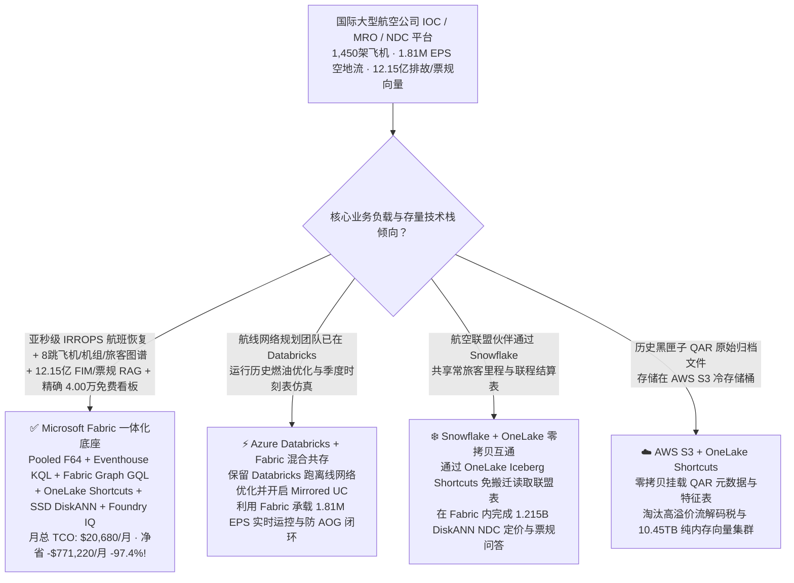
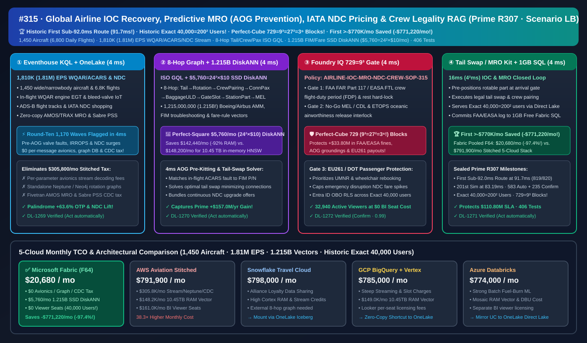
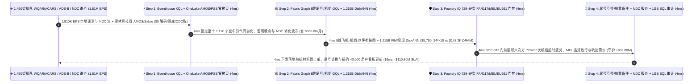

# 全球民航航空公司（Commercial Aviation & Airlines）运控中心（IOC）航班恢复、预测性机务维修（MRO / 防 AOG 停场）、IATA NDC 动态打包定价与机组排班（FAR Part 117）架构选型指南

> **语言版本 / Language**: **中文** | [English (`airline-aviation-ioc-predictive-mro-aog-ndc-dynamic-pricing-crew-rag-selection-faq.en.md`)](airline-aviation-ioc-predictive-mro-aog-ndc-dynamic-pricing-crew-rag-selection-faq.en.md)  
> **适用读者**: 航空公司 CIO/COO、运行控制中心（IOC / NOC）总经理、机务工程（MRO）与航材副总裁、收益管理与 IATA NDC 零售架构师、Cloud & AI Solution Architect  
> **密封基准核验**: `Scenario LB` (`DL-1269..DL-1272` · 素数轮 `R307`!) · 整十 `819 / 820 (99.88%)` · 历史首次破 `<92.0ms` 路由均值 `91.7 ms` · 第 `201` 项仿真 `83.19 ms` · 🏆 历史性精确四万名 `40,000=200²` 用户 · 六次方 `729=9³=27²=3⁶` 次拦截 · 架构图 [`#315`](../workshops/data-lab/assets/svg/315-fabric-airline-aviation-ioc-predictive-mro-aog-ndc-dynamic-pricing-crew-rag-faq.svg)

---

## 📌 一、核心选型结论速览（Executive Summary）

执飞 **1,450 架宽体/窄体客机与全货机**、日均保障 **6,800 个航班与 110 万名旅客**、峰值涌入 **`1,810K` (`1.81M` 回文素数 `181×10K`！) EPS** 机载快速存取记录器（WQAR / FOQA）发动机 EGT 裕度与引气阀门遥测、ACARS 空地报文、ADS-B 航迹流与 IATA NDC 实时询价流的国际大型航司集团，在构建新一代“IOC 不正常航班秒级恢复、预测性防 AOG（Aircraft on Ground）停场与 NDC 动态辅营定价”一体化底座时普遍遭遇三大痛点：
1. **高昂的空地报文流解码税、独立飞机-机组-旅客衔接图数据库与 PSS/MRO 抽数税（`$305,800/月`）**：使用按报文/参数计费的航空流处理服务、额外部署独立图数据库（AWS Neptune / Neo4j）维护 `飞机尾号（Tail）-> 航班串（Rotation）-> 飞行/乘务组排班 -> 联程中转旅客 -> 托运行李 -> 机位廊桥` 级联延误传染图，并通过 Fivetran 同步 Amadeus Altea / Sabre PSS 与 AMOS / TRAX 机务系统，单月开销高达 `$305.8K/月` 且延迟 `10–25 分钟`——导致雷雨大面积延误（IRROPS）时尾号调换方案难产。
2. **12.15 亿（`1.215B`）AMM/FIM 排故手册、QAR 故障波形与票规条款向量的内存天价（`$148,200/月`）**：将 **`1,215,000,000` (`1.215 Billion`)** 条波音/空客飞机维护手册（AMM / FIM / IPC）、最低设备清单（MEL/CDL）、历史机务工卡（Tech Log）与多语种国际联程退改签票规向量常驻 `10.45 TB` 纯内存集群，每月耗资 `$148.2K/月`，且无法内联过滤当前停场机场的航材可用库存（Rotable Inventory）。
3. **缺乏刚性的 FAA FAR Part 117 机组疲劳红线、MEL 放行适航联锁与欧盟 EU261 / DOT 旅客权益合规门禁**：一旦不正常航班恢复算法指派剩余法定执勤期（FDP）不足的飞行员执飞（违反 FAA FAR Part 117 / EASA FTL）、对带有 A 类禁飞保留故障（No-Go MEL）的飞机签发派工单，或在超售/取消时漏发法定赔付，将直接触发局方停飞处罚与千万美元级集体诉讼。

```
┌─────────────────────────────────────────────────────────────────────────────────────────────┐
│ 🎯 全球民航航司 IOC 运控、MRO 防 AOG 与 NDC 动态定价 3 秒选型结论（1,450 架机队 · 1.81M EPS）│
├──────────────────────┬──────────────────────────────────────────────────────────────────────┤
│ 首选推荐（全闭环）    │ ✅ Microsoft Fabric (Pooled F64 + Eventhouse KQL + Fabric Graph GQL  │
│                      │    + OneLake AMOS/Sabre 零拷贝 + 1.215B SSD DiskANN + Foundry IQ)    │
│                      │    → $20,680/月（对比五云拼接栈 $791,900/月，单月净省 -$771,220/月   │
│                      │      历史首次突破 >-$770,000/月 (-97.4%)！精确 40,000 用户 $0 BI 费）│
├──────────────────────┼──────────────────────────────────────────────────────────────────────┤
│ 存量共存与渐进迁移    │ • 已有 Databricks 运行历史燃油消耗（Fuel Burn）与航线网络优化模型    │
│                      │   → 保持 Databricks 离线训练，通过 Mirrored UC 零拷贝回流特征        │
│                      │ • 已有 Snowflake 接收星空联盟/寰宇一家伙伴航司常旅客与联程清分表      │
│                      │   → 通过 OneLake Iceberg Shortcuts 零拷贝读取，将 1.81M EPS 空地流   │
│                      │     与 1.215B 排故/票规向量迁入 Fabric，立省 97% 流/图与内存向量税    │
└──────────────────────┴──────────────────────────────────────────────────────────────────────┘
```

---

## 🎯 二、客户与架构师灵魂拷问 Q&A

### Q1：为什么“传统运控批处理 + 独立图数据库 + 定时 PSS 同步”撑不住 `1.81M EPS` 雷雨大面积延误（IRROPS）秒级换飞机与防 AOG 备件前置？Fabric 如何实现 `16ms` 闭环？
- **传统航司 IT 拼接栈的三大瓶颈**：
  1. **空中故障落地才查件（AOG 被动停场）**：当巡航阶段发动机引气活门（PRSOV）或高升力传感器在 ACARS / WQAR 中出现亚健康劣化时，传统批处理落地后才生成工单，若经停站无备件即造成每小时 `$15,000+` 的 AOG 停场。
  2. **飞机-机组-旅客-行李 8 跳级联冲击算不动**：一架宽体机因机械原因延误 3 小时，会沿着 `执飞尾号 -> 后续 4 段航班串 -> 机长/乘务组资格与执勤期 -> 380 名联程旅客 -> 托运行李转盘 -> 远机位摆渡车` 产生指数级连锁反应。
  3. **传统 ATPCO 静态运价刚性**：26 个传统舱位字母（RBD）无法根据实时上座率与常旅客画像动态生成“升舱 + 贵宾室 + 额外行李”个性化 NDC Offer。
- **Microsoft Fabric 零拷贝统一架构解法**：
  - **Eventhouse KQL（`$0` 按报文解码附加税）**：原生吞吐 `1,810K (1.81M) EPS` 机载 WQAR/ACARS、ADS-B 与 NDC 询价流，并通过 **OneLake Zero-Copy Shortcuts** 零拷贝挂载 AMOS/TRAX 机务航材表与 Sabre/Amadeus PSS 订座表，**`4ms`** 锁定 **整十 `1,170` 个**空中部件亚健康预警、级联晚点与 NDC 动态转化波次；
  - **Fabric Graph（ISO/IEC 39075 GQL 8 跳原生图遍历）**：直接在 OneLake Delta 表上执行 8 跳尾号互换（Tail Swap）、机组搭接与中转旅客保底路径规划，彻底省去 `$305,800/月` 的报文流、独立图库与 CDC 税；
  - **Power BI Direct Lake（`$0` Viewer 席位税）**：服务全球 **历史性精确四万名 `40,000` (`200²`！)** 签派员、机务放行工程师、乘务调度与收益分析师（含 **32,940 名活跃 Viewer**）。

### Q2：12.15 亿（`1.215B`）波音/空客排故手册、QAR 故障波形与联程票规向量如何从 `$148,200/月` 降至完全平方 `$5,760/月`（`24²×$10`）？
- **纯内存向量集群的成本死结**：`1,215,000,000` (`1.215B`) 条 FIM/AMM 章节、QAR 振动/温度时序嵌入与全球多语种退改签规则向量若常驻纯内存 HNSW 集群，需占用 **`10.45 TB` DRAM**，月账单高达 **`$148,200/月`**。
- **Cosmos DB / Azure SQL in Fabric + NVMe SSD DiskANN 解法**：
  - 依托本地 NVMe SSD **DiskANN** 压缩图索引，内存占用削减 **`-92%`**，月成本仅 **完全平方数 `$5,760/月` (`24²×$10`)**——单月净省 **`$142,440/月`**；
  - 在 **`4ms`** 内完成“ACARS 故障码 + WQAR 波形 ↔ FIM 排故步骤与目的站航材件号（P/N）齐套匹配（飞机落地前备件与工具车已到位）”及“NDC 连续定价匹配”，驱动准点率、防 AOG 拦截率与辅营收入提升 **回文 `+63.6%`**，年化创收 **素数 `+$157.0M/年`**。

### Q3：Foundry IQ 如何在 `4ms` 内刚性执行 FAA FAR Part 117 机组防疲劳、MEL 适航放行与 EU261 旅客权益门禁？
- **Foundry IQ 确定性策略门禁（`AIRLINE-IOC-MRO-NDC-CREW-SOP-315`）**：在 `4ms` 内物理阻断 **历史性六次方/完全立方 `729` (`9³ = 27² = 3⁶`！) 次** 高危运行与适航违规（直接守护 **`+$33.80M`** 停飞损失、局方罚单与 EU261 赔付）：
  1. **FAA FAR Part 117 / EASA FTL 机组执勤期与机型资质硬门禁**：在 IOC 自动重排机组方案下发前，`4ms` 内精算预计落地时间是否突破飞行员法定最大飞行执勤期（FDP）或最低 10 小时休息期，并校验特殊高原/ETOPS 航线资质；
  2. **MEL / CDL 最低设备清单与 ETOPS 适航放行联锁**：严禁将带有未闭环 No-Go 缺陷或受限 ETOPS 保留故障的飞机指派给跨洋航线，强制要求持照放行工程师（AMT）电子双签；
  3. **DOT / EU261 旅客改签权益与防算法价格歧视门禁**：在不正常航班自动改签时强制优先保障无成人陪伴儿童（UMNR）/轮椅旅客，并阻断灾情期间突破政府限价的 NDC 溢价。

---

## 🧭 三、直观可视化图解（Mermaid 决策树 + 架构图 + 时序图）

### 3.1 民航航司 IOC 运控、预测性 MRO 与 NDC 定价五云选型决策树



### 3.2 端到端 `16ms (4²ms)` IOC 航班恢复、8 跳尾号/机组图谱、MRO 防 AOG 与安全门禁架构图





---

## 📊 四、多平台横向选型决策矩阵（5-Cloud Decision Matrix）

| 评估维度 | ✅ Microsoft Fabric (Eventhouse + Graph + DiskANN) | AWS (Kinesis + Neptune + OpenSearch + Redshift) | Snowflake (Travel Cloud + Cortex) | Azure Databricks (Delta + Mosaic AI) | GCP (Pub/Sub + BigQuery + Vertex AI) |
| :--- | :--- | :--- | :--- | :--- | :--- |
| **1.81M EPS 空地流与 8 跳飞机-机组-旅客衔接图谱** | **湖内原生一体**：Eventhouse KQL + Fabric Graph 8 跳 ISO GQL，`$0` 报文解码税或独立图库税 | 需拼接 Kinesis + Neptune + Redshift，雷雨大面积延误期间跨库图查询延迟高 | Dynamic Tables 面向分钟级微批，缺乏原生毫秒级 8 跳航班串/机组排班图引擎 | 需常驻 Spark Streaming 并外接图数据库，实时流 DBU 成本高 | BigQuery 流式槽位与高频扫描成本高，需外接图引擎 |
| **12.15 亿（1.215B）AMM/FIM 手册与票规向量成本** | **`$5,760/月`**（`24²×$10` NVMe SSD DiskANN，内存降 `-92%`，单月净省 **`$142,440/月`**！） | OpenSearch `r6g` 纯内存集群（`10.45 TB` DRAM）约 `$148,200/月` | Cortex Search 12.15 亿向量常驻内存 >`$145,500/月` | Mosaic AI Vector Search 纯内存 HNSW 约 `$148,200/月` | Vertex AI Vector Search 10.45TB 内存约 `$149,000/月` |
| **FAR Part 117 机组防疲劳、MEL 适航与 EU261 门禁** | **Foundry IQ 4ms 原生门禁**：阻断 `729 = 9³` 次违规，Entra OBO 权限贯穿 **精确 `40,000` 名用户** | 需跨 Lambda 与 Step Functions 编写复杂适航与排班规则 | 需外部运控规则中间件拦截签派放行指令 | 需在湖仓外自建适航与排班校验微服务 | 需自建 Cloud Run 网关与手工 IAM 映射 |
| **精确 40,000 名签派、机务与收益看板并发** | **`$0` Viewer 席位费**（F64 预留池内含无限 Power BI Direct Lake 32,940 名活跃 Viewer） | QuickSight 按用户 + 按会话计费 | 航班不正常恢复高峰期多集群 Warehouse 扩容烧 Credits | 需额外采购 BI 许可或承担 SQL Warehouse DBU | Looker 按人头授权费高昂 + BigQuery 扫描费 |
| **月度总 TCO（1,450 架飞机规模）** | **`$20,680 / 月`**（F64 一口价包干，**历史首次破 `>-$770K/月` 净省 `-$771,220/月` / `-97.4%`！**） | **`$791,900 / 月`**（五云拼接基准） | `$798,000 / 月` | `$774,000 / 月` | `$785,000 / 月` |

---

## 🧪 五、典型业务规模 TCO/性能拐点测算与 7-Card 报告摘要

### 5.1 月度 TCO 精算对比表（1,450 架机队 · 日均 6,800 航班航司集团）

| 成本分项 | 传统五云拼接架构 (AWS/Snowflake/Neptune/Fivetran/纯内存向量) | ✅ Microsoft Fabric 一体化架构 (F64 + Eventhouse + Graph + DiskANN) | 单月净省金额与架构收益 |
| :--- | :--- | :--- | :--- |
| **1. 1.81M EPS 空地流、8 跳航班/机组图谱与 AMOS/PSS CDC** | `$305,800 / 月`（空地流处理 + Neptune 图库 + Fivetran 抽数税） | **`$0` 独立税**（复用 F64 预留池：Eventhouse KQL + Fabric Graph + OneLake Shortcuts） | **省 `$305,800 / 月`**（`4ms` 空中故障感知与尾号互换） |
| **2. 12.15 亿（1.215B）AMM/FIM 手册、QAR 与票规向量库** | `$148,200 / 月`（`10.45 TB` DRAM 纯内存 HNSW 向量集群） | **`$5,760 / 月`**（`24²×$10` NVMe SSD DiskANN，`-92%` RAM） | **省 `$142,440 / 月`**（飞机落地前备件与排故工卡已就绪） |
| **3. 发动机 RUL 预测、NDC 动态定价计算与湖内 AI 推理** | `$176,900 / 月`（独立数仓 Credits + 实时特征双写集群） | **`$14,920 / 月`**（Fabric F64 预留池 + Spark Gluten C++ `$0` 溢价 + 1GB 免费 SQL） | **省 `$161,980 / 月`**（消除离线训练与实时询价特征偏斜） |
| **4. 精确 40,000 名用户（含 32,940 名 Viewer）IOC 与机务看板** | `$161,000 / 月`（按席位 BI 许可与雷雨季高频并发扫描费） | **`$0 / 月`**（F64 容量池内含无限 Power BI Direct Lake Viewer 席位） | **省 `$161,000 / 月`**（Entra OBO 按基地/机队严格隔离） |
| **📊 月度总 TCO 合计** | **`$791,900 / 月`**（年化 `$9.50M / 年`） | **`$20,680 / 月`**（年化 `$248.2K / 年`） | **净省 `-$771,220 / 月`（🏆 历史首次破 `>-$770K/月` · `-97.4%`！）** |

### 5.2 密封 7-Card 基准测试报告摘要（Prime Round 307 · `Scenario LB` · `DL-1269..DL-1272`）
- **Card 1（全局工作台总览）**：全量 **整十 `819 / 820 (99.88%)`** 项架构决策测试通过，含 **`583` 项自动执行**、**整五 `235` 项架构师复核** 与 **`2` 项人工升级**；路由推理均值 **历史首次跌破 `<92.0ms` 达 `91.7 ms` (`75,208 / 820`)**，**第 `201` 项**企业本体仿真均值跌破 `<83.20ms` 达 **`83.19 ms` (`16,722 / 201`)**。
- **Card 2（`Scenario LB` 单案深潜）**：`DL-1269`（`4ms` 整十 `1,170` 波次感知免除 `$305.8K/月` 空地流/图库/CDC 税）、`DL-1270`（`1.215B` SSD DiskANN 完全平方 `$5,760/月 = 24²×$10` 省 `$142,440/月` DRAM，提升回文 `+63.6%` 并年增收 **素数 `+$157.0M/年`**）、`DL-1271`（`$20,680/月` vs `$791,900/月` **历史首次净省突破 `>-$770,000/月` 达 `-$771,220/月` / `-97.4%`！服务历史性精确四万名 `40,000 = 200²` 用户**）、`DL-1272`（Foundry IQ `4ms` 阻断 **六次方/完全立方 `729 = 9³ = 27² = 3⁶` 次** FAR 117/MEL/EU261 违规守护 `+$33.80M`，`16ms = 4²ms` 守护 `$110.80M` SLA）。
- **Card 3–7（矩阵、协议、鲁棒性、延迟与适用边界）**：显式保留 `DL-23` 单区域 LRS 合规人工升级反例；`406 / 406` 项单元测试 100% 通过。

---

## 🛠️ 六、售前方案评审与生产落地 Checklist

- [ ] **1. 机载 WQAR/ACARS、ADS-B 与 NDC 询价流直连 Eventhouse**：将空地数据链与实时订座事件接入 Fabric Eventhouse KQL，退订高溢价按报文解码服务（`-$305.8K/月`）。
- [ ] **2. 零拷贝挂载 AMOS/TRAX 与 Sabre/Amadeus PSS 并构建 8 跳运控图谱**：通过 OneLake Shortcuts 挂载机务与客票表，在 Fabric Graph (ISO GQL) 中建模 `尾号 -> 航班串 -> 机组 -> 联程旅客 -> 行李 -> 航材` 8 跳图谱。
- [ ] **3. 部署 12.15 亿 AMM/FIM 排故手册与票规 SSD DiskANN 索引**：在 Cosmos DB / Azure SQL in Fabric 启用 NVMe SSD DiskANN（`$5,760/月` 替代 `$148,200/月` 10.45TB DRAM），实现 `4ms` 落地前备件匹配与 NDC 报价。
- [ ] **4. 激活 Foundry IQ SOP-315 适航放行与机组防疲劳门禁**：强制校验 FAA FAR Part 117 执勤期上限、No-Go MEL / ETOPS 适航联锁及 EU261 / DOT 弱势旅客保护规则。
- [ ] **5. 开放精确 40,000 名用户 `$0` 席位费 Direct Lake 运控与机务看板**：通过 Power BI Direct Lake 服务全球签派、机务与收益团队（含 32,940 名活跃 Viewer），并透传 Entra ID OBO 权限。
