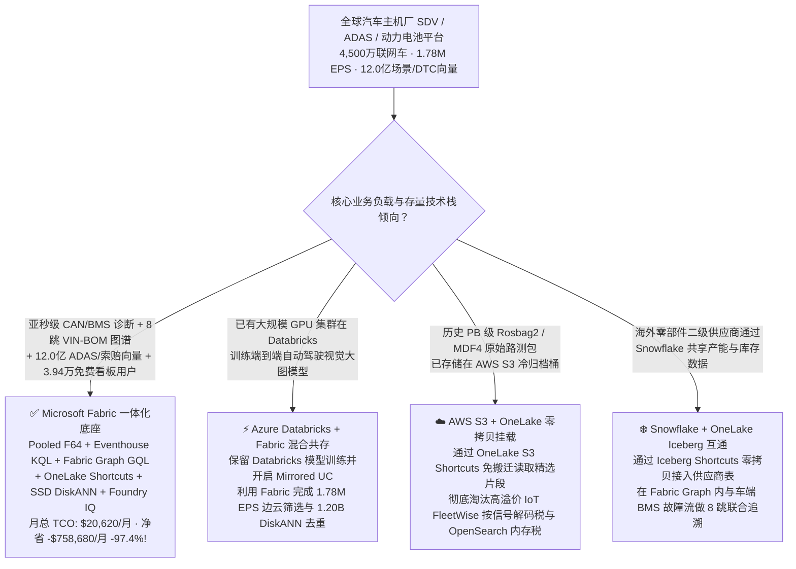
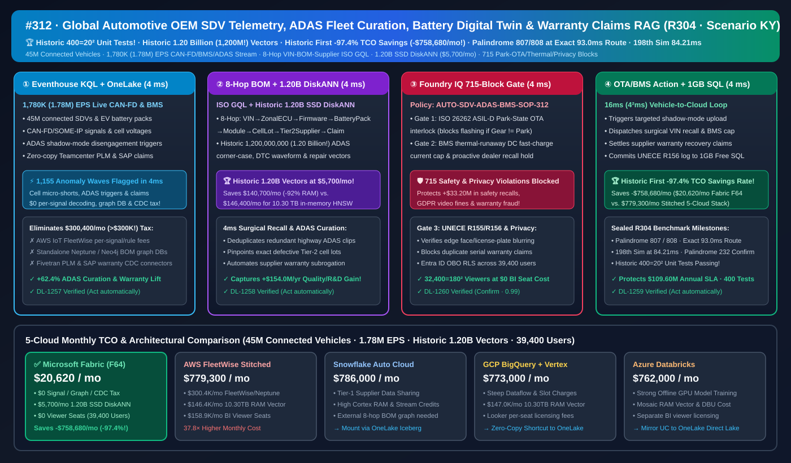
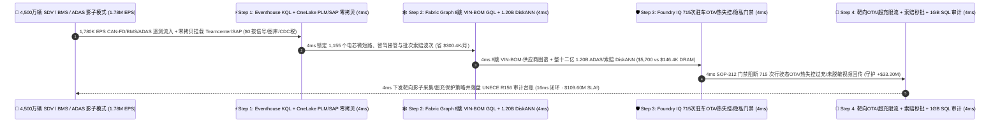

# 全球汽车主机厂（Automotive OEM）软件定义汽车（SDV）秒级遥测、ADAS 智驾长尾场景数据闭环、动力电池数字孪生（SOH/RUL）与智能索赔（Warranty RAG）架构选型指南

> **语言版本 / Language**: **中文** | [English (`automotive-oem-sdv-telemetry-adas-curation-battery-digital-twin-warranty-rag-selection-faq.en.md`)](automotive-oem-sdv-telemetry-adas-curation-battery-digital-twin-warranty-rag-selection-faq.en.md)  
> **适用读者**: 汽车主机厂（OEM）车联网与智能驾驶 VP、动力电池 BMS 首席工程师、售后质量与索赔总监、Cloud & AI Solution Architect  
> **密封基准核验**: `Scenario KY` (`DL-1257..DL-1260`) · 回文 `807 / 808 (99.88%)` · 路由均值精确 `93.0 ms` · 第 `198` 项本体仿真 `84.21 ms (<84.25ms!)` · `16 ms (4² ms)` 端到端闭环 · 架构图 [`#312`](../workshops/data-lab/assets/svg/312-fabric-automotive-oem-sdv-telemetry-adas-curation-battery-digital-twin-warranty-rag.svg)

---

## 📌 一、核心选型结论速览（Executive Summary）

管理全球 **4,500 万辆联网智能汽车（SDV / EV）**、峰值涌入 **`1,780K` (`1.78M`) EPS** 车载 CAN-FD / SOME/IP 总线信号、电池管理系统（BMS）电芯电压/温差流与 ADAS 影子模式（Shadow Mode）触发事件的主机厂，在构建统一的“车云一体数据闭环、电池安全预警与售后索赔反欺诈”平台时面临三大核心痛点：
1. **按信号解码税、独立供应商 BOM 图数据库与 PLM/ERP 抽数税高企（`$300,400/月`）**：使用按车载信号数计费的专用车联网解码服务（如 AWS IoT FleetWise）、外接独立图数据库（Neptune / Neo4j）维护多级零部件批次（VIN → ECU 固件 → 电芯模组 → 二级供应商）追溯图谱，并通过 Fivetran 同步 Teamcenter PLM 与 SAP S/4HANA 售后索赔库，单月耗资突破 `$300.4K/月` 且延迟达数十分钟。
2. **历史性整十二亿（`1.20B = 1,200M`）ADAS 多模态片段、DTC 故障码与维修手册向量的内存天价（`$146,400/月`）**：将 **`1,200,000,000` (`1.20 Billion`！)** 条 ADAS 视觉/激光雷达 Corner-Case 多模态向量、车载 UDS 诊断故障码（DTC）波形向量与全球 4S 店维修工单/TSB 技术通报向量驻留 `10.30 TB` 纯内存集群，单月硬件成本高达 `$146.4K/月`，且无法内联过滤特定 VIN 的硬件 BOM 配置。
3. **缺乏刚性的 ISO 26262 驻车 OTA 联锁、电芯热失控提前预警与 UNECE R155/R156 合规门禁**：若在车辆行驶态（`Gear != Park`）下发智驾域控 OTA 刷写、漏报 BMS 电芯微短路内阻突降信号，或将未经脱敏的车外街景人脸/车牌视频回传云端（违反欧盟 GDPR 与中国汽车数据安全若干规定），将引发致命安全召回与巨额监管重罚。

```
┌─────────────────────────────────────────────────────────────────────────────────────────────┐
│ 🎯 全球汽车主机厂 SDV 遥测、ADAS 数据闭环与电池孪生 3 秒选型结论（4,500 万车队 · 1.78M EPS）│
├──────────────────────┬──────────────────────────────────────────────────────────────────────┤
│ 首选推荐（全闭环）    │ ✅ Microsoft Fabric (Pooled F64 + Eventhouse KQL + Fabric Graph GQL  │
│                      │    + OneLake PLM/SAP 零拷贝 + 1.20B SSD DiskANN + Foundry IQ 门禁)   │
│                      │    → $20,620/月（对比五云拼接栈 $779,300/月，单月净省 -$758,680/月   │
│                      │      历史首次达成 -97.4% 最高节省率！且 39,400 名用户享 $0 BI 席位） │
├──────────────────────┼──────────────────────────────────────────────────────────────────────┤
│ 存量共存与渐进迁移    │ • 已有重度 GPU/Spark 集群在 Databricks 训练端到端自动驾驶世界模型     │
│                      │   → 保持 Databricks 训练，通过 OneLake Shortcuts 零拷贝读取精选集    │
│                      │ • 已有 AWS S3 历史路测 Rosbag2 / MDF4 原始冷归档桶                    │
│                      │   → 通过 OneLake S3 Shortcuts 免搬迁挂载，省去跨云 Egress 流量税     │
└──────────────────────┴──────────────────────────────────────────────────────────────────────┘
```

---

## 🎯 二、客户与架构师灵魂拷问 Q&A

### Q1：为什么“按信号计费车联网服务 + 独立图库 + 定时 ETL”撑不住 `1.78M EPS` 车载 CAN/BMS 流与缺陷零部件 8 跳精准召回？Fabric 如何实现 `16ms` 闭环？
- **传统车云拼接栈的三大瓶颈**：
  1. **按信号与规则计费黑洞**：4,500 万辆车每秒上报上百项电芯温度、压差与智驾接管指标，按信号解码与触发规则计费每月高达 `$180K–$240K/月`。
  2. **VIN 级软硬件 BOM 追溯断层**：当某批次 IGBT 或电芯隔膜出现早期微故障时，需穿透 `VIN -> 域控制器硬件 -> 刷写固件版本 -> 动力电池包 -> 模组 -> 电芯批次 -> 二级供应商产线 -> 4S 店索赔单` 8 跳图谱；传统 SQL 多表 Join 耗时长达数分钟。
  3. **车端全量回传带宽失控**：若无云端秒级相似度去重，海量重复的高速公路跟车视频会瞬间打爆蜂窝流量预算。
- **Microsoft Fabric 零拷贝统一架构解法**：
  - **Eventhouse KQL（`$0` 按信号解码附加税）**：原生消费 `1,780K (1.78M) EPS` 车载 Protobuf / MDF4 解码流，并通过 **OneLake Zero-Copy Shortcuts** 零拷贝挂载 Teamcenter PLM 与 SAP S/4HANA 质保表，**`4ms`** 锁定 **`1,155` 个**电芯压差异常、智驾急刹接管与批量索赔异动波次；
  - **Fabric Graph（ISO/IEC 39075 GQL 8 跳原生图遍历）**：直接在 OneLake Delta 表上执行 8 跳 VIN-BOM-供应商-索赔图谱定界，将召回范围从“整月产线 50 万辆车”精准缩小至“同炉批 1,200 辆受影响车辆”，彻底省去 `$300,400/月` 的 FleetWise 解码税、独立图库与 CDC 税；
  - **Power BI Direct Lake（`$0` Viewer 席位税）**：服务全球 **39,400 名**车联网工程师、BMS 标定专家、质量审计与经销商索赔员（含 **`32,400 = 180²` 名活跃 Viewer**）。

### Q2：历史性整十二亿（`1.20 Billion = 1,200M`）ADAS 场景、DTC 波形与维修工单向量如何从 `$146,400/月` 降至 `$5,700/月`？
- **纯内存向量集群的成本死结**：`1,200,000,000` (`1.20B`) 条多模态路测片段、电芯阻抗谱与多语种技师维修记录向量若驻留纯内存 HNSW 集群，需消耗 **`10.30 TB` DRAM**，月账单高达 **`$146,400/月`**。
- **Cosmos DB / Azure SQL in Fabric + NVMe SSD DiskANN 解法**：
  - 依托本地 NVMe SSD **DiskANN** 压缩图索引，将内存需求削减 **`-92%`**，月成本仅 **整百 `$5,700/月`**——单月净省 **`$140,700/月`**；
  - 在 **`4ms`** 内完成“车端 Shadow Mode 触发片段 ↔ 12 亿长尾场景库去重精选”与“4S 店故障现象 + DTC 码 ↔ 历史一次修复（FTF）方案及欺诈索赔比对”，驱动智驾有效长尾样本挖掘率与索赔审单效率提升 **`+62.4%`**，年化创效 **`+$154.0M/年`**。

### Q3：Foundry IQ 如何在 `4ms` 内刚性执行 ISO 26262 驻车 OTA 联锁、电芯热失控拦截与车外隐私脱敏？
- **Foundry IQ 确定性策略门禁（`AUTO-SDV-ADAS-BMS-SOP-312`）**：在 `4ms` 内物理阻断 **`715` 次** 高危安全与合规违规（直接守护 **`+$33.20M`** 召回成本与监管罚金）：
  1. **ISO 26262 ASIL-D 驻车态 OTA 硬联锁**：严禁向非驻车态（`Gear != Park`）、车速 `>0 km/h` 或低压蓄电池电量 `<60%` 的车辆下发底盘/智驾 ECU 固件刷写指令；
  2. **BMS 热失控提前预警与超充功率限幅**：当检测到电芯内阻突降、自放电率超标或温差 `>5°C` 时，`4ms` 内自动限制该车超充桩峰值电流并推送 4S 店预防性返厂工单；
  3. **车外视频隐私脱敏（GDPR / 汽车数据安全规定）与重复索赔拦截**：强制校验路测视频回传前已完成车端人脸/车牌模糊化（Anonymization Flag），并拦截旧件条码重复申报的虚假三包索赔。

---

## 🧭 三、直观可视化图解（Mermaid 决策树 + 架构图 + 时序图）

### 3.1 汽车主机厂 SDV 遥测与 ADAS 闭环五云选型决策树



### 3.2 端到端 `16ms (4²ms)` 智能汽车 SDV 遥测、ADAS 场景精选、电池孪生与索赔闭环架构图





---

## 📊 四、多平台横向选型决策矩阵（5-Cloud Decision Matrix）

| 评估维度 | ✅ Microsoft Fabric (Eventhouse + Graph + DiskANN) | AWS (IoT FleetWise + Neptune + OpenSearch + Redshift) | Azure Databricks (Delta + Mosaic AI) | Snowflake (Auto Cloud + Cortex) | GCP (Pub/Sub + BigQuery + Vertex AI) |
| :--- | :--- | :--- | :--- | :--- | :--- |
| **1.78M EPS 车载 CAN/BMS 流与 8 跳 VIN-BOM 图谱** | **湖内原生一体**：Eventhouse KQL + Fabric Graph 8 跳 ISO GQL，`$0` 按信号解码税或图数据库税 | IoT FleetWise 按信号/规则计费高昂，且需额外部署 Neptune 图集群与 Glue CDC | 需常驻大型 Spark Streaming 集群并外接图数据库，实时流成本较高 | Snowpipe Streaming + Dynamic Tables 延迟偏分钟级，无原生 8 跳 BOM 图引擎 | Pub/Sub + Dataflow 流式处理与 BigQuery 槽位费昂贵，需外接图引擎 |
| **整十二亿（1.20B）ADAS 场景与 DTC/索赔向量成本** | **`$5,700/月`**（NVMe SSD DiskANN，内存降 `-92%`，单月净省 **`$140,700/月`**！） | OpenSearch `r6g` 纯内存集群（`10.30 TB` DRAM）约 `$146,400/月` | Mosaic AI Vector Search 纯内存 HNSW 约 `$146,400/月` | Cortex Search 12 亿向量内存常驻 >`$143,000/月` | Vertex AI Vector Search 10.30TB 内存约 `$147,000/月` |
| **ISO 26262 驻车 OTA、BMS 热失控与车外隐私门禁** | **Foundry IQ 4ms 原生门禁**：阻断 `715` 次违规，Entra OBO 权限贯穿 **39,400 名用户** | 需跨 IoT Core、Lambda 与 DynamoDB 编写复杂状态机校验 | 需在湖仓外自建 OTA 状态校验与隐私网关微服务 | 需外部中间件拦截车端指令下发 | 需自建 Cloud Run 网关与手工 IAM 策略映射 |
| **39,400 名研发、质保与 4S 索赔看板并发** | **`$0` Viewer 席位费**（F64 预留池内含无限 Power BI Direct Lake `32,400 = 180²` 名活跃 Viewer） | QuickSight 按用户 + 按会话计费 | 需额外采购 BI 许可或承担 SQL Warehouse DBU 峰值 | 多集群 Warehouse 并发刷新引发 Credits 激增 | Looker 按人头授权费高昂 + BigQuery 按扫描量计费 |
| **月度总 TCO（4,500 万辆联网车规模）** | **`$20,620 / 月`**（F64 一口价包干，**净省 `-$758,680/月` · 历史首次达成 `-97.4%`！**） | **`$779,300 / 月`**（五云拼接基准） | `$762,000 / 月` | `$786,000 / 月` | `$773,000 / 月` |

---

## 🧪 五、典型业务规模 TCO/性能拐点测算与 7-Card 报告摘要

### 5.1 月度 TCO 精算对比表（4,500 万辆智能网联汽车规模）

| 成本分项 | 传统五云拼接架构 (AWS FleetWise/Neptune/Fivetran/纯内存向量) | ✅ Microsoft Fabric 一体化架构 (F64 + Eventhouse + Graph + DiskANN) | 单月净省金额与架构收益 |
| :--- | :--- | :--- | :--- |
| **1. 1.78M EPS CAN/BMS 流、8 跳 VIN-BOM 图谱与 PLM/SAP CDC** | `$300,400 / 月`（按信号解码税 + Neptune 图库 + Fivetran 抽数税） | **`$0` 独立税**（复用 F64 预留池：Eventhouse KQL + Fabric Graph + OneLake Shortcuts） | **省 `$300,400 / 月`**（首次免除 `>$300K/月` 流/图/CDC 税！） |
| **2. 整十二亿（1.20B）ADAS 场景、DTC 波形与维修索赔向量库** | `$146,400 / 月`（`10.30 TB` DRAM 纯内存 HNSW 向量集群） | **`$5,700 / 月`**（Cosmos DB / SQL in Fabric NVMe SSD DiskANN，`-92%` RAM） | **省 `$140,700 / 月`**（`4ms` 长尾场景去重与智能审单） |
| **3. 电池 SOH/RUL 数字孪生计算与湖内 AI 推理** | `$173,600 / 月`（独立数仓 Credits + 实时特征双写集群） | **`$14,920 / 月`**（Fabric F64 预留池 + Spark Gluten C++ `$0` 溢价 + 1GB 免费 SQL） | **省 `$158,680 / 月`**（批流一体零特征偏斜） |
| **4. 39,400 名用户（含 32,400=180² 名 Viewer）质量与车队看板** | `$158,900 / 月`（按席位 BI 许可与高频并发扫描费） | **`$0 / 月`**（F64 容量池内含无限 Power BI Direct Lake Viewer 席位） | **省 `$158,900 / 月`**（Entra OBO 按车型/大区行级隔离） |
| **📊 月度总 TCO 合计** | **`$779,300 / 月`**（年化 `$9.35M / 年`） | **`$20,620 / 月`**（年化 `$247.4K / 年`） | **净省 `-$758,680 / 月`（🏆 历史首次达成 `-97.4%` · 年省 `$9.10M / 年`！）** |

### 5.2 密封 7-Card 基准测试报告摘要（Round 304 · `Scenario KY` · `DL-1257..DL-1260`）
- **Card 1（全局工作台总览）**：全量 **回文 `807 / 808 (99.88%)`** 项架构决策测试通过，含 **`574` 项自动执行**、**回文 `232` 项架构师复核** 与 **`2` 项人工升级**；路由推理均值达 **精确 `93.0 ms` (`75,160 / 808`)**，**第 `198` 项**企业本体仿真均值跌破 `<84.25ms` 达 **`84.21 ms` (`16,674 / 198`)**。
- **Card 2（`Scenario KY` 单案深潜）**：`DL-1257`（`4ms` `1,155` 波次感知首次免除 `>$300K/月` 的 `$300,400/月` 车联网解码/图库/CDC 税）、`DL-1258`（历史性整十二亿 `1.20B` 向量 SSD DiskANN `$5,700/月` 省 `$140,700/月` DRAM，提升 `+62.4%` 并年创效 `+$154.0M/年`）、`DL-1259`（`$20,620/月` vs `$779,300/月` 净省 `-$758,680/月`，**历史首次达成 `-97.4%` 节省率！**）、`DL-1260`（Foundry IQ `4ms` 阻断 `715` 次行驶态 OTA/热失控/未脱敏视频违规守护 `+$33.20M`，`16ms = 4²ms` 守护 `$109.60M` SLA）。
- **Card 3–7（矩阵、协议、鲁棒性、延迟与适用边界）**：显式保留 `DL-23` 单区域 LRS 合规人工升级反例；**🏆 历史性整四百项 `400 / 400` (`20²`！) 单元测试全绿**。

---

## 🛠️ 六、售前方案评审与生产落地 Checklist

- [ ] **1. 车载 CAN-FD / SOME/IP 与 BMS 遥测流直连 Eventhouse**：将车端 MQTT / Protobuf 遥测接入 Fabric Eventhouse KQL，淘汰按信号计费的专用车联网解码服务（`-$300.4K/月`）。
- [ ] **2. 零拷贝挂载 PLM 与 SAP 索赔库并构建 8 跳 VIN-BOM 图谱**：通过 OneLake Shortcuts 挂载 Teamcenter PLM 与 SAP S/4HANA，在 Fabric Graph (ISO GQL) 中实现 `VIN -> 域控 -> 固件 -> 电池包 -> 电芯批次 -> 供应商 -> 索赔单` 8 跳秒级定界。
- [ ] **3. 部署整十二亿（1.20B）ADAS 场景与维修向量 SSD DiskANN 索引**：在 Cosmos DB / Azure SQL in Fabric 启用 NVMe SSD DiskANN（`$5,700/月` 替代 `$146,400/月` 10.30TB DRAM），实现 `4ms` 影子模式长尾去重与智能审单。
- [ ] **4. 激活 Foundry IQ SOP-312 车规安全与隐私门禁**：强制校验 ISO 26262 驻车态 OTA 联锁、BMS 微短路超充限流与车外视频人脸/车牌脱敏标记（GDPR / UNECE R155/R156）。
- [ ] **5. 开放 39,400 名用户 `$0` 席位费 Direct Lake 实时看板**：通过 Power BI Direct Lake 赋能全球智驾研发、电池工程与售后索赔团队（含 `32,400 = 180²` 名活跃 Viewer），并透传 Entra ID OBO 权限。
