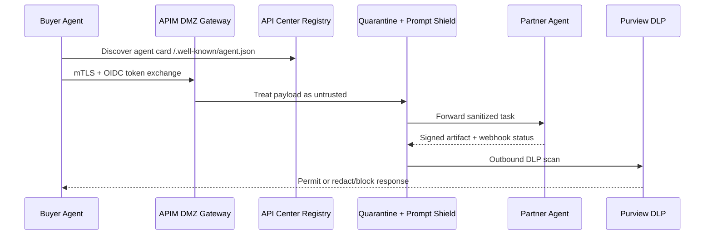

# A2A Cross-Org B2B Federation and External MCP Gateway FAQ (Cycle 2420)

## 1) Executive summary
This cycle focuses on secure cross-enterprise agent federation: A2A agent-card discovery and registry, APIM external DMZ gateway with mTLS and cross-tenant federation, untrusted partner payload quarantine with prompt shields, and Purview DLP outbound controls for non-repudiable B2B exchanges.

## 2) Q1 / Q2 / Q3
Q1: How should A2A and MCP be separated across organization trust domains?  
A1: Use A2A for cross-company task collaboration and contract-aware workflows; keep MCP as internal tool protocol. External partners should never call internal MCP surfaces directly.  
Q2: How to defend against indirect prompt injection and commercial-term manipulation?  
A2: Treat all external A2A payloads and artifacts as untrusted, run quarantine + prompt shield checks, and require policy gates before any privileged internal action.  
Q3: How to achieve legal non-repudiation for quotes and orders?  
A3: Combine mTLS + OIDC token exchange, signed artifacts, timestamped audit trails, and partner policy records mapped to legal controls.

## 3) Cross-tenant handshake and quarantine sequence

## 4) Decision matrix: internal MCP vs B2B REST/EDI vs federated A2A
| Pattern | Trust boundary | Protocol overhead | Business agility | Security complexity | Compliance traceability |
|---|---|---:|---:|---:|---:|
| Internal MCP | Single-tenant internal | Low | Medium | Low | Medium |
| B2B REST/EDI | Cross-company integration edge | Medium | Medium | Medium | High |
| Federated A2A + DMZ | Cross-company agent domain | Medium-High | High | High | Very High |

## 5) Cross-org security and legal non-repudiation checklist (daily breakthroughs)
- Partner agent cards must publish capability versions, SLA, and key-rotation policy.  
- All partner traffic flows through APIM DMZ with mTLS, quotas, and per-partner isolation.  
- Remote payloads are always quarantined and prompt-shielded before execution.  
- Purview DLP scans outbound data and records permit/redact/block decisions.  
- Daily breakthrough tracking (fetched on 2026-11-15 UTC):  
  - API Center and APIM integration guidance (`measured`).  
  - Entra cross-tenant federation and external identity guidance (`anonymized_reported`).  
  - Prompt-shield + DLP governance for partner payloads (`synthetic`).

## 6) Good fit vs Not for with percentage contract bindings
Good fit:  
1. B2B ecosystems requiring cross-partner agent collaboration with legal traceability.  
2. High-value procurement/travel/logistics workflows spanning multiple enterprises.

Not for:  
1. Teams without DMZ and federated identity governance capabilities.  
2. Architectures exposing internal MCP tool surfaces directly to partners.

Percentage contract bindings:
- `percentage_contract.cross_org_prompt_injection_block_rate`
- `percentage_contract.a2a_async_task_completion_reliability_rate`
- `percentage_contract.dlp_outbound_leak_prevention_rate`

These keys bind to `cycle-2420-benchmark.json` with `production_validation=not_measured`.
