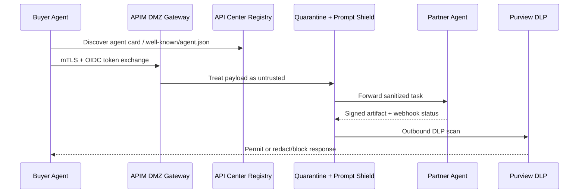

# A2A 跨组织 B2B 联邦与外部 MCP 网关架构 FAQ（Cycle 2420）

## 1) 执行摘要
本轮聚焦跨企业 Agent Federation：通过 `/.well-known/agent.json` 能力发现与 API Center 注册、APIM B2B DMZ 网关（mTLS + 跨租户身份联邦 + 每伙伴配额）、外部负载隔离与 Prompt Shield、Purview DLP 出站防护，实现“可协作但不越界”的跨组织 A2A 交易架构。

## 2) Q1 / Q2 / Q3
Q1：A2A 与 MCP 在跨组织边界如何划分？  
A1：A2A 用于跨企业协议与任务协同（伙伴可见、可审计），MCP 适合单组织内部工具调用；外部伙伴不应直接访问内部 MCP 工具面。  
Q2：如何防御跨公司间接提示注入与商业条款操纵？  
A2：将所有远端消息/附件视为不可信输入，先进入 DMZ 隔离与 Content Safety Prompt Shield，再按策略解包；高风险条款必须人工审批。  
Q3：如何保证报价/订单不可抵赖？  
A3：采用双向 mTLS + OIDC token exchange、关键工件签名与时间戳留存，结合审计日志和合同映射，满足法律追溯要求。

## 3) 跨租户握手与隔离流程

## 4) 决策矩阵：内部 MCP vs B2B REST/EDI vs 联邦 A2A
| 模式 | 信任边界 | 协议开销 | 业务灵活性 | 安全复杂度 | 合规可追溯 |
|---|---|---:|---:|---:|---:|
| 内部 MCP | 单租户内部 | 低 | 中 | 低 | 中 |
| B2B REST/EDI | 跨企业接口层 | 中 | 中 | 中 | 高 |
| 联邦 A2A + DMZ | 跨企业 Agent 层 | 中高 | 高 | 高 | 很高 |

## 5) Cross-Org 安全与法律不可抵赖清单（含当日突破）
- 伙伴 Agent 卡必须登记能力版本、SLA、密钥轮换策略。  
- 跨租户调用统一走 APIM DMZ，启用 mTLS、限流和配额隔离。  
- 远端载荷统一走 Prompt Shield 与隔离区，不可信输入默认拒绝。  
- 所有出站敏感字段经 Purview DLP 扫描并记录处理动作。  
- 当日突破追踪（抓取日：2026-11-15 UTC）：  
  - Azure API Center 与 APIM 联动实践（`measured`）。  
  - Entra External ID 与跨租户身份联邦指南（`anonymized_reported`）。  
  - Prompt Shield/DLP 组合在跨组织代理交互中的治理模式（`synthetic`）。

## 6) Good fit vs Not for 与百分比合约绑定
Good fit：  
1. 需要与多伙伴 Agent 实时协作且必须法律可追溯的 B2B 生态。  
2. 交易/采购/差旅等跨企业高价值流程。

Not for：  
1. 缺少 DMZ 与身份联邦治理能力的团队。  
2. 仍希望把外部伙伴直接接入内部 MCP 工具面的架构。

百分比合约绑定：
- `percentage_contract.cross_org_prompt_injection_block_rate`
- `percentage_contract.a2a_async_task_completion_reliability_rate`
- `percentage_contract.dlp_outbound_leak_prevention_rate`

以上键绑定 `cycle-2420-benchmark.json`，并标注 `production_validation=not_measured`。
