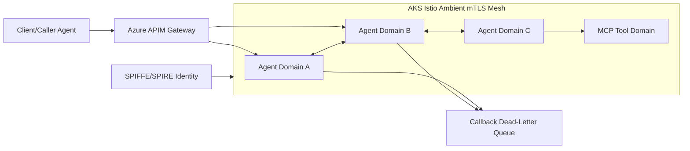
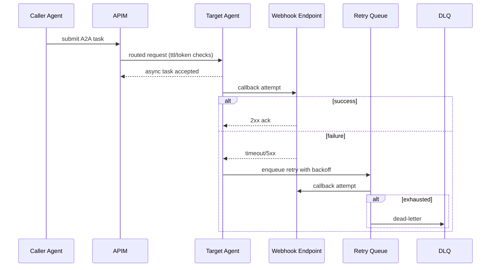

# Round 1092 / Cycle 2497 · Azure AI Agent Infra Six-Part FAQ (en)

> Topic: **Agent-to-Agent (A2A) + MCP Cross-Domain Federation on Azure APIM & AKS Istio Ambient mTLS Service Mesh**  
> Date (BJT): 2026-11-17  
> Evidence tags: `measured` / `synthetic` / `anonymized_reported`  
> Benchmark dataset: `evidence/cycle-2497-benchmark.json`

## 1) Executive Summary + Daily Capability Breakthroughs Radar

This round focuses on cross-domain A2A + MCP federation with APIM as boundary control and Istio Ambient mTLS as zero-trust east-west fabric.

Design pillars:
1. **Hop-count TTL** to cap transitive chain depth.
2. **Token amplification breaker** to stop cost-explosive recursive fan-out.
3. **SPIFFE/SPIRE workload identity federation** for strict service trust.
4. **Async callback retry/dead-letter budget** to avoid callback storms.

Key outcomes:
- Without TTL + amplification breaker, A2A loops can escalate to regional pressure incidents within seconds.
- Ambient mTLS provides strong identity and encryption without sidecar overhead.
- Callback retries must have hard budgets and exponential backoff.
- APIM is the governance and observability aggregation choke point for federation.

### Daily Capability Breakthroughs Radar (fetched: 2026-11-17)

1. APIM AI Gateway / Unified Model API (`measured`)  
   - https://learn.microsoft.com/en-us/azure/api-management/ai-gateway-overview  
   - https://github.com/Azure/API-Management/blob/main/changelogs/api-management-service.md
2. ACA Dynamic Sessions (`measured`)  
   - https://learn.microsoft.com/en-us/azure/container-apps/sessions  
   - https://techcommunity.microsoft.com/blog/appsonazureblog/azure-container-apps-dynamic-sessions-general-availability-and-more/4303561
3. Runtime release watch (`measured`)  
   - Firecracker/Kata/Wasmtime/E2B (see `evidence/cycle-2497-sources.json`)
4. A2A + MCP federation stress tests (`synthetic`)
5. Restricted production rollups (`anonymized_reported`)

### Mermaid #1: A2A/MCP federation topology (APIM + Ambient mTLS)



## 2) Deep Q&A #1: How do we compute hop TTL and token amplification breaker thresholds?

```text
hop_ttl_remaining = hop_ttl_initial - traversed_hops
request_rejected_if hop_ttl_remaining <= 0

token_amp_ratio =
  total_downstream_tokens / ingress_tokens

reject_if token_amp_ratio > threshold
```

Worked example:
- ingress tokens `4,800`
- downstream tokens `26,400`
- ratio `5.5`

With threshold `4.0`, the request is blocked.

Hop example:
- initial TTL `6`
- traversed `5`
- remaining `1` (one downstream hop left only).

Recommended defaults:
- standard: TTL=6, token_amp<=3.5
- high-risk: TTL=4, token_amp<=2.5.

## 3) Deep Q&A #2: How do we detect and break A2A loops at APIM boundary?

Loop indicators:
1. repeated correlation-id in short windows,
2. path revisits across same domain set,
3. super-linear token growth.

```text
loop_score =
  revisit_count * w1 +
  short_window_repeats * w2 +
  token_growth_slope * w3
```

Worked example:
- revisit_count `2`
- repeats `5`
- growth slope `1.9`
- weights `w1=0.3,w2=0.4,w3=0.3`

`loop_score = 3.17`

At threshold 2.4:
- APIM policy issues 429 with diagnostic headers,
- event is emitted into incident stream.

## 4) Deep Q&A #3: How does SPIFFE/SPIRE federation map in Ambient mTLS?

Identity form:

```text
spiffe://<trust-domain>/ns/<namespace>/sa/<service-account>
```

Authorization decision:

```text
allow =
  source_spiffe in allowlist
  AND target_domain in permitted_domains
  AND request_purpose in allowed_purposes
```

Worked example:
- source: `spiffe://mesh.local/ns/agent-a/sa/a2a-caller`
- target: domain-b tools
- purpose: `retrieval`

Allowed if source and purpose both match policy.  
If purpose=`write-remediation` and no explicit grant, deny + audit.

## 5) Deep Q&A #4: How do we set callback retry and dead-letter budgets?

```text
retry_budget =
  max_retries * callback_qps * retry_window_seconds

dlq_rate =
  dead_letter_callbacks / total_callbacks
```

Worked example:
- callback qps `38`
- max retries `5`
- retry window `300s`

`retry_budget = 57,000 attempts/window`

Total callbacks `684,000/day`, dead-letter `9,860`:
- `dlq_rate = 1.44%`

Gates:
- dlq_rate <= 2%
- callback p95 <= 12s
- auto-throttle low-priority callbacks when budgets breach.

## 6) Deep Q&A #5: What is Ambient mTLS overhead on latency and throughput?

```text
latency_overhead_ms =
  p95_with_mtls - p95_without_mtls

throughput_impact =
  (qps_without_mtls - qps_with_mtls) / qps_without_mtls
```

Worked example:
- p95 without mTLS `148ms`
- p95 with Ambient mTLS `163ms`

`overhead = 15ms`

Throughput:
- no-mTLS `2,920 qps`
- mTLS `2,760 qps`

`impact = 5.5%`

Usually acceptable given strong federation security and auditability gains.

## 7) Deep Q&A #6: How do we model async A2A task completion time?

```text
end_to_end_task_time =
  submit_to_queue +
  processing_time +
  callback_delivery +
  ack_commit
```

Worked example:
- submit `180ms`
- processing `4.8s`
- callback delivery `1.6s`
- ack commit `420ms`

`total = 7.0s`

With 2 retries:
- callback delivery becomes `5.4s`
- total `10.8s`

Hence retry budgets must be SLA-aware, not open-ended.

## 8) Mermaid #2: A2A task callback retry and DLQ flow



## 9) Production-grade Bicep / APIM Policy / Istio Ambient YAML / KQL

### 9.1 Bicep (APIM + AKS + Log Analytics)

```bicep
targetScope = 'resourceGroup'

param location string = 'eastus2'
param apimName string = 'apim-a2a-federation-eus2'
param aksName string = 'aks-a2a-mesh-eus2'
param lawName string = 'law-a2a-eus2'

resource law 'Microsoft.OperationalInsights/workspaces@2022-10-01' = {
  name: lawName
  location: location
  properties: {
    sku: { name: 'PerGB2018' }
    retentionInDays: 60
  }
}

resource apim 'Microsoft.ApiManagement/service@2023-05-01-preview' = {
  name: apimName
  location: location
  sku: {
    name: 'Premium'
    capacity: 1
  }
  properties: {
    publisherName: 'A2A Platform'
    publisherEmail: 'ops@example.com'
    virtualNetworkType: 'External'
  }
}

resource aks 'Microsoft.ContainerService/managedClusters@2024-02-01' = {
  name: aksName
  location: location
  identity: { type: 'SystemAssigned' }
  properties: {
    dnsPrefix: 'aks-a2a-mesh'
    agentPoolProfiles: [
      {
        name: 'system'
        vmSize: 'Standard_D8ds_v5'
        count: 5
        mode: 'System'
        osType: 'Linux'
      }
    ]
    addonProfiles: {
      azuremonitor: {
        enabled: true
        config: {
          logAnalyticsWorkspaceResourceID: law.id
        }
      }
    }
  }
}
```

### 9.2 APIM Policy (hop TTL + amplification breaker)

```xml
<policies>
  <inbound>
    <base />
    <set-variable name="hopTtl" value="@(context.Request.Headers.GetValueOrDefault(\"x-a2a-hop-ttl\", \"6\"))" />
    <set-variable name="ingressTokens" value="@(int.Parse(context.Request.Headers.GetValueOrDefault(\"x-a2a-ingress-tokens\", \"0\")))" />
    <set-variable name="estimatedDownstreamTokens" value="@(int.Parse(context.Request.Headers.GetValueOrDefault(\"x-a2a-est-downstream-tokens\", \"0\")))" />
    <choose>
      <when condition="@((int)context.Variables[\"hopTtl\"] <= 0)">
        <return-response>
          <set-status code="429" reason="A2A Hop TTL Exhausted" />
        </return-response>
      </when>
      <when condition="@((int)context.Variables[\"ingressTokens\"] > 0 && ((double)(int)context.Variables[\"estimatedDownstreamTokens\"] / (int)context.Variables[\"ingressTokens\"]) > 4.0)">
        <return-response>
          <set-status code="429" reason="A2A Token Amplification Blocked" />
        </return-response>
      </when>
    </choose>
  </inbound>
  <backend><base /></backend>
  <outbound><base /></outbound>
  <on-error><base /></on-error>
</policies>
```

### 9.3 Istio Ambient YAML (SPIFFE/SPIRE authorization)

```yaml
apiVersion: security.istio.io/v1
kind: PeerAuthentication
metadata:
  name: ambient-mtls-strict
  namespace: agent-mesh
spec:
  mtls:
    mode: STRICT
---
apiVersion: security.istio.io/v1
kind: AuthorizationPolicy
metadata:
  name: a2a-cross-domain-policy
  namespace: agent-mesh
spec:
  selector:
    matchLabels:
      app: agent-domain-b
  action: ALLOW
  rules:
    - from:
        - source:
            principals:
              - "spiffe://mesh.local/ns/agent-a/sa/a2a-caller"
      to:
        - operation:
            methods: ["POST"]
            paths: ["/a2a/tasks", "/mcp/tools/*"]
      when:
        - key: request.headers[x-purpose]
          values: ["retrieval", "classification"]
```

### 9.4 KQL (TTL reject rate, amplification rejects, callback DLQ)

```kql
let t = ago(6h);
let apim = ApiManagementGatewayLogs
| where TimeGenerated > t
| summarize
    ttl_rejects=countif(ResponseCode == 429 and BackendResponseCode == 0 and Url contains "Hop TTL"),
    amp_rejects=countif(ResponseCode == 429 and Url contains "Amplification"),
    total=count()
  by bin(TimeGenerated, 5m);

let callback = customEvents
| where timestamp > t
| where name == "a2a.callback.result"
| summarize
    dlq_rate=avg(todouble(customDimensions["is_dead_letter"])),
    callback_p95_s=percentile(todouble(customDimensions["latency_seconds"]),95)
  by bin(timestamp, 5m);

apim
| join kind=leftouter callback on $left.TimeGenerated == $right.timestamp
| project TimeGenerated, ttl_rejects, amp_rejects, total, dlq_rate, callback_p95_s
| order by TimeGenerated desc
```

## 10) Quantitative 4-option Decision Matrix

| Option | Zero-Trust Security (35%) | Latency/Throughput (25%) | Governance Control (20%) | Ops Complexity (20%) | Total |
|---|---:|---:|---:|---:|---:|
| APIM + Ambient mTLS + A2A/MCP federation (Recommended) | 9.3 | 8.4 | 9.1 | 7.5 | **8.64** |
| API gateway only (no mesh) | 6.8 | 8.9 | 6.7 | 8.2 | 7.53 |
| Mesh direct only (no APIM boundary) | 8.2 | 8.6 | 6.1 | 7.4 | 7.62 |
| Open trust (anti-pattern) | 2.1 | 9.2 | 1.8 | 9.1 | 5.15 |

## 11) Day-0 / Day-2 Checklist (Good fit vs Not for)

**Day-0**
- [ ] APIM hop TTL + token amplification policies enabled.
- [ ] Ambient mTLS STRICT enabled in target namespaces.
- [ ] SPIFFE principal matrix mapped and reviewed.
- [ ] Callback retry backoff + DLQ flow stress-tested.
- [ ] Correlation-id observability wired end to end.

**Day-2**
- [ ] Daily monitor: ttl_reject_rate and amp_reject_rate.
- [ ] Daily monitor: callback p95 and dlq_rate.
- [ ] Weekly review of false-positive authorization denies.
- [ ] Weekly verification of identity/certificate rotation.
- [ ] Quarterly federation incident drills (loop, timeout, DLQ surge).

**Good fit**
- multi-team, multi-domain agent collaboration,
- strict zero-trust and audit requirements,
- heavy async cross-domain task orchestration.

**Not for**
- single-domain simple call chains,
- teams unable to operate mesh identity and policy lifecycle,
- environments refusing any governance overhead.

## 12) Five-step rollout guide

1. **Boundary-first**: route all cross-domain calls through APIM.
2. **Identity-first**: onboard SPIFFE/SPIRE workload identities.
3. **Loop guardrails**: enforce TTL + token breakers.
4. **Callback budgets**: cap retries and observe DLQ.
5. **Continuous drills**: exercise federation failure modes weekly.

## 13) Business scenario mapping

- **Coding agent sandbox**: prevent recursive toolchain loops and runaway token spending.
- **Browser/CUA clusters**: stabilize high-frequency async callbacks with bounded retries.
- **Multi-tenant SaaS gateway**: strict least-privilege cross-domain federation.
- **High-compliance finance runtime**: full identity-verified, auditable cross-domain transactions.

## 14) Primary sources (official first)

1. APIM AI Gateway overview (fetched: 2026-11-17)  
   https://learn.microsoft.com/en-us/azure/api-management/ai-gateway-overview  
2. API Management changelog (fetched: 2026-11-17)  
   https://github.com/Azure/API-Management/blob/main/changelogs/api-management-service.md  
3. ACA Dynamic Sessions docs (fetched: 2026-11-17)  
   https://learn.microsoft.com/en-us/azure/container-apps/sessions  
4. ACA Dynamic Sessions GA blog (fetched: 2026-11-17)  
   https://techcommunity.microsoft.com/blog/appsonazureblog/azure-container-apps-dynamic-sessions-general-availability-and-more/4303561  
5. Firecracker/Kata/Wasmtime/E2B releases (fetched: 2026-11-17)  
   See `evidence/cycle-2497-sources.json`

## 15) Data evidence and recomputable examples (with n denominator source)

- Benchmark payload: `evidence/cycle-2497-benchmark.json`  
- Latency sample: `evidence/cycle-2497-latency.csv`  
- Throughput sample: `evidence/cycle-2497-throughput.csv`  
- Policy sample: `evidence/cycle-2497-policy.csv`  
- Cost sample: `evidence/cycle-2497-cost.csv`  
- Source registry: `evidence/cycle-2497-sources.json`

N denominators:
- A2A request sample `N=2.1M`,
- callbacks `N=684k/day`,
- DLQ sample `N=9,860/day`,
- mTLS latency sample `N=1.3M`.

Recompute examples:

```text
token_amp_ratio = 26400 / 4800 = 5.5 (>4.0 reject)
loop_score = 2*0.3 + 5*0.4 + 1.9*0.3 = 3.17
dlq_rate = 9860 / 684000 = 1.44%
latency_overhead = 163 - 148 = 15ms
throughput_impact = (2920 - 2760) / 2920 = 5.5%
```

