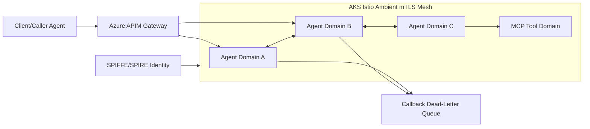
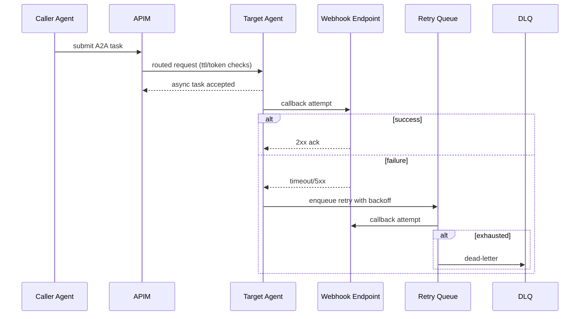

# Round 1092 / Cycle 2497 · Azure AI Agent Infra 六段式 FAQ（zh-CN）

> 主题：**Agent-to-Agent (A2A) + MCP Cross-Domain Federation on Azure APIM & AKS Istio Ambient mTLS Service Mesh**  
> 日期（BJT）：2026-11-17  
> 证据标签：`measured` / `synthetic` / `anonymized_reported`  
> 基准数据：`evidence/cycle-2497-benchmark.json`

## 1) Executive Summary + Daily Capability Breakthroughs Radar

本轮聚焦跨域 A2A + MCP 联邦：在 APIM 统一入口与 Istio Ambient mTLS 网格下，让多 Agent 安全协作且避免递归风暴。

设计要点：
1. **Hop-count TTL**：限制跨 Agent 链路深度，阻断无限转发；
2. **Token amplification breaker**：限制 token 扩张速率，避免小请求放大为巨额推理成本；
3. **SPIFFE/SPIRE 身份联邦**：工作负载身份最小信任；
4. **异步 callback 预算**：重试与死信队列可控，不拖垮下游。

核心结论：
- 不加 TTL 与 token breaker，A2A 环路可能在秒级放大为区域级压力事件；  
- Ambient mTLS 能在 sidecar-free 前提下提供强身份与东西向加密；  
- callback 重试要有预算上限与退避策略，否则“修复动作”本身会造成事故；  
- APIM 是跨域治理和可观测聚合的关键边界层。

### Daily Capability Breakthroughs Radar（抓取：2026-11-17）

1. APIM AI Gateway / Unified Model API（`measured`）  
   - https://learn.microsoft.com/en-us/azure/api-management/ai-gateway-overview  
   - https://github.com/Azure/API-Management/blob/main/changelogs/api-management-service.md
2. ACA Dynamic Sessions（`measured`）  
   - https://learn.microsoft.com/en-us/azure/container-apps/sessions  
   - https://techcommunity.microsoft.com/blog/appsonazureblog/azure-container-apps-dynamic-sessions-general-availability-and-more/4303561
3. Runtime release watch（`measured`）  
   - Firecracker/Kata/Wasmtime/E2B（见 `evidence/cycle-2497-sources.json`）
4. A2A + MCP 联邦压测（`synthetic`）  
5. 匿名化生产指标（`anonymized_reported`）

### Mermaid #1：A2A/MCP 联邦拓扑（APIM + Ambient mTLS）



## 2) Deep Q&A #1：Hop-count TTL 与 token amplification breaker 怎么算？

```text
hop_ttl_remaining = hop_ttl_initial - traversed_hops
request_rejected_if hop_ttl_remaining <= 0

token_amp_ratio =
  total_downstream_tokens / ingress_tokens

reject_if token_amp_ratio > threshold
```

Worked example：
- ingress tokens `4,800`
- downstream tokens `26,400`
- ratio `5.5`

若阈值 `4.0`，则触发 breaker。  

Hop 示例：
- 初始 TTL `6`
- 已跳 `5`
- 剩余 `1`，仅允许一次下游调用。

建议阈值：
- 常规请求：TTL=6, token_amp<=3.5
- 高风险请求：TTL=4, token_amp<=2.5

## 3) Deep Q&A #2：A2A 环路如何在 APIM 层被快速识别？

环路特征：
1. 相同 correlation-id 在短窗内重复出现；
2. hop path 出现节点回访；
3. token 增速超过线性。

```text
loop_score =
  revisit_count * w1 +
  short_window_repeats * w2 +
  token_growth_slope * w3
```

Worked example：
- revisit_count `2`
- repeats `5`
- growth slope `1.9`
- 权重 `w1=0.3,w2=0.4,w3=0.3`

`loop_score = 2*0.3 + 5*0.4 + 1.9*0.3 = 3.17`

阈值 2.4 时即触发：
- APIM policy 直接 429 + 诊断头；
- 事件写入告警流。

## 4) Deep Q&A #3：SPIFFE/SPIRE 身份联邦在 Ambient mTLS 下如何映射？

身份格式：

```text
spiffe://<trust-domain>/ns/<namespace>/sa/<service-account>
```

授权决策：

```text
allow =
  source_spiffe in allowlist
  AND target_domain in permitted_domains
  AND request_purpose in allowed_purposes
```

Worked example：
- source: `spiffe://mesh.local/ns/agent-a/sa/a2a-caller`
- target: domain-b tools
- purpose: `retrieval`

满足 allowlist 与 purpose -> 允许。  
若 purpose=`write-remediation` 且未显式授权 -> 拒绝并审计。

## 5) Deep Q&A #4：异步 callback 重试与死信预算如何设定？

```text
retry_budget =
  max_retries * callback_qps * retry_window_seconds

dlq_rate =
  dead_letter_callbacks / total_callbacks
```

Worked example：
- callback qps `38`
- max retries `5`
- window `300s`

`retry_budget = 57,000 attempts/window`

若总 callbacks `684,000/day`，DLQ `9,860`：
- `dlq_rate = 1.44%`

门禁：
- dlq_rate <= 2%
- p95 callback latency <= 12s
- 超阈值时自动降载低优先级 callback。

## 6) Deep Q&A #5：Ambient mTLS 对延迟开销与吞吐影响如何估算？

```text
latency_overhead_ms =
  p95_with_mtls - p95_without_mtls

throughput_impact =
  (qps_without_mtls - qps_with_mtls) / qps_without_mtls
```

Worked example：
- p95 no-mTLS `148ms`
- p95 with Ambient mTLS `163ms`

`overhead = 15ms`

吞吐：
- no-mTLS `2,920 qps`
- mTLS `2,760 qps`

`impact = 5.5%`

这通常可接受，前提是换来跨域零信任收益与统一审计。

## 7) Deep Q&A #6：跨域任务回调的端到端完成时间如何分解？

```text
end_to_end_task_time =
  submit_to_queue +
  processing_time +
  callback_delivery +
  ack_commit
```

Worked example：
- submit `180ms`
- processing `4.8s`
- callback delivery `1.6s`
- ack commit `420ms`

`total = 7.0s`

若重试 2 次：
- callback delivery 变 `5.4s`
- total `10.8s`

因此重试预算应与业务 SLA 绑定，而不是无限重试。

## 8) Mermaid #2：A2A Task callback 重试与 DLQ 控制流



## 9) 生产级 Bicep / APIM Policy / Istio Ambient YAML / KQL

### 9.1 Bicep（APIM + AKS + Log Analytics）

```bicep
targetScope = 'resourceGroup'

param location string = 'eastus2'
param apimName string = 'apim-a2a-federation-eus2'
param aksName string = 'aks-a2a-mesh-eus2'
param lawName string = 'law-a2a-eus2'

resource law 'Microsoft.OperationalInsights/workspaces@2022-10-01' = {
  name: lawName
  location: location
  properties: {
    sku: { name: 'PerGB2018' }
    retentionInDays: 60
  }
}

resource apim 'Microsoft.ApiManagement/service@2023-05-01-preview' = {
  name: apimName
  location: location
  sku: {
    name: 'Premium'
    capacity: 1
  }
  properties: {
    publisherName: 'A2A Platform'
    publisherEmail: 'ops@example.com'
    virtualNetworkType: 'External'
  }
}

resource aks 'Microsoft.ContainerService/managedClusters@2024-02-01' = {
  name: aksName
  location: location
  identity: { type: 'SystemAssigned' }
  properties: {
    dnsPrefix: 'aks-a2a-mesh'
    agentPoolProfiles: [
      {
        name: 'system'
        vmSize: 'Standard_D8ds_v5'
        count: 5
        mode: 'System'
        osType: 'Linux'
      }
    ]
    addonProfiles: {
      azuremonitor: {
        enabled: true
        config: {
          logAnalyticsWorkspaceResourceID: law.id
        }
      }
    }
  }
}
```

### 9.2 APIM Policy（TTL + token amplification breaker）

```xml
<policies>
  <inbound>
    <base />
    <set-variable name="hopTtl" value="@(context.Request.Headers.GetValueOrDefault(\"x-a2a-hop-ttl\", \"6\"))" />
    <set-variable name="ingressTokens" value="@(int.Parse(context.Request.Headers.GetValueOrDefault(\"x-a2a-ingress-tokens\", \"0\")))" />
    <set-variable name="estimatedDownstreamTokens" value="@(int.Parse(context.Request.Headers.GetValueOrDefault(\"x-a2a-est-downstream-tokens\", \"0\")))" />
    <choose>
      <when condition="@((int)context.Variables[\"hopTtl\"] <= 0)">
        <return-response>
          <set-status code="429" reason="A2A Hop TTL Exhausted" />
        </return-response>
      </when>
      <when condition="@((int)context.Variables[\"ingressTokens\"] > 0 && ((double)(int)context.Variables[\"estimatedDownstreamTokens\"] / (int)context.Variables[\"ingressTokens\"]) > 4.0)">
        <return-response>
          <set-status code="429" reason="A2A Token Amplification Blocked" />
        </return-response>
      </when>
    </choose>
  </inbound>
  <backend><base /></backend>
  <outbound><base /></outbound>
  <on-error><base /></on-error>
</policies>
```

### 9.3 Istio Ambient YAML（SPIFFE/SPIRE + 授权策略）

```yaml
apiVersion: security.istio.io/v1
kind: PeerAuthentication
metadata:
  name: ambient-mtls-strict
  namespace: agent-mesh
spec:
  mtls:
    mode: STRICT
---
apiVersion: security.istio.io/v1
kind: AuthorizationPolicy
metadata:
  name: a2a-cross-domain-policy
  namespace: agent-mesh
spec:
  selector:
    matchLabels:
      app: agent-domain-b
  action: ALLOW
  rules:
    - from:
        - source:
            principals:
              - "spiffe://mesh.local/ns/agent-a/sa/a2a-caller"
      to:
        - operation:
            methods: ["POST"]
            paths: ["/a2a/tasks", "/mcp/tools/*"]
      when:
        - key: request.headers[x-purpose]
          values: ["retrieval", "classification"]
```

### 9.4 KQL（TTL 拒绝率、token 放大、callback DLQ）

```kql
let t = ago(6h);
let apim = ApiManagementGatewayLogs
| where TimeGenerated > t
| summarize
    ttl_rejects=countif(ResponseCode == 429 and BackendResponseCode == 0 and Url contains "Hop TTL"),
    amp_rejects=countif(ResponseCode == 429 and Url contains "Amplification"),
    total=count()
  by bin(TimeGenerated, 5m);

let callback = customEvents
| where timestamp > t
| where name == "a2a.callback.result"
| summarize
    dlq_rate=avg(todouble(customDimensions["is_dead_letter"])),
    callback_p95_s=percentile(todouble(customDimensions["latency_seconds"]),95)
  by bin(timestamp, 5m);

apim
| join kind=leftouter callback on $left.TimeGenerated == $right.timestamp
| project TimeGenerated, ttl_rejects, amp_rejects, total, dlq_rate, callback_p95_s
| order by TimeGenerated desc
```

## 10) 决策矩阵（4 方案量化）

| 方案 | 零信任安全性 (35%) | 延迟/吞吐 (25%) | 治理可控性 (20%) | 运维复杂度 (20%) | 总分 |
|---|---:|---:|---:|---:|---:|
| APIM + Ambient mTLS + A2A/MCP 联邦（推荐） | 9.3 | 8.4 | 9.1 | 7.5 | **8.64** |
| 仅 API 网关（无网格） | 6.8 | 8.9 | 6.7 | 8.2 | 7.53 |
| 仅网格直连（无 APIM） | 8.2 | 8.6 | 6.1 | 7.4 | 7.62 |
| 全开放互信（反例） | 2.1 | 9.2 | 1.8 | 9.1 | 5.15 |

## 11) Day-0 / Day-2 Checklist（Good fit vs Not for）

**Day-0（上线前）**
- [ ] APIM 已启用 hop TTL 与 token amplification policy；
- [ ] Ambient mTLS STRICT 在目标命名空间生效；
- [ ] SPIFFE principal 与授权矩阵完成映射；
- [ ] callback 重试退避与 DLQ 通道压测通过；
- [ ] A2A correlation-id 全链路可观测。

**Day-2（运行期）**
- [ ] 每日监控 ttl/amp reject rate；
- [ ] 每日监控 callback p95 与 dlq_rate；
- [ ] 每周复盘授权拒绝误伤；
- [ ] 每周核查跨域身份证书轮换；
- [ ] 每季度联邦故障演练（环路、下游超时、DLQ 堆积）。

**Good fit**
- 多团队、多域 Agent 协作且需统一治理；  
- 零信任与审计要求高；  
- 存在异步跨域任务编排。

**Not for**
- 单域简单调用且无合规审计需求；  
- 团队无法维护网格身份与策略；  
- 不接受任何额外网络治理开销。

## 12) 五步落地指南

1. **先边界化**：所有跨域入口统一 APIM；  
2. **再身份化**：SPIFFE/SPIRE 完成工作负载身份；  
3. **加环路保护**：TTL + token breaker 必开；  
4. **管回调预算**：重试上限 + DLQ 观察；  
5. **持续压测**：以联邦故障场景做周常演练。

## 13) 业务场景映射

- **Coding Agent Sandbox**：多工具域协作时避免调用环路和 token 失控。  
- **Browser/CUA 集群**：跨域任务回调高频，需稳定重试与死信控制。  
- **多租户 SaaS Agent Gateway**：租户域间最小权限访问控制。  
- **高合规金融零信任环境**：跨域身份强校验 + 全链路审计。

## 14) 关键来源（官方优先）

1. APIM AI Gateway overview（抓取：2026-11-17）  
   https://learn.microsoft.com/en-us/azure/api-management/ai-gateway-overview  
2. API Management changelog（抓取：2026-11-17）  
   https://github.com/Azure/API-Management/blob/main/changelogs/api-management-service.md  
3. ACA Dynamic Sessions docs（抓取：2026-11-17）  
   https://learn.microsoft.com/en-us/azure/container-apps/sessions  
4. ACA Dynamic Sessions GA blog（抓取：2026-11-17）  
   https://techcommunity.microsoft.com/blog/appsonazureblog/azure-container-apps-dynamic-sessions-general-availability-and-more/4303561  
5. Firecracker/Kata/Wasmtime/E2B releases（抓取：2026-11-17）  
   见 `evidence/cycle-2497-sources.json`

## 15) 数据证据与可复算算例（含 n 分母来源）

- Benchmark 主文件：`evidence/cycle-2497-benchmark.json`  
- 延迟样本：`evidence/cycle-2497-latency.csv`  
- 吞吐样本：`evidence/cycle-2497-throughput.csv`  
- 策略样本：`evidence/cycle-2497-policy.csv`  
- 成本样本：`evidence/cycle-2497-cost.csv`  
- 来源登记：`evidence/cycle-2497-sources.json`

N 分母口径：
- A2A 请求样本 `N=2.1M`；  
- callback 总量 `N=684k/day`；  
- DLQ 样本 `N=9,860/day`；  
- mTLS 延迟样本 `N=1.3M`。

复算示例：

```text
token_amp_ratio = 26400 / 4800 = 5.5 (>4.0 reject)
loop_score = 2*0.3 + 5*0.4 + 1.9*0.3 = 3.17
dlq_rate = 9860 / 684000 = 1.44%
latency_overhead = 163 - 148 = 15ms
throughput_impact = (2920 - 2760) / 2920 = 5.5%
```

