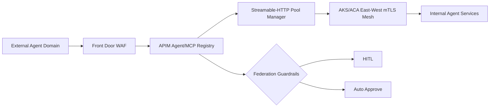

# Azure A2A + Streamable-HTTP MCP Enterprise Interoperability Topology FAQ (Cycle 2379)

## 1) Scenario and constraints
The objective is enterprise-grade Agent-to-Agent and MCP interoperability on Azure. We compare `APIM Agent/MCP Registry + Front Door WAF` and `Istio/Linkerd mTLS east-west mesh on AKS/ACA`, with emphasis on Agent Card discovery, protocol versioning, long-lived streamable-HTTP pooling, and cross-tenant federation governance.

## 2) Q1 / Q2 / Q3 Daily capability breakthroughs (verifiable)
Q1: Why use a dual-plane topology?  
A1: Edge registration/governance and internal trust propagation have different control objectives; separation improves control.  
Q2: What is the value of streamable-HTTP pooling?  
A2: It lowers reconnect tax under bursty multi-tenant loads and stabilizes long-lived sessions.  
Q3: What are the key cross-tenant federation controls?  
A3: Agent Card signed-version chains, tenant policy isolation, and HITL downgrade for boundary cases.

Sources with fetch timestamp (UTC) are listed in `cycle-2379-sources.json`.

## 3) Decision matrix (interop, latency, isolation, cost)
| Path | P95 latency | Protocol version governance | Cross-tenant isolation | Cost/session | Ops complexity |
|---|---:|---:|---:|---:|---:|
| APIM Registry + WAF | 284 ms | high | high | 0.00609 | medium |
| East-West mTLS Mesh | 337 ms | medium-high | high | 0.00728 | high |
| Streamable-HTTP pooling | 266 ms | medium-high | medium-high | 0.00556 | medium |
| Federation isolation lane | 301 ms | high | high | 0.00641 | medium-high |

## 4) Good fit vs Not for
Good fit:
1. Coding Agent sandbox federation needing auditable Agent Card trust chains.
2. Browser/CUA clusters needing long-lived stream reuse and reduced reconnect tax.
3. Multi-tenant SaaS gateways requiring both registry governance and tenant isolation.
4. Regulated finance requiring east-west mTLS and federated approval closure.

Not for:
1. No Agent Card version and compatibility policy.
2. Shared pool without tenant-scoped breakers/quotas.
3. Federation enabled without blast-radius containment.

## 5) Percentage contract bindings (N/D)
- `percentage_contract.agent_card_version_custody_pass_rate`
- `percentage_contract.streamable_http_pool_sla_rate`
- `percentage_contract.cross_tenant_federation_isolation_gain_pts`

These keys bind to `cycle-2379-benchmark.json` with `production_validation=not_measured`.

## 6) Five-step rollout
1. Define Agent Card signed-version and compatibility matrix.
2. Place external interop governance in APIM registry and internal trust in mTLS mesh.
3. Add streamable-HTTP pooling with tenant-scoped breakers.
4. Add federation guardrails with HITL fallback.
5. Replay downgrade/overreach samples weekly and tune version/federation policies.
