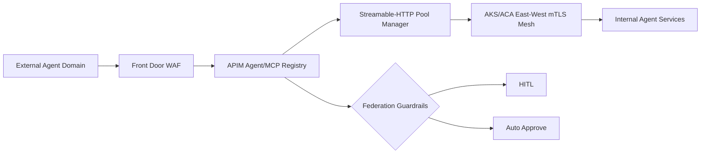

# Azure A2A + Streamable-HTTP MCP 企业互操作拓扑 FAQ（Cycle 2379）

## 1) 场景与约束
目标是构建企业级 Agent-to-Agent 与 MCP 互操作拓扑：比较 `APIM Agent/MCP Registry + Front Door WAF` 与 `AKS/ACA 上 Istio/Linkerd mTLS East-West Mesh` 的边界分工，关注 Agent Card 发现、协议版本演进、长连接池与跨租户联邦治理。

## 2) Q1 / Q2 / Q3 当日能力突破（可验证）
Q1：为什么要双平面拓扑？  
A1：边缘注册/治理与内部服务间信任传播职责不同，拆分后更可控。  
Q2：Streamable-HTTP 连接池价值是什么？  
A2：减少高并发场景下重连税，稳定长流式会话。  
Q3：跨租户联邦的关键控制点？  
A3：Agent Card 版本签名链 + 租户级策略隔离 + 降级到 HITL 审批。

来源与抓取时间（UTC）写入 `cycle-2379-sources.json`。

## 3) 决策矩阵（互操作、延迟、隔离、成本）
| 路径 | P95 延迟 | 协议版本治理 | 跨租户隔离 | 单会话成本 | 运维复杂度 |
|---|---:|---:|---:|---:|---:|
| APIM Registry + WAF | 284 ms | 高 | 高 | 0.00609 | 中 |
| East-West mTLS Mesh | 337 ms | 中高 | 高 | 0.00728 | 高 |
| Streamable-HTTP 池化 | 266 ms | 中高 | 中高 | 0.00556 | 中 |
| 联邦隔离通道 | 301 ms | 高 | 高 | 0.00641 | 中高 |

## 4) Good fit vs Not for
Good fit：
1. Coding Agent sandbox 联邦：需要 Agent Card 信任链可追溯。  
2. Browser/CUA 集群：需要长连接复用降低重连时延税。  
3. 多租户 SaaS：需要 registry 治理与租户隔离并存。  
4. 金融合规：需要东西向 mTLS 与联邦审批闭环。

Not for：
1. 没有 Agent Card 版本与兼容策略。  
2. 无租户级熔断/配额就直接共享连接池。  
3. 无跨租户爆炸半径控制就开启联邦互联。

## 5) Percentage contract bindings (N/D)
- `percentage_contract.agent_card_version_custody_pass_rate`
- `percentage_contract.streamable_http_pool_sla_rate`
- `percentage_contract.cross_tenant_federation_isolation_gain_pts`

以上键绑定 `cycle-2379-benchmark.json`，并标注 `production_validation=not_measured`。

## 6) 五步落地指南
1. 建立 Agent Card 版本签名与兼容矩阵。  
2. 把外部互联治理放在 APIM registry，内部身份传播放在 mTLS mesh。  
3. 引入 streamable-HTTP 池化与租户级熔断策略。  
4. 为跨租户联邦建立策略护栏与 HITL 回退路径。  
5. 周度回放协议降级/越权样本，迭代版本与联邦策略。
