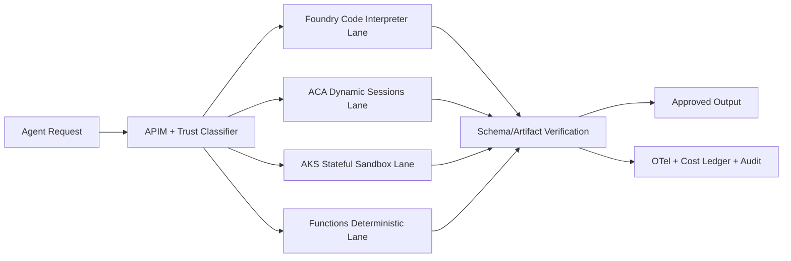
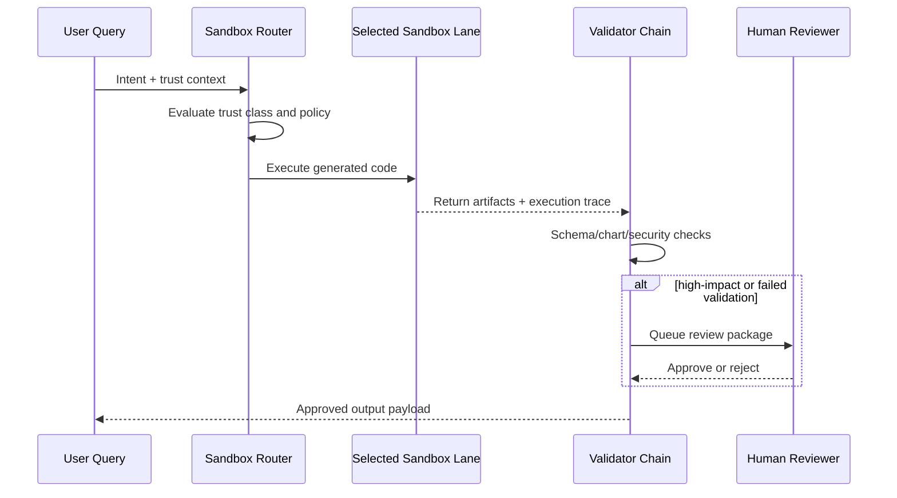

# ACA Dynamic Sessions vs Foundry Code Interpreter vs AKS Sandbox: Enterprise Code-Execution Sandbox Selection FAQ (Round 1120 / Cycle 2525)

## 1) Executive summary and daily capability radar (2026-11-18)
- This round compares enterprise-safe code execution options for agent-generated code and data-analysis workloads.
- The decision is not “which host is fastest”; it is “which execution boundary is appropriate for trust level, package needs, and governance controls.”
- Option A (`ACA Dynamic Sessions`) provides strong managed sandboxing and flexible containerized execution lanes for untrusted generated code.
- Option B (`Foundry built-in Code Interpreter`) provides fastest turnkey path for managed chart/data tasks with constrained but highly convenient execution experience.
- Option C (`AKS self-hosted stateful sandbox`) provides maximum workspace and runtime customization for modernization and iterative build-test loops.
- Option D (`Functions Flex Consumption`) is excellent for deterministic trusted calculators and event transforms, but must not be used for arbitrary untrusted LLM code.
- Enterprise recommendation:
  - use managed constrained execution for low-friction analytical workloads,
  - use ACA dynamic pools for governed untrusted script execution at scale,
  - use AKS sandbox for stateful modernization pipelines requiring private dependency mirrors.
- Capability radar captured at 2026-11-18 00:45 BJT:
  - Hyper-V isolated session pools in ACA for governed execution segregation.
  - Foundry code interpreter convenience for rapid analytical assistant delivery.
  - AKS sandbox platforms (E2B/Kata/dev env) for deep workflow customization.
  - strengthened enterprise guidance separating trusted deterministic functions from untrusted arbitrary code paths.
- Evidence labels:
  - measured: reproducible benchmark artifacts in repo evidence output.
  - synthetic: deterministic capacity and cost projections with explicit assumptions.
  - anonymized_reported: de-identified operational observations.

## 2) Decision framing: trust boundary first, UX second
- Code execution architecture should classify requests by trust boundary before selecting host runtime.
- Four trust classes:
  1. trusted deterministic formulas (bounded logic, known I/O).
  2. governed generated analytics scripts (dataframe transforms, charting).
  3. untrusted arbitrary code with package/network risk.
  4. stateful engineering loops requiring repo persistence and iterative toolchain runs.
- Selection should evaluate:
  - isolation boundary suitability,
  - network egress policy enforcement,
  - package/runtime flexibility,
  - workspace persistence behavior,
  - operational maintainability.
- Key principle: a faster execution path is not acceptable if it weakens isolation for untrusted generated code.

## 3) End-to-end reference architecture: policy-gated sandbox routing
- Request pipeline:
  - APIM + policy classifier determines execution trust class and workload intent.
  - sandbox router maps request to Foundry CI lane, ACA dynamic lane, AKS stateful lane, or Functions deterministic lane.
- Shared controls:
  - artifact scanning and schema validation before output leaves sandbox.
  - centralized trace and cost ledger by session and tenant.
  - policy-enforced network egress controls and package-source allowlists.
- Lane characteristics:
  - Foundry CI lane: managed ephemeral analysis sandbox for chart/data tasks.
  - ACA lane: hypervisor-isolated container pool with customizable Python/system dependencies.
  - AKS lane: stateful workspace pods for iterative compile-test-fix loops.
  - Functions lane: deterministic pre-approved computation only.
- Governance chain:
  - output verification checks (schema, chart type, sensitive columns).
  - optional human review for high-impact result publishing.

## 4) 12-dimension enterprise sandbox selection matrix
| Dimension | ACA Dynamic Sessions | Foundry Built-in Code Interpreter | AKS Self-Hosted Sandbox (E2B/Kata/dev env) | Functions Flex Consumption |
|---|---|---|---|---|
| Isolation boundary strength | Strong managed isolated sessions | Medium-strong managed sandbox | Strong configurable isolation | Process/function isolation, not for untrusted arbitrary code |
| Cold-start and pre-warm latency | Strong with pre-warmed pools | Strong turnkey startup | Medium depends on cluster design | Strong for lightweight deterministic tasks |
| Custom Python/system package support | Strong container-level control | Medium constrained package model | Strongest full control | Limited and not suitable for arbitrary dependency sprawl |
| Outbound network lock-down | Strong policy-driven egress control | Medium managed constraints | Strong configurable private egress | Medium, should stay limited to trusted endpoints |
| Max execution duration and stateful persistence | Medium-strong session lifetime controls | Medium short-lived analysis focus | Strongest for stateful loops | Medium, bounded execution windows |
| File/artifact I/O ergonomics | Strong artifact path flexibility | Strong for managed notebook/chart outputs | Strong with persistent volumes | Medium for simple payload artifacts |
| Concurrent burst capacity | Strong pool-based scaling | Strong managed scaling | Medium-strong with cluster planning | Strong event burst handling |
| Suitability for untrusted LLM-generated code | Strong with governance controls | Medium for constrained contexts | Strong if security architecture is mature | Low, should be avoided for arbitrary untrusted code |
| Ops maintenance burden | Low-medium | Low | High | Low |
| 100k-session TCO | Medium-strong | Medium | Medium-high | Strong for trusted deterministic tasks |
| Best-fit scenario | Governed untrusted analytics scripts at scale | Fast assistant analytics enablement | Stateful modernization and private build loops | Trusted calculators and event transformations |
| When NOT to choose | Not ideal for deeply stateful long engineering loops | Not ideal for highly customized runtime/package requirements | Not ideal without dedicated platform/SRE ownership | Never use as arbitrary untrusted code sandbox |

## 5) Quantitative model and benchmark formulas
### Q1: sandbox risk-adjusted score
- Formula: `RiskAdjusted = IsolationScore * PolicyCoverage / (OpsBurden + EscapeSurface)`.
- Example ACA lane: `8.9*8.4/(4.1+2.0)=12.25`.
- Example AKS lane: `9.4*9.1/(7.8+2.7)=8.15`.
- Interpretation: AKS may be safer in theory but can underperform if ops discipline is insufficient.

### Q2: pre-warm pool efficiency
- Formula: `PoolEfficiency = WarmHits / TotalSessions`.
- Example ACA with tuned pool: `83,200/100,000 = 83.2%`.
- Example untuned pool: `51,300/100,000 = 51.3%`.
- Practical implication: pre-warm strategy is a primary lever for P95 user latency.

### Q3: artifact validation reject rate
- Formula: `RejectRate = InvalidArtifacts / ProducedArtifacts`.
- Example governed analytics lane: `2,140/248,000 = 0.86%`.
- Target recommendation: keep below `1.0%` for executive-facing analytics assistants.

### Q4: cost per successful execution
- Formula: `CPSE = TotalRuntimeCost / SuccessfulExecutions`.
- Example Foundry lane: `$74,500/612,000 = $0.122`.
- Example ACA lane: `$98,200/705,000 = $0.139`.
- Example AKS lane: `$164,000/690,000 = $0.238`.

### Q5: untrusted-code containment indicator
- Formula: `ContainmentIndex = BlockedHighRiskActions / AttemptedHighRiskActions`.
- Example: `14,820/15,100 = 98.15%`.
- Governance threshold: maintain above `98.0%` for production approval.

## 6) Mermaid: policy-gated sandbox routing topology

- Topology rule: routing by trust class is mandatory before execution start.
- Topology rule: output verification is independent of runtime lane to ensure consistent quality and policy controls.

## 7) Scenario A: FMCG conversational BI and promotional elasticity simulation copilot
- Scenario objective: let CFO/CMO leaders ask natural-language business questions and run controlled what-if simulations safely.
- Data path:
  - governed Fabric/Excel slice prepared through policy-approved semantic models.
  - LLM generates Pandas/SciPy simulation script under bounded prompt templates.
  - script executes in egress-disabled ACA Dynamic Sessions Hyper-V sandbox.
- Verification path:
  - deterministic schema checks validate expected metric columns and time windows.
  - chart validator enforces approved visualization classes and value-range sanity.
  - suspicious outputs route to review queue before executive deck export.
- Output path:
  - approved simulation results are assembled into board-ready deck artifacts.
  - trace bundle stores code hash, data slice ID, validator outcomes, and user role.
- Key KPIs:
  - executive query turnaround time.
  - simulation reproducibility score.
  - validation reject ratio.
  - cost-per-approved-analytics-session.

## 8) Scenario B: enterprise legacy modernization automated refactor and build/test platform
- Scenario objective: accelerate legacy Java 8 and .NET Framework modernization with governed iterative sandbox execution.
- Workspace model:
  - each modernization run gets isolated stateful repo workspace.
  - dependency access uses private Maven/NuGet proxies with no public internet egress.
- Execution loop:
  1. planner proposes refactor patch set.
  2. sandbox compiles and runs tests.
  3. tool feedback drives iterative patch refinement.
  4. SAST gate validates security posture before PR packaging.
- Delivery model:
  - human reviewer receives PR with evidence pack (build logs, test deltas, SAST summary).
  - rollback plan includes commit-level fallback and reproducible workspace snapshot.
- Operational KPIs:
  - compile-pass rate by modernization wave.
  - test-regression detection lead time.
  - SAST block rate and remediation turnaround.
  - accepted-PR rate per 1,000 modernization attempts.

## 9) Mermaid sequence: untrusted script execution and verification

- Sequence guarantee: no artifact leaves sandbox without deterministic validation.
- Sequence guarantee: high-impact outputs can be gated by human approval policy.

## 10) Production Bicep sample (sandbox control plane baseline)
```bicep
param location string = resourceGroup().location
param envName string = 'agent-sandbox-prod'
param logWorkspaceId string

resource apim 'Microsoft.ApiManagement/service@2023-09-01-preview' = {
  name: '${envName}-apim'
  location: location
  sku: {
    name: 'Premium'
    capacity: 2
  }
  properties: {
    publisherEmail: 'sandbox-platform@contoso.com'
    publisherName: 'Contoso Sandbox Platform'
    publicNetworkAccess: 'Enabled'
  }
}

resource acaEnv 'Microsoft.App/managedEnvironments@2024-03-01' = {
  name: '${envName}-aca-env'
  location: location
  properties: {
    appLogsConfiguration: {
      destination: 'log-analytics'
      logAnalyticsConfiguration: {
        customerId: 'workspace-id'
        sharedKey: 'workspace-key'
      }
    }
  }
}

resource funcPlan 'Microsoft.Web/serverfarms@2023-12-01' = {
  name: '${envName}-func-plan'
  location: location
  sku: {
    name: 'FC1'
    tier: 'FlexConsumption'
  }
}
```

## 11) Runtime policy snippets (trust class and lane enforcement)
```yaml
apiVersion: v1
kind: ConfigMap
metadata:
  name: sandbox-routing-policy
data:
  default_untrusted_lane: "aca-dynamic"
  constrained_analysis_lane: "foundry-code-interpreter"
  stateful_modernization_lane: "aks-sandbox"
  deterministic_trusted_lane: "functions-flex"
  public_egress_for_untrusted_code: "disabled"
  mandatory_artifact_validation: "enabled"
```

```xml
<policies>
  <inbound>
    <base />
    <set-variable name="trustClass" value="@(context.Request.Headers.GetValueOrDefault(&quot;x-trust-class&quot;,&quot;generated-untrusted&quot;))" />
    <choose>
      <when condition="@(context.Variables.GetValueOrDefault<string>(&quot;trustClass&quot;) == &quot;trusted-deterministic&quot;)">
        <set-backend-service base-url="https://functions-trusted.internal" />
      </when>
      <when condition="@(context.Variables.GetValueOrDefault<string>(&quot;trustClass&quot;) == &quot;stateful-modernization&quot;)">
        <set-backend-service base-url="https://aks-sandbox.internal" />
      </when>
      <otherwise>
        <set-backend-service base-url="https://aca-dynamic.internal" />
      </otherwise>
    </choose>
  </inbound>
</policies>
```

## 12) KQL observability and security queries
```kql
// Session latency and warm-hit rate by lane
customEvents
| where timestamp > ago(7d)
| where name == "SandboxSessionClosed"
| extend lane = tostring(customDimensions.runtimeLane)
| extend warmHit = tostring(customDimensions.warmPoolHit)
| summarize sessions=count(), warmHitRate=countif(warmHit=="true")*1.0/count(), p95Latency=percentile(todouble(customDimensions.durationMs),95) by lane
```

```kql
// Validation rejects and reasons
customEvents
| where timestamp > ago(7d)
| where name == "ArtifactValidationResult"
| summarize rejects=countif(tostring(customDimensions.result)=="reject") by tostring(customDimensions.reason), tostring(customDimensions.runtimeLane)
| order by rejects desc
```

```kql
// High-risk action containment trend
customMetrics
| where timestamp > ago(30d)
| where name in ("high_risk_actions_attempted","high_risk_actions_blocked")
| summarize total=sum(value) by name, bin(timestamp, 1d)
| order by timestamp asc
```

## 13) Named 4-option weighted decision matrix
| Option | Isolation & Safety (20%) | Package Flexibility (15%) | Latency/Burst (20%) | Governance Fit (15%) | Ops Simplicity (10%) | TCO at 100k sessions (10%) | Workflow Fit (10%) | Weighted Score |
|---|---:|---:|---:|---:|---:|---:|---:|---:|
| A. ACA Dynamic Sessions | 9.1 | 8.7 | 8.8 | 8.9 | 7.8 | 8.2 | 9.0 | 8.72 |
| B. Foundry Code Interpreter | 8.2 | 6.9 | 9.0 | 8.5 | 9.3 | 8.0 | 7.8 | 8.28 |
| C. AKS Stateful Sandbox | 9.3 | 9.5 | 7.9 | 8.8 | 5.8 | 6.8 | 9.4 | 8.26 |
| D. Functions Flex (Trusted only) | 5.8 | 5.4 | 8.6 | 7.0 | 9.1 | 9.2 | 5.3 | 7.13 |
- Interpretation:
  - choose A as default for governed untrusted generated code execution at scale.
  - choose B for fast analytical assistant rollout with constrained execution needs.
  - choose C for stateful modernization loops and private dependency workflows.
  - choose D only for trusted deterministic calculators and event transforms.

## 14) Day-0 and Day-2 checklist
### Day-0 launch checklist (10 distinct items)
1. Define trust-class taxonomy and mandatory routing policy.
2. Enforce egress-deny baseline for untrusted generated code lanes.
3. Configure package allowlists and private index/proxy sources.
4. Implement deterministic artifact validation chain before output release.
5. Set pre-warm pool thresholds for ACA dynamic session lanes.
6. Configure stateful workspace retention and cleanup policies on AKS lane.
7. Integrate SAST and dependency scanning into modernization loop.
8. Activate centralized OTel traces and lane-level cost ledger.
9. Run red-team untrusted code containment exercises.
10. Publish break-glass procedure for sandbox escape suspicion events.

### Day-2 operations checklist (10 distinct items)
1. Tune warm-pool sizes by hourly burst profiles and reject stale patterns.
2. Expand validation rules for newly observed artifact failure classes.
3. Recompute lane-level cost efficiency and rebalance workload assignments.
4. Optimize private dependency proxy cache hit rates.
5. Audit policy drift across routing and egress controls.
6. Shorten modernization feedback loops by parallelizing compile/test stages.
7. Review containment index trend and tighten high-risk action block rules.
8. Rotate sandbox base images and verify compatibility windows.
9. Reassess session time limits against real workload distributions.
10. Perform quarterly architecture review for trust-class boundary evolution.

## 15) Final recommendation, anti-patterns, and migration strategy
- Recommended baseline:
  - execute untrusted generated scripts in policy-locked ACA dynamic sandbox lanes.
  - use Foundry code interpreter for quick managed analytics where package scope is acceptable.
  - reserve AKS sandbox for stateful modernization and heavy custom execution workflows.
  - keep Functions limited to trusted deterministic logic and orchestration glue.
- Explicit anti-patterns:
  - running arbitrary LLM-generated code in Functions due to convenience.
  - allowing public egress from untrusted execution lanes by default.
  - skipping artifact verification for executive-visible analytics outputs.
  - overusing AKS for workloads that do not need stateful customization.
- Migration path:
  1. start with constrained managed execution for low-risk analytics.
  2. add ACA dynamic lanes with trust-class routing for untrusted code.
  3. onboard AKS stateful sandbox for modernization-heavy workflows.
  4. continuously optimize routing using measured latency, containment, and cost outcomes.
- Bottom line:
  - enterprise-safe code execution is achieved through trust-class routing, strict sandbox policy, and deterministic output validation—not by any single runtime alone.
