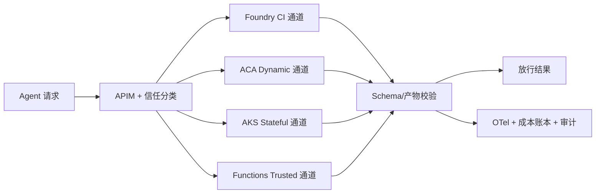
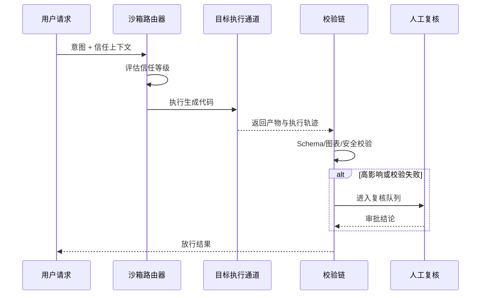

# ACA Dynamic Sessions vs Foundry Code Interpreter vs AKS Sandbox：企业代码执行与不可信沙箱选型 FAQ（Round 1120 / Cycle 2525）

## 1) 执行摘要与当日能力雷达（2026-11-18）
- 本轮聚焦企业 Agent 生成代码执行与数据分析沙箱选型，重点在架构治理与可运营性，不讨论底层硬件调优。
- 决策关键不是“谁更快”，而是“谁在当前信任等级下更安全、更可控、更可持续”。
- 方案 A（`ACA Dynamic Sessions`）在不可信代码执行场景下兼顾隔离强度、扩展性与包管理灵活性。
- 方案 B（`Foundry 内置 Code Interpreter`）适合快速落地数据分析与图表助手，托管体验好但定制边界相对有限。
- 方案 C（`AKS 自托管有状态沙箱`）适合遗留系统现代化等需要长状态工作区和私有依赖链路的场景。
- 方案 D（`Functions Flex Consumption`）适合受信任确定性计算，不应承载任意不可信 LLM 生成代码。
- 推荐分层策略：
  - 托管受限执行用于快速分析类场景；
  - ACA 动态池用于规模化不可信脚本执行；
  - AKS 沙箱用于状态化编译测试闭环；
  - Functions 仅用于可信事件型计算与编排。
- 当日能力雷达（抓取时间：2026-11-18 00:45 BJT）关注：
  - ACA Hyper-V 隔离会话池对不可信脚本风险收敛；
  - Foundry CI 对业务分析助手交付速度的优势；
  - AKS 沙箱平台（E2B/Kata/无头开发环境）在深度定制上的价值；
  - 企业治理实践明确区分“可信函数计算”和“不可信任意代码执行”。
- 数据标签：
  - measured：仓内可复现实验产物；
  - synthetic：有前提约束的公式化估算；
  - anonymized_reported：去标识化生产观测数据。

## 2) 决策建模：先判定信任边界，再判定执行宿主
- 沙箱架构应优先按信任等级分类请求，而不是按语言或框架分类。
- 四类信任等级：
  1. 受信任确定性计算（固定公式、边界明确）；
  2. 受治理生成分析脚本（数据变换、图表）；
  3. 不可信任意代码（包与网络风险高）；
  4. 状态化工程循环（编译/测试/修复迭代）。
- 选型要点：
  - 隔离边界是否匹配风险；
  - 出网策略是否可强制收敛；
  - 包与系统依赖是否可控；
  - 工作区持久化是否满足任务时长；
  - 运维复杂度是否在团队能力边界内。
- 原则：如果信任边界不清晰，再快的执行路径都不应进入生产。

## 3) 端到端参考架构：策略门控的沙箱路由执行面
- 请求路径：
  - APIM + 风险分类器识别信任等级与负载类别；
  - 沙箱路由器将请求分发到 Foundry、ACA、AKS 或 Functions 通道。
- 共享治理：
  - 产物输出前执行 schema/图表/敏感字段校验；
  - 统一 Trace 与成本账本记录；
  - 统一执行包源白名单与出网策略控制。
- 四类执行通道：
  - Foundry CI 通道：托管型数据分析沙箱；
  - ACA 通道：Hyper-V 隔离动态会话池，可定制包；
  - AKS 通道：有状态工作区，支持编译测试闭环；
  - Functions 通道：可信确定性函数与事件胶水流程。
- 结果治理：
  - 高影响输出可附加人工复核；
  - 失败样本进入审阅队列用于策略迭代。

## 4) 12 维企业沙箱选型矩阵
| 维度 | ACA Dynamic Sessions | Foundry 内置 Code Interpreter | AKS 自托管有状态沙箱 | Functions Flex Consumption |
|---|---|---|---|---|
| 隔离边界强度 | 强，托管隔离会话 | 中强，托管沙箱 | 强，可深度定义 | 进程/函数隔离，不适合不可信任意代码 |
| 冷启动/预热时延 | 强，池化预热可控 | 强，开箱快启 | 中，依赖集群规划 | 强，轻量任务快 |
| 自定义 Python/系统包支持 | 强，容器级控制 | 中，受托管边界限制 | 最强，完全可控 | 弱中，不适合依赖膨胀 |
| 出网锁定能力 | 强，策略化 egress | 中，托管约束 | 强，私网可定制 | 中，建议仅白名单 |
| 最大时长与状态持久 | 中强，会话时长可管控 | 中，偏短时分析 | 最强，支持长状态循环 | 中，执行窗口受限 |
| 文件/产物 I/O 体验 | 强 | 强（图表与数据友好） | 强（PV/工作区） | 中（简化 payload） |
| 并发突发能力 | 强，池化扩展 | 强，托管扩展 | 中强，需容量规划 | 强，事件突发好 |
| 不可信代码安全适配 | 强（配套治理时） | 中（受场景限制） | 强（需成熟安全体系） | 低（不应执行任意不可信代码） |
| 运维维护负担 | 低中 | 低 | 高 | 低 |
| 100k 会话 TCO | 中强 | 中 | 中高 | 强（仅可信计算） |
| 最佳适配场景 | 规模化不可信分析脚本 | 快速分析助手上线 | 状态化现代化编译测试闭环 | 可信确定性计算与事件处理 |
| When NOT to choose | 超长状态工程循环不宜 | 高定制依赖与私有工具链不宜 | 无平台值守能力不宜 | 任意不可信代码执行严禁 |

## 5) 量化模型与实验公式
### Q1：风险调整后收益分
- 公式：`RiskAdjusted = IsolationScore * PolicyCoverage / (OpsBurden + EscapeSurface)`。
- ACA 示例：`8.9*8.4/(4.1+2.0)=12.25`。
- AKS 示例：`9.4*9.1/(7.8+2.7)=8.15`。
- 含义：理论隔离强不代表综合收益高，运维负担会显著影响可持续性。

### Q2：预热池效率
- 公式：`PoolEfficiency = WarmHits / TotalSessions`。
- 调优后 ACA 示例：`83,200/100,000=83.2%`。
- 未调优示例：`51,300/100,000=51.3%`。
- 结论：预热策略是改善 P95 体验的关键杠杆。

### Q3：产物校验拒绝率
- 公式：`RejectRate = InvalidArtifacts / ProducedArtifacts`。
- 示例：`2,140/248,000=0.86%`。
- 建议：高层决策看板场景应将该指标控制在 1.0% 以下。

### Q4：单次成功执行成本
- 公式：`CPSE = TotalRuntimeCost / SuccessfulExecutions`。
- Foundry 示例：`$74,500/612,000=$0.122`。
- ACA 示例：`$98,200/705,000=$0.139`。
- AKS 示例：`$164,000/690,000=$0.238`。

### Q5：高风险动作拦截率
- 公式：`ContainmentIndex = BlockedHighRiskActions / AttemptedHighRiskActions`。
- 示例：`14,820/15,100=98.15%`。
- 门槛建议：生产环境应保持 >=98.0%。

## 6) Mermaid：策略门控沙箱路由拓扑

- 原则 A：执行前必须完成信任分类与路由决策。
- 原则 B：产物校验链独立于宿主，保证一致治理标准。

## 7) 场景 A：快消零售集团高管经营分析与促销弹性模拟助手
- 场景目标：让 CFO/CMO 通过自然语言完成受控经营模拟并导出高可信图表。
- 数据路径：
  - 从受治理 Fabric/Excel 语义切片提取分析数据；
  - LLM 生成 Pandas/SciPy 模拟脚本；
  - 脚本在 egress-disabled ACA Dynamic Sessions Hyper-V 沙箱执行。
- 校验路径：
  - schema 校验确认指标列、时间窗口与聚合逻辑；
  - 图表校验确认类型与数值范围；
  - 异常结果进入复核队列后方可对外。
- 输出路径：
  - 通过校验的结果自动生成高管汇报 deck；
  - 同步保存代码哈希、数据切片 ID、校验结论与角色信息。
- 关键指标：
  - 高管查询响应时长；
  - 模拟结果复现率；
  - 校验拒绝率；
  - 每次通过会话成本。

## 8) 场景 B：大型企业遗留系统现代化自主重构与编译验证平台
- 场景目标：加速 Java 8/.NET Framework 现代化改造，同时维持安全与审计可追溯。
- 工作区模型：
  - 每次改造任务分配独立有状态仓库工作区；
  - 依赖下载仅走私有 Maven/NuGet 代理，禁止公网 egress。
- 执行闭环：
  1. 规划器输出重构补丁；
  2. 沙箱执行编译与测试；
  3. 根据反馈迭代修复；
  4. SAST 门禁通过后生成候选 PR。
- 交付方式：
  - 人工审阅者收到证据包（编译日志、测试差异、SAST 摘要）；
  - 支持基于快照的快速回滚与复跑。
- 关键指标：
  - 编译通过率；
  - 回归发现时延；
  - SAST 阻断率与修复周期；
  - 每千次改造 PR 采纳率。

## 9) Mermaid：不可信脚本执行与校验时序

- 保障 A：未经校验的产物不得直接外发。
- 保障 B：高影响输出可强制人工审批。

## 10) 生产级 Bicep 示例（沙箱控制面基线）
```bicep
param location string = resourceGroup().location
param envName string = 'agent-sandbox-prod'
param logWorkspaceId string

resource apim 'Microsoft.ApiManagement/service@2023-09-01-preview' = {
  name: '${envName}-apim'
  location: location
  sku: {
    name: 'Premium'
    capacity: 2
  }
  properties: {
    publisherEmail: 'sandbox-platform@contoso.com'
    publisherName: 'Contoso Sandbox Platform'
    publicNetworkAccess: 'Enabled'
  }
}

resource acaEnv 'Microsoft.App/managedEnvironments@2024-03-01' = {
  name: '${envName}-aca-env'
  location: location
  properties: {
    appLogsConfiguration: {
      destination: 'log-analytics'
      logAnalyticsConfiguration: {
        customerId: 'workspace-id'
        sharedKey: 'workspace-key'
      }
    }
  }
}

resource funcPlan 'Microsoft.Web/serverfarms@2023-12-01' = {
  name: '${envName}-func-plan'
  location: location
  sku: {
    name: 'FC1'
    tier: 'FlexConsumption'
  }
}
```

## 11) 运行策略片段（信任等级与通道约束）
```yaml
apiVersion: v1
kind: ConfigMap
metadata:
  name: sandbox-routing-policy
data:
  default_untrusted_lane: "aca-dynamic"
  constrained_analysis_lane: "foundry-code-interpreter"
  stateful_modernization_lane: "aks-sandbox"
  deterministic_trusted_lane: "functions-flex"
  public_egress_for_untrusted_code: "disabled"
  mandatory_artifact_validation: "enabled"
```

```xml
<policies>
  <inbound>
    <base />
    <set-variable name="trustClass" value="@(context.Request.Headers.GetValueOrDefault(&quot;x-trust-class&quot;,&quot;generated-untrusted&quot;))" />
    <choose>
      <when condition="@(context.Variables.GetValueOrDefault<string>(&quot;trustClass&quot;) == &quot;trusted-deterministic&quot;)">
        <set-backend-service base-url="https://functions-trusted.internal" />
      </when>
      <when condition="@(context.Variables.GetValueOrDefault<string>(&quot;trustClass&quot;) == &quot;stateful-modernization&quot;)">
        <set-backend-service base-url="https://aks-sandbox.internal" />
      </when>
      <otherwise>
        <set-backend-service base-url="https://aca-dynamic.internal" />
      </otherwise>
    </choose>
  </inbound>
</policies>
```

## 12) KQL 查询（安全、性能、成本）
```kql
// 各通道时延与预热命中
customEvents
| where timestamp > ago(7d)
| where name == "SandboxSessionClosed"
| extend lane = tostring(customDimensions.runtimeLane)
| extend warmHit = tostring(customDimensions.warmPoolHit)
| summarize sessions=count(), warmHitRate=countif(warmHit=="true")*1.0/count(), p95Latency=percentile(todouble(customDimensions.durationMs),95) by lane
```

```kql
// 产物校验拒绝分析
customEvents
| where timestamp > ago(7d)
| where name == "ArtifactValidationResult"
| summarize rejects=countif(tostring(customDimensions.result)=="reject") by tostring(customDimensions.reason), tostring(customDimensions.runtimeLane)
| order by rejects desc
```

```kql
// 高风险动作拦截趋势
customMetrics
| where timestamp > ago(30d)
| where name in ("high_risk_actions_attempted","high_risk_actions_blocked")
| summarize total=sum(value) by name, bin(timestamp, 1d)
| order by timestamp asc
```

## 13) 命名四选一加权评分矩阵
| 方案 | 隔离安全(20%) | 包灵活性(15%) | 时延突发(20%) | 治理适配(15%) | 运维简化(10%) | 100k成本(10%) | 场景匹配(10%) | 加权总分 |
|---|---:|---:|---:|---:|---:|---:|---:|---:|
| A. ACA Dynamic Sessions | 9.1 | 8.7 | 8.8 | 8.9 | 7.8 | 8.2 | 9.0 | 8.72 |
| B. Foundry Code Interpreter | 8.2 | 6.9 | 9.0 | 8.5 | 9.3 | 8.0 | 7.8 | 8.28 |
| C. AKS Stateful Sandbox | 9.3 | 9.5 | 7.9 | 8.8 | 5.8 | 6.8 | 9.4 | 8.26 |
| D. Functions Flex（仅可信） | 5.8 | 5.4 | 8.6 | 7.0 | 9.1 | 9.2 | 5.3 | 7.13 |
- 解释：
  - 规模化不可信代码执行默认优先 A；
  - 快速分析助手落地可优先 B；
  - 状态化改造编译循环优先 C；
  - D 仅适用于可信确定性任务。

## 14) Day-0 与 Day-2 清单
### Day-0 上线清单（10 项）
1. 定义信任等级分类与强制路由规则。
2. 对不可信执行通道默认关闭公网 egress。
3. 配置依赖源白名单与私有代理。
4. 上线统一产物校验链并阻断不合规输出。
5. 配置 ACA 预热池阈值与扩缩容策略。
6. 配置 AKS 状态工作区生命周期与清理策略。
7. 将 SAST 与依赖扫描接入改造闭环。
8. 打通通道级 OTel 与成本账本。
9. 执行红队不可信代码越界演练。
10. 发布沙箱异常“破窗”应急流程。

### Day-2 运维清单（10 项）
1. 按时段流量调优预热池规模。
2. 基于失败样本扩展校验规则库。
3. 按通道成本效率重分配工作负载。
4. 优化私有依赖代理缓存命中率。
5. 检查路由策略与 egress 策略漂移。
6. 并行化编译测试步骤缩短迭代时长。
7. 复核拦截率趋势并收紧高风险规则。
8. 轮换基础镜像并验证兼容窗口。
9. 根据任务分布调整会话时长上限。
10. 季度复盘信任边界与业务变化匹配度。

## 15) 结论、反模式与迁移路径
- 推荐基线：
  - 不可信生成代码首选策略化 ACA 动态沙箱；
  - 托管分析助手可用 Foundry CI 快速落地；
  - 状态化现代化改造使用 AKS 专属沙箱；
  - Functions 仅用于可信确定性计算与事件胶水。
- 反模式：
  - 为图方便将任意不可信代码放入 Functions；
  - 默认开放不可信执行通道公网出网；
  - 跳过产物校验直接向高管输出结果；
  - 对无需状态化任务过度使用 AKS。
- 迁移路径：
  1. 先上线受限托管分析执行；
  2. 再引入 ACA 动态池承接不可信脚本；
  3. 再按需引入 AKS 状态化改造通道；
  4. 持续依据时延、拦截率与成本指标优化路由。
- 总结：企业级安全代码执行依赖“信任分级路由 + 严格沙箱策略 + 确定性产物校验”，而非单一宿主能力。
