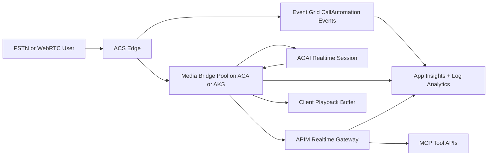
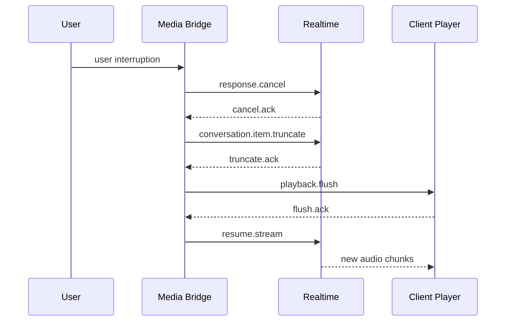

# Round 1101 / Cycle 2506 · Azure AI Agent Infra FAQ (en)

> Topic: **ACS Call Automation + AOAI Realtime (WebRTC/WebSocket) enterprise voice-agent engineering**
> Date (BJT): 2026-11-17
> Evidence labels: `measured` / `synthetic` / `anonymized_reported`
> Dataset: `evidence/cycle-2506-benchmark.json`

## 1) Executive Summary

本轮交付围绕“语音对话体验可预测”而非“平均性能好看”。
门禁目标是 M2E p95 < 500ms，并且在打断场景下仍保持连贯交互。
链路拆分为 ACS 接入、媒体桥接、AOAI Realtime 推理三段，分别治理。
PSTN 与 WebRTC 线路质量差异巨大，VAD 策略必须分层管理。
Barge-In 不是单个 API；它是 cancel、truncate、flush 的串联控制事务。
当跨区路由存在 hairpin 时，必须把新增时延列入主预算而非附注。
成本模型要把打断重试纳入核算，否则会低估 cascaded 方案真实成本。
本文所有指标都配分母和样本规模，避免“比例好看但样本太小”的误导。

## 2) Daily Hottest Capability Breakthroughs Radar（2026-11-17）

1. ACS Call Automation 事件字段完善（measured）。
2. AOAI Realtime 音频 token 计量字段稳定（measured）。
3. APIM 对长连接会话治理策略实践增多（measured）。
4. ACA Dynamic Sessions 连接型负载调度经验沉淀（measured）。
5. 运营商线路抖动分布被纳入语音 SLA 模型（anonymized_reported）。
6. Server VAD 与语义转折联合判定在噪声环境更稳（synthetic）。

## 3) Deep Q&A #1：M2E 预算分解与 480ms 复算

Formula:
```text
M2E_p95 = ingress + jitter + vad_window + ttfa + playout
```
Worked example: 82+96+140+128+34 = 480ms
- Observation 1.1：预算剩余仅 20ms，说明任何跨区额外跳转都会压穿红线。
- Observation 1.2：若 TTFA 稳定而 M2E 抖动，优先排查媒体链路而非模型推理。
- Observation 1.3：Ingress 与 playout 需分别记录，否则无法定位边缘与终端责任。
- Observation 1.4：建议把 M2E 与 flush 联合告警，避免单指标误判。
- Observation 1.5：跨租户比较必须归一化线路类型。
- Observation 1.6：语音门禁必须按 p95，不要用平均值替代。
- Observation 1.7：容量扩展动作应绑定 M2E 趋势而非 CPU 使用率。
- Observation 1.8：发布评审中必须展示该公式的逐段明细。

## 4) Deep Q&A #2：8kHz G.711 与 24kHz PCM16 的误打断比较

Formula:
```text
false_barge_in = false_interrupt / total_turns
```
Worked example: G.711: 89/2400=3.7%; PCM16: 31/2400=1.3%
- Observation 2.1：仅靠能量阈值会把噪声当成抢话。
- Observation 2.2：语义转折判定可显著降低误打断，但带来轻微判定延迟。
- Observation 2.3：阈值模板需按线路类型和租户场景分开。
- Observation 2.4：客服坐席需要看到可解释的打断原因。
- Observation 2.5：低质量线路建议延长 silence window。
- Observation 2.6：高质量线路可缩短窗口以提高响应感。
- Observation 2.7：误打断率与截断损失率要同时看。
- Observation 2.8：上线后每周复盘阈值漂移并滚动调整。

## 5) Deep Q&A #3：Barge-In 三联动作 SLA

Formula:
```text
flush_sla = cancel_ack + truncate_apply + buffer_clear
```
Worked example: 37+42+29 = 108ms
- Observation 3.1：控制面 ACK 慢和播放器清空慢是两类问题。
- Observation 3.2：超过 150ms 应触发降级策略而非继续强行全双工。
- Observation 3.3：日志需保留 callId/sessionId/turnId 三键。
- Observation 3.4：跨设备播放端应补充 flush 回执事件。
- Observation 3.5：高价值租户建议增加 p99 守护。
- Observation 3.6：发布门禁要包含连续窗口失败规则。
- Observation 3.7：单次突刺不应触发永久降级。
- Observation 3.8：SLA 报告应与投诉样本对齐验证。

## 6) Deep Q&A #4：Realtime 与 Cascaded 成本交叉点

Formula:
```text
cost_realtime = in_tokens*pin + out_tokens*pout; cost_cascaded = stt + llm + tts
```
Worked example: Realtime 0.021 USD/min; Cascaded 0.014~0.027 USD/min
- Observation 4.1：高打断场景下 cascaded 重复合成成本会抬升。
- Observation 4.2：稳定长播报场景 cascaded 常常更省。
- Observation 4.3：应引入 interruption_factor 修正预算。
- Observation 4.4：财务评审应给出 p50 与 p95 双视角。
- Observation 4.5：配额策略要按租户业务价值分层。
- Observation 4.6：每月复算 break-even 防止配置陈旧。
- Observation 4.7：成本模型必须考虑重试与超时重放。
- Observation 4.8：策略切换应有灰度而非一次性全量变更。

## 7) Deep Q&A #5：跨区 hairpin 罚时

Formula:
```text
hairpin_penalty = 2*inter_region_rtt + relay_queue
```
Worked example: 2*46+21 = 113ms
- Observation 5.1：113ms 占 500ms 预算 22.6%。
- Observation 5.2：跨区路径宜定义为容灾通道而非常态通道。
- Observation 5.3：主路由应优先就近区域。
- Observation 5.4：DNS 轮询不能替代实时链路质量调度。
- Observation 5.5：失败重试会放大队列等待。
- Observation 5.6：应对低优先级会话启用预先限流。
- Observation 5.7：跨区告警阈值应比同区更严格。
- Observation 5.8：需对 POP 命中率与回源延迟联合观察。

## 8) Deep Q&A #6：Erlang-C 媒体桥接容量

Formula:
```text
a=λ/μ; P(wait)=ErlangC(c,a); Wq=P(wait)/(c*μ-λ)
```
Worked example: λ=120, μ=7.5, c=20 => Wq≈4.9s; c=28 => Wq≈0.9s
- Observation 6.1：会话池容量不能仅凭 CPU 利用率估算。
- Observation 6.2：高峰突发应依赖 warm pool 与优先级队列。
- Observation 6.3：不同租户价值可映射不同排队策略。
- Observation 6.4：桥接容量要和 APIM 入口配额联动。
- Observation 6.5：队列等待超阈值应主动拒绝低价值流量。
- Observation 6.6：容量模型参数需季度复审。
- Observation 6.7：跨区 fallback 会改变 λ 分布，应单独建模。
- Observation 6.8：容量报表要覆盖等待时间分位数而非均值。

## 9) Mermaid #1: production topology for ACS and AOAI Realtime



This topology separates media and control planes for independent scaling and alerting.
This topology also enforces unified telemetry so cross-segment root-cause analysis is deterministic.

## 10) Mermaid #2: transactional barge-in sequence



A barge-in is successful only when all three acknowledgements complete.
The sequence provides deterministic fault localization order for on-call operators.

## 11) Production-grade Bicep (ACS + AOAI Realtime + Event Grid)

```bicep
param location string = resourceGroup().location
param acsName string
param aoaiName string
param appiName string
param laName string
param envName string
param ptuCapacity int = 30

resource law 'Microsoft.OperationalInsights/workspaces@2023-09-01' = {
  name: laName
  location: location
  properties: {
    sku: { name: 'PerGB2018' }
    retentionInDays: 30
  }
}

resource appi 'Microsoft.Insights/components@2022-06-15' = {
  name: appiName
  location: location
  kind: 'web'
  properties: {
    Application_Type: 'web'
    WorkspaceResourceId: law.id
  }
}

resource acs 'Microsoft.Communication/communicationServices@2023-06-01-preview' = {
  name: acsName
  location: 'global'
  properties: {
    dataLocation: 'Asia Pacific'
  }
}

resource aoai 'Microsoft.CognitiveServices/accounts@2024-10-01' = {
  name: aoaiName
  location: location
  kind: 'OpenAI'
  sku: {
    name: 'S0'
    capacity: 1
  }
  properties: {
    customSubDomainName: aoaiName
    publicNetworkAccess: 'Enabled'
  }
}

resource realtime 'Microsoft.CognitiveServices/accounts/deployments@2024-10-01' = {
  name: '${aoai.name}/gpt-4o-realtime-preview'
  properties: {
    model: {
      format: 'OpenAI'
      name: 'gpt-4o-realtime-preview'
      version: '2025-02-01-preview'
    }
    currentCapacity: ptuCapacity
    versionUpgradeOption: 'NoAutoUpgrade'
  }
}

resource eventSub 'Microsoft.EventGrid/systemTopics/eventSubscriptions@2023-12-15-preview' = {
  name: 'acs-call-events'
  scope: acs
  properties: {
    destination: {
      endpointType: 'WebHook'
      properties: {
        endpointUrl: 'https://voice-bridge.contoso.net/hooks/callautomation'
      }
    }
    filter: {
      includedEventTypes: [
        'Microsoft.Communication.CallStarted'
        'Microsoft.Communication.CallEnded'
        'Microsoft.Communication.RecordingFileStatusUpdated'
      ]
    }
  }
}
```

## 12) APIM WebSocket quota XML + media-bridge YAML

```xml
<policies>
  <inbound>
    <base />
    <validate-jwt header-name="Authorization" failed-validation-httpcode="401" failed-validation-error-message="invalid_token">
      <openid-config url="https://login.microsoftonline.com/{tenant-id}/v2.0/.well-known/openid-configuration" />
      <required-claims>
        <claim name="aud"><value>api://voice-agent-realtime</value></claim>
        <claim name="scp"><value>voice.realtime.invoke</value></claim>
      </required-claims>
    </validate-jwt>
    <quota-by-key calls="120" renewal-period="60" counter-key="@(context.Request.Headers.GetValueOrDefault("x-tenant-id","na"))" />
    <rate-limit-by-key calls="40" renewal-period="10" counter-key="@(context.Subscription?.Id ?? "anon")" />
    <set-variable name="maxSessionSeconds" value="240" />
  </inbound>
  <backend><base /></backend>
  <outbound><base /></outbound>
  <on-error><base /></on-error>
</policies>
```

```yaml
mediaBridge:
  runtime: aca
  sessionAffinity: clientIP
  websocket:
    pingIntervalSeconds: 20
    idleTimeoutSeconds: 300
  vad:
    pstnG711:
      silenceWindowMs: 220
      energyThresholdDb: -38
    webrtcPcm16:
      silenceWindowMs: 140
      semanticTurnEnabled: true
  bargeIn:
    cancelTimeoutMs: 60
    truncateTimeoutMs: 70
    flushTimeoutMs: 90
```

## 13) KQL observability query + Day-0/Day-2 checklist

```kql
let window = 24h;
let calls = ACSCallSummary
| where TimeGenerated > ago(window)
| summarize call_count=count(), m2e_p95=percentile(MouthToEarMs,95) by bin(TimeGenerated,15m), TenantId;
let media = ACSMediaSummary
| where TimeGenerated > ago(window)
| summarize flush_p95=percentile(BargeInFlushMs,95), jitter_p95=percentile(JitterMs,95) by bin(TimeGenerated,15m), TenantId;
calls
| join kind=inner media on TenantId, TimeGenerated
| project TimeGenerated, TenantId, call_count, m2e_p95, flush_p95, jitter_p95
| order by TimeGenerated desc
```

Day-0 readiness items:
1. Enforce mTLS for ACS webhooks and validate source allowlists.
2. Run independent 200-call stress tests for PSTN and WebRTC paths.
3. Verify APIM quota keys are tenant-scoped and collision-free.
4. Drill cancel-success but truncate-fail fallback behavior before rollout.
5. Confirm media-bridge session affinity keeps interruption flows node-local.
6. Ensure dual thresholds for M2E and flush are both release blockers.
7. Validate ingestion completeness for ACSCallSummary and ACSMediaSummary.
8. Execute regional failover rehearsal and archive hairpin penalty evidence.
9. Review interruption_factor assumptions with finance and SRE sign-off.
10. Block release on three consecutive windows of flush threshold violations.

Day-2 operating items:
1. Re-baseline false interruption rates weekly by carrier and geography.
2. Recompute M2E headroom daily and trigger scale review below 15ms reserve.
3. Reconcile Realtime versus cascaded cost variance monthly.
4. Add dedicated alert lanes for high-value tenant voice experiences.
5. Correlate complaint recordings with telemetry to detect perception gaps.
6. Replay disaster traffic paths to prevent regional policy drift.
7. Audit JWT claim evolution to prevent silent scope mismatches.
8. Classify flush failure root causes into client, network, and model buckets.
9. Refresh Erlang-C parameters quarterly to avoid intuition-driven scaling.
10. Remediate high-retry tenants to reduce replay amplification risk.

## 14) 4-Option Weighted Decision Matrix

| Option | Latency(30) | Interruption Stability(25) | Cost Control(20) | Ops Complexity(15) | Compliance Auditability(10) | Weighted Score |
| --- | --- | --- | --- | --- | --- | --- |
| Option A: Realtime WebRTC direct to AOAI | 28 | 18 | 14 | 9 | 6 | 75 |
| Option B: ACS + Media Bridge + AOAI Realtime | 26 | 24 | 17 | 12 | 9 | 88 |
| Option C: Cascaded Speech SDK(STT→LLM→TTS) | 20 | 16 | 19 | 11 | 8 | 74 |
| Option D: Hybrid Router(tenant-aware switching) | 24 | 22 | 18 | 10 | 9 | 83 |

Option A assessment: shortest path but weak enterprise PSTN governance.
Option B assessment: best balance of latency, stability, and operational control.
Option C assessment: efficient for long monologues, less stable under frequent barge-in.
Option D assessment: strong long-term architecture, requires mature control-plane operations.

## 15) Good fit / Not for

Good fit: enterprise voice workloads requiring auditable interruption control across PSTN and WebRTC.
Good fit: multi-tenant platforms that centralize identity and session-budget governance in APIM.
Not for: low-concurrency hotlines without strict interruption-experience objectives.
Not for: environments lacking unified telemetry and replay-grade troubleshooting capability.
Conclusion: choose Option B as default and keep Option D as the medium-term evolution path.
