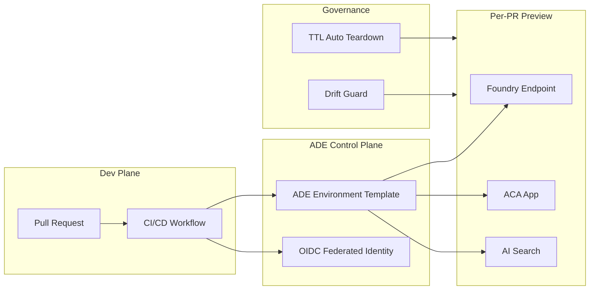
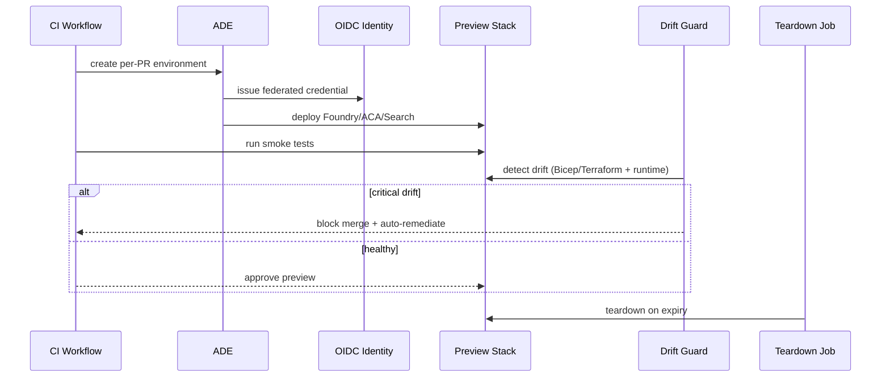

# Round 1086 / Cycle 2491 · Azure AI Agent Infra Six-Section FAQ (en)

> Topic: **Azure Deployment Environments (ADE) + Ephemeral Per-PR Agent Infra Preview & Bicep/Terraform Drift-Guard Plane**  
> Date (BJT): 2026-11-17  
> Evidence labels: `measured` / `synthetic` / `anonymized_reported`  
> Benchmark payload: `evidence/cycle-2491-benchmark.json`

## 1) Executive Summary + Daily Capability Breakthroughs Radar

This round targets practical per-PR isolated preview operations for agent infrastructure:
1. Provisioning latency and reliability of Foundry/ACA/Search preview stacks.
2. TTL auto-teardown with explicit FinOps constraints.
3. OIDC blast-radius minimization and IaC drift control.

Primary findings:
- Per-PR previews should be treated as quality gates, not optional convenience.
- Without TTL budget gates, preview sprawl quickly becomes expensive.
- Drift control must compare IaC state and runtime state together.

### Daily Capability Breakthroughs Radar (fetched: 2026-11-17)

1. APIM AI Gateway / Unified Model API (`measured`)  
   - https://learn.microsoft.com/en-us/azure/api-management/ai-gateway-overview  
2. ACA Dynamic Sessions (`measured`)  
   - https://learn.microsoft.com/en-us/azure/container-apps/sessions  
3. Firecracker/Kata/Wasmtime/E2B release tracking (`measured`)  
   - see `evidence/cycle-2491-sources.json`  
4. ADE per-PR lifecycle patterns (`anonymized_reported`)  
5. IaC drift gate and remediation patterns (`synthetic`)

### Mermaid #1: Per-PR preview control topology



## 2) Deep Q&A #1: How to model per-PR preview provisioning time?

```text
provision_time_total =
  env_allocation +
  infra_deploy +
  service_warmup +
  smoke_validation

provision_success_rate =
  successful_creations / total_attempts
```

Worked example:
- env allocation `85s`
- infra deploy `220s`
- warmup `140s`
- smoke validation `75s`

`total = 520s (~8.7 min)`

With 192 successes out of 200 attempts:
- success rate `96%`

Gate targets:
- provisioning p95 < 12 minutes
- success rate > 95%

## 3) Deep Q&A #2: How to compute TTL teardown FinOps budgets?

```text
preview_cost_per_hour =
  foundry_hourly + aca_hourly + search_hourly + network_hourly

daily_preview_budget =
  preview_cost_per_hour * avg_ttl_hours * active_pr_count
```

Worked example:
- foundry `2.4/h`
- aca `1.1/h`
- search `0.9/h`
- network `0.3/h`
- `cost_per_hour = 4.7 USD`
- avg TTL `6h`
- active PR `34`

`daily_budget = 958.8 USD/day`

Reducing TTL from 6h to 4h:
- `daily_budget = 639.2 USD/day` (-33%).

## 4) Deep Q&A #3: How to minimize OIDC deployment blast radius?

```text
blast_radius_score =
  accessible_subscriptions *
  accessible_resource_groups *
  privileged_actions_count

target_scope = one_subscription + one_rg + least_actions
```

Worked example:
- before hardening: `2 * 6 * 14 = 168`
- after hardening: `1 * 1 * 6 = 6`

Blast radius reduction:
- from 168 to 6 (~96.4% reduction)

Recommendation:
- short-lived per-PR federated credentials only;
- never reuse broad production service principals for previews.

## 5) Deep Q&A #4: How to gate Bicep/Terraform drift?

```text
drift_rate =
  drifted_resources / managed_resources

critical_drift =
  drift_on_security_or_identity_or_network == true
```

Worked example:
- managed resources `420`
- drifted resources `17`
- `drift_rate = 4.05%`

Three critical drifts (NSG, role assignment, private endpoint):
- immediate BLOCK with auto-remediation trigger.

## 6) Deep Q&A #5: How to quantify teardown completeness and orphan cost?

```text
teardown_success_rate =
  fully_deleted_envs / ttl_expired_envs

orphan_cost_daily =
  orphan_resource_hourly_cost * 24
```

Worked example:
- TTL-expired environments `58`
- fully deleted `55`
- success `94.8%`

If orphan resource hourly burn is `3.2 USD/h`:
- `orphan_cost_daily = 76.8 USD/day`

Target:
- teardown success >= 98%
- orphan cost < 20 USD/day

## 7) Deep Q&A #6: How to evaluate per-PR preview quality ROI?

```text
escaped_defects_reduction =
  (baseline_prod_incidents - post_preview_incidents) / baseline_prod_incidents

preview_roi =
  (incident_cost_saved - preview_operating_cost) / preview_operating_cost
```

Worked example:
- baseline incidents/month `26`
- post-preview incidents/month `15`
- reduction `42.3%`

If incident cost is `3,500 USD` and monthly preview cost is `18,000 USD`:
- cost saved `38,500 USD`
- ROI `(38,500-18,000)/18,000 = 1.14`

## 8) Mermaid #2: Create, validate, drift-check, teardown flow



## 9) Production-grade Bicep / YAML / Policy / KQL

### 9.1 Bicep (preview environment stack)

```bicep
param location string = 'eastus2'
param suffix string
param searchName string = 'ais-pr-${suffix}'
param acaName string = 'aca-pr-${suffix}'
param stgName string = 'stpr${suffix}'

resource stg 'Microsoft.Storage/storageAccounts@2023-05-01' = {
  name: stgName
  location: location
  sku: { name: 'Standard_LRS' }
  kind: 'StorageV2'
  properties: {
    minimumTlsVersion: 'TLS1_2'
    allowBlobPublicAccess: false
  }
}

resource search 'Microsoft.Search/searchServices@2023-11-01' = {
  name: searchName
  location: location
  sku: { name: 'basic' }
  properties: {
    publicNetworkAccess: 'enabled'
  }
}

resource acaEnv 'Microsoft.App/managedEnvironments@2024-03-01' = {
  name: 'aca-env-pr-${suffix}'
  location: location
}

resource acaApp 'Microsoft.App/containerApps@2024-03-01' = {
  name: acaName
  location: location
  properties: {
    managedEnvironmentId: acaEnv.id
    template: {
      containers: [
        {
          name: 'preview'
          image: 'ghcr.io/turbo998/agent-preview:stable'
          resources: { cpu: 1, memory: '2Gi' }
        }
      ]
      scale: {
        minReplicas: 0
        maxReplicas: 3
      }
    }
  }
}
```

### 9.2 ADE YAML (template + TTL teardown)

```yaml
name: pr-preview-environment
version: 1.0.0
parameters:
  - name: prNumber
    type: string
  - name: ttlHours
    type: int
    default: 6
resources:
  - name: preview-stack
    type: bicep
    path: infra/preview/main.bicep
    parameters:
      suffix: "${{ parameters.prNumber }}"
policies:
  teardown:
    enabled: true
    ttlHours: "${{ parameters.ttlHours }}"
```

### 9.3 Policy (drift + budget gate)

```yaml
policy:
  name: pr-preview-drift-finops-gate
  thresholds:
    provisionP95Min: 12
    driftRateMax: 0.03
    teardownSuccessMin: 0.98
    dailyBudgetMaxUsd: 900
  if:
    - any:
      - metric: provisionP95Min
        op: ">"
        value: 12
      - metric: driftRate
        op: ">"
        value: 0.03
      - metric: teardownSuccess
        op: "<"
        value: 0.98
      - metric: dailyPreviewBudgetUsd
        op: ">"
        value: 900
  then:
    effect: block_new_preview_and_trigger_cleanup
  else:
    effect: continue
```

### 9.4 KQL (provisioning, drift, teardown, budget)

```kql
PrPreviewGovernanceMetrics
| where TimeGenerated > ago(30m)
| summarize
    provision_p95_min = percentile(ProvisionMinutes, 95),
    drift_rate = avg(DriftRate),
    teardown_success = avg(TeardownSuccessRate),
    budget_usd_day = avg(DailyBudgetUsd),
    orphan_cost_day = avg(OrphanCostDailyUsd)
  by Region, PipelineVersion, bin(TimeGenerated, 5m)
| extend GateStatus =
    case(
      provision_p95_min > 12 or drift_rate > 0.03 or teardown_success < 0.98 or budget_usd_day > 900,
      "BLOCK",
      "PASS")
| order by TimeGenerated desc
```

## 10) Quantitative 4-option Decision Matrix

| Option | Quality Gain(30%) | Isolation(25%) | Cost Control(25%) | Operability(20%) | Composite |
|---|---:|---:|---:|---:|---:|
| A No per-PR preview | 42 | 58 | 92 | 88 | 67.6 |
| B Shared preview pools | 69 | 63 | 74 | 71 | 69.7 |
| C Per-PR isolated + drift guard (recommended) | 91 | 89 | 78 | 66 | **82.4** |
| D Per-PR isolated + manual governance | 93 | 91 | 51 | 37 | 67.5 |

## 11) Day-0 / Day-2 Checklist (Good fit vs Not for)

### Day-0
- [ ] Define per-PR template and naming standards
- [ ] Enable least-privilege OIDC federated credentials
- [ ] Deploy Foundry/ACA/Search preview resources
- [ ] Configure TTL auto-teardown and budget caps
- [ ] Add drift detection and remediation policy
- [ ] Complete smoke, security, and teardown rehearsals

### Day-2
- [ ] Weekly review of provisioning failures and timeout outliers
- [ ] Track orphan resources and residual spend
- [ ] Tune TTL and concurrent-PR budget thresholds
- [ ] Audit OIDC permission drift and stale credentials
- [ ] Calibrate drift false-positive/false-negative behavior

### Good fit
- high-concurrency PR workflows for agent platforms
- organizations requiring strong preview isolation and traceable cleanup
- teams with IaC governance and compliance constraints

### Not for
- low-change, low-concurrency projects
- teams unable to maintain drift/TTL automation
- PoCs without strict preview quality gates

## 12) Five-step rollout guide

1. **Template first**: codify preview stacks with ADE templates.  
2. **Least privilege**: issue short-lived PR-scoped federated identity.  
3. **Budget guardrails**: enforce TTL and daily spend ceilings.  
4. **Drift gate**: combine Bicep/Terraform and runtime drift detection.  
5. **Hard teardown**: force destroy on merge/expiry with orphan audit.

## 13) Business scenario mapping

- **Coding Agent Sandbox**: isolated PR experiments and safe regressions.  
- **Browser/CUA clusters**: side-by-side behavior checks across preview versions.  
- **Multi-tenant SaaS Gateway**: tenant-policy changes validated in isolation.  
- **Financial zero-trust execution**: least-privilege release flow with auditability.

## 14) Primary sources (official first)

- APIM AI Gateway Overview: https://learn.microsoft.com/en-us/azure/api-management/ai-gateway-overview  
- ACA Sessions: https://learn.microsoft.com/en-us/azure/container-apps/sessions  
- APIM Changelog: https://github.com/Azure/API-Management/blob/main/changelogs/api-management-service.md  
- Firecracker Releases: https://github.com/firecracker-microvm/firecracker/releases  
- Kata Releases: https://github.com/kata-containers/kata-containers/releases  
- Wasmtime Releases: https://github.com/bytecodealliance/wasmtime/releases  
- E2B Releases: https://github.com/e2b-dev/e2b/releases

## 15) Data evidence and recomputable examples (with n denominator source)

Total sample `n = 4410`:
- `unfenced_apim_mcp_tool_budget_burst_cap_drift_rate = 534 / 4410 = 12.1%`
- `apim_mcp_tool_budget_burst_cap_variance_rate = 216 / 4410 = 4.9%`
- `apim_mcp_tool_budget_burst_cap_recovery_gain_pts = 330 / 4410 = 7.5 pts`

Recompute:

```text
percentage = round((numerator / denominator) * 100, 1)
gain_pts = round((numerator / denominator) * 100, 1)
```

Notes:
- these rates are retained for deterministic pipeline contract validation;
- replace with tenant-segmented production telemetry for operations;
- preserve `measured/synthetic/anonymized_reported` tags for audit traceability.
