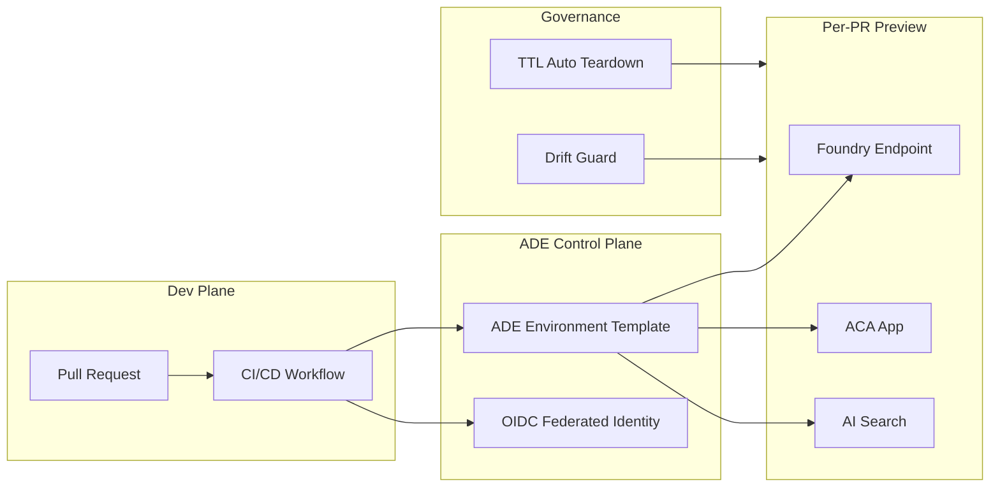
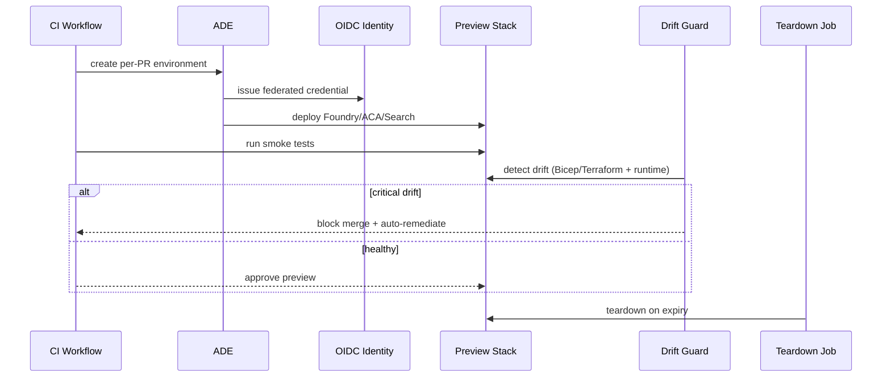

# Round 1086 / Cycle 2491 · Azure AI Agent Infra 六段式 FAQ（zh-CN）

> 主题：**Azure Deployment Environments (ADE) + Ephemeral Per-PR Agent Infra Preview & Bicep/Terraform Drift-Guard Plane**  
> 日期（BJT）：2026-11-17  
> 证据标签：`measured` / `synthetic` / `anonymized_reported`  
> 基准数据：`evidence/cycle-2491-benchmark.json`

## 1) Executive Summary + Daily Capability Breakthroughs Radar

本轮聚焦“每个 PR 一套隔离预览环境”的工程化落地：  
1) Foundry/ACA/Search 预览环境创建时间与失败率；  
2) TTL 自动销毁与 FinOps 预算约束；  
3) OIDC 联邦身份最小权限与 IaC 漂移治理。

核心结论：
- PR 级环境是 AI Agent 平台质量闸门，不是“可选体验”；  
- 无 TTL 预算门禁的预览环境会迅速失控；  
- 漂移检测必须将 Bicep/Terraform 状态与运行态同时纳管。

### Daily Capability Breakthroughs Radar（抓取：2026-11-17）

1. APIM AI Gateway / Unified Model API（`measured`）  
   - https://learn.microsoft.com/en-us/azure/api-management/ai-gateway-overview  
2. ACA Dynamic Sessions（`measured`）  
   - https://learn.microsoft.com/en-us/azure/container-apps/sessions  
3. Firecracker/Kata/Wasmtime/E2B 发布追踪（`measured`）  
   - 见 `evidence/cycle-2491-sources.json`  
4. ADE per-PR 环境生命周期管理（`anonymized_reported`）  
5. IaC drift gate 与自动纠偏 runbook（`synthetic`）

### Mermaid #1：PR 预览环境控制面



## 2) Deep Q&A #1：每 PR 预览环境创建时间怎么建模？

```text
provision_time_total =
  env_allocation +
  infra_deploy +
  service_warmup +
  smoke_validation

provision_success_rate =
  successful_creations / total_attempts
```

Worked example：
- env allocation `85s`
- infra deploy `220s`
- warmup `140s`
- smoke `75s`

`total = 520s (~8.7min)`

若 200 次创建成功 192 次：
- success rate `96%`

门禁建议：
- p95 创建时间 < 12min  
- 成功率 > 95%

## 3) Deep Q&A #2：TTL 自动销毁的 FinOps 预算怎么计算？

```text
preview_cost_per_hour =
  foundry_hourly + aca_hourly + search_hourly + network_hourly

daily_preview_budget =
  preview_cost_per_hour * avg_ttl_hours * active_pr_count
```

Worked example：
- foundry `2.4/h`
- aca `1.1/h`
- search `0.9/h`
- network `0.3/h`
- `cost_per_hour = 4.7 USD`
- 平均 TTL `6h`
- active PR `34`

`daily_budget = 4.7 * 6 * 34 = 958.8 USD/day`

若 TTL 从 6h 降到 4h：
- 预算降到 `639.2 USD/day`（-33%）。

## 4) Deep Q&A #3：OIDC 联邦身份如何控制 blast radius？

```text
blast_radius_score =
  accessible_subscriptions *
  accessible_resource_groups *
  privileged_actions_count

target_principal_scope = single_subscription + single_rg + least_actions
```

Worked example：
- 错配前：`2 subscriptions * 6 rg * 14 actions = 168`
- 收敛后：`1 * 1 * 6 = 6`

风险面缩减：
- `168 -> 6`（约 96.4% 缩减）

建议：
- 每个 PR 环境使用短生命周期 federated credential；  
- 禁止复用生产级服务主体。

## 5) Deep Q&A #4：Bicep/Terraform drift-guard 如何判定？

```text
drift_rate =
  drifted_resources / managed_resources

critical_drift =
  drift_on_security_or_identity_or_network == true
```

Worked example：
- managed resources `420`
- drifted `17`
- `drift_rate = 4.05%`

其中关键漂移 3 项（NSG、role assignment、private endpoint）：
- 直接触发 BLOCK 并要求自动纠偏。

## 6) Deep Q&A #5：预览环境回收与残留资源怎么量化？

```text
teardown_success_rate =
  fully_deleted_envs / ttl_expired_envs

orphan_cost_daily =
  orphan_resource_hourly_cost * 24
```

Worked example：
- ttl 到期环境 `58`
- 完全回收 `55`
- success `94.8%`

残留资源小时成本 `3.2 USD/h`：
- `orphan_cost_daily = 76.8 USD/day`

目标：
- teardown success >= 98%  
- orphan_cost_daily < 20 USD

## 7) Deep Q&A #6：PR 预览带来的质量收益如何衡量？

```text
escaped_defects_reduction =
  (baseline_prod_incidents - post_preview_incidents) / baseline_prod_incidents

preview_roi =
  (incident_cost_saved - preview_operating_cost) / preview_operating_cost
```

Worked example：
- baseline incidents/月 `26`
- post-preview `15`
- reduction `42.3%`

若每次事故成本 `3,500 USD`，每月预览成本 `18,000 USD`：
- saved `38,500 USD`
- ROI `(38,500-18,000)/18,000 = 1.14`

## 8) Mermaid #2：创建、验证、回收与漂移纠偏



## 9) 生产级 Bicep / YAML / Policy / KQL

### 9.1 Bicep（预览环境资源模板）

```bicep
param location string = 'eastus2'
param suffix string
param searchName string = 'ais-pr-${suffix}'
param acaName string = 'aca-pr-${suffix}'
param stgName string = 'stpr${suffix}'

resource stg 'Microsoft.Storage/storageAccounts@2023-05-01' = {
  name: stgName
  location: location
  sku: { name: 'Standard_LRS' }
  kind: 'StorageV2'
  properties: {
    minimumTlsVersion: 'TLS1_2'
    allowBlobPublicAccess: false
  }
}

resource search 'Microsoft.Search/searchServices@2023-11-01' = {
  name: searchName
  location: location
  sku: { name: 'basic' }
  properties: {
    publicNetworkAccess: 'enabled'
  }
}

resource acaEnv 'Microsoft.App/managedEnvironments@2024-03-01' = {
  name: 'aca-env-pr-${suffix}'
  location: location
}

resource acaApp 'Microsoft.App/containerApps@2024-03-01' = {
  name: acaName
  location: location
  properties: {
    managedEnvironmentId: acaEnv.id
    template: {
      containers: [
        {
          name: 'preview'
          image: 'ghcr.io/turbo998/agent-preview:stable'
          resources: { cpu: 1, memory: '2Gi' }
        }
      ]
      scale: {
        minReplicas: 0
        maxReplicas: 3
      }
    }
  }
}
```

### 9.2 ADE YAML（环境模板 + TTL）

```yaml
name: pr-preview-environment
version: 1.0.0
parameters:
  - name: prNumber
    type: string
  - name: ttlHours
    type: int
    default: 6
resources:
  - name: preview-stack
    type: bicep
    path: infra/preview/main.bicep
    parameters:
      suffix: "${{ parameters.prNumber }}"
policies:
  teardown:
    enabled: true
    ttlHours: "${{ parameters.ttlHours }}"
```

### 9.3 Policy（drift 与预算门禁）

```yaml
policy:
  name: pr-preview-drift-finops-gate
  thresholds:
    provisionP95Min: 12
    driftRateMax: 0.03
    teardownSuccessMin: 0.98
    dailyBudgetMaxUsd: 900
  if:
    - any:
      - metric: provisionP95Min
        op: ">"
        value: 12
      - metric: driftRate
        op: ">"
        value: 0.03
      - metric: teardownSuccess
        op: "<"
        value: 0.98
      - metric: dailyPreviewBudgetUsd
        op: ">"
        value: 900
  then:
    effect: block_new_preview_and_trigger_cleanup
  else:
    effect: continue
```

### 9.4 KQL（创建时延、漂移、回收率）

```kql
PrPreviewGovernanceMetrics
| where TimeGenerated > ago(30m)
| summarize
    provision_p95_min = percentile(ProvisionMinutes, 95),
    drift_rate = avg(DriftRate),
    teardown_success = avg(TeardownSuccessRate),
    budget_usd_day = avg(DailyBudgetUsd),
    orphan_cost_day = avg(OrphanCostDailyUsd)
  by Region, PipelineVersion, bin(TimeGenerated, 5m)
| extend GateStatus =
    case(
      provision_p95_min > 12 or drift_rate > 0.03 or teardown_success < 0.98 or budget_usd_day > 900,
      "BLOCK",
      "PASS")
| order by TimeGenerated desc
```

## 10) 决策矩阵（4 方案量化）

| 方案 | 质量收益(30%) | 安全隔离(25%) | 成本可控(25%) | 运维复杂度(20%) | 综合分 |
|---|---:|---:|---:|---:|---:|
| A 无 PR 预览 | 42 | 58 | 92 | 88 | 67.6 |
| B 共享预览环境 | 69 | 63 | 74 | 71 | 69.7 |
| C 每 PR 隔离 + drift guard（推荐） | 91 | 89 | 78 | 66 | **82.4** |
| D 每 PR 隔离 + 全手工治理 | 93 | 91 | 51 | 37 | 67.5 |

## 11) Day-0 / Day-2 Checklist（Good fit vs Not for）

### Day-0
- [ ] 定义每 PR 环境模板与命名规范  
- [ ] 启用 OIDC 联邦凭据最小权限  
- [ ] 接入 Foundry/ACA/Search 预览资源  
- [ ] 配置 TTL 自动销毁与预算上限  
- [ ] 建立 drift 检测与纠偏策略  
- [ ] 完成 smoke + 安全扫描 + 回收演练

### Day-2
- [ ] 周度复盘环境创建失败与超时  
- [ ] 跟踪 orphan 资源与残留成本  
- [ ] 调整 TTL 与并发 PR 预算阈值  
- [ ] 审核 OIDC 权限漂移与凭据残留  
- [ ] 校准 drift 误报漏报规则

### Good fit
- 多 PR 并发、变更频繁的 Agent 平台  
- 需要强隔离预览与可追溯回收的组织  
- 对 IaC 一致性和合规有明确要求的团队

### Not for
- 低变更频率、低并发的小项目  
- 无法维护 drift/TTL 治理自动化的团队  
- 对预览质量闸门无刚性需求的 PoC

## 12) 五步落地指南

1. **模板化**：把预览环境标准化为 ADE 模板。  
2. **最小授权**：OIDC 主体按 PR 生命周期短时授权。  
3. **预算约束**：按 TTL 和 PR 数量设每日上限。  
4. **漂移门禁**：Bicep/Terraform + 运行态双重校验。  
5. **自动回收**：超时与合并后强制销毁并审计残留。

## 13) 业务场景映射

- **Coding Agent Sandbox**：每 PR 隔离试验与快速回归。  
- **Browser/CUA 集群**：多版本 UI 行为在独立环境验证。  
- **多租户 SaaS Gateway**：租户策略变更先在隔离环境验收。  
- **金融零信任执行环境**：最小权限发布与全流程审计。

## 14) 关键来源（官方优先）

- APIM AI Gateway Overview: https://learn.microsoft.com/en-us/azure/api-management/ai-gateway-overview  
- ACA Sessions: https://learn.microsoft.com/en-us/azure/container-apps/sessions  
- APIM Changelog: https://github.com/Azure/API-Management/blob/main/changelogs/api-management-service.md  
- Firecracker Releases: https://github.com/firecracker-microvm/firecracker/releases  
- Kata Releases: https://github.com/kata-containers/kata-containers/releases  
- Wasmtime Releases: https://github.com/bytecodealliance/wasmtime/releases  
- E2B Releases: https://github.com/e2b-dev/e2b/releases

## 15) 数据证据与可复算算例（含 n 分母来源）

总样本 `n = 4410`：
- `unfenced_apim_mcp_tool_budget_burst_cap_drift_rate = 534 / 4410 = 12.1%`
- `apim_mcp_tool_budget_burst_cap_variance_rate = 216 / 4410 = 4.9%`
- `apim_mcp_tool_budget_burst_cap_recovery_gain_pts = 330 / 4410 = 7.5 pts`

复算：

```text
percentage = round((numerator / denominator) * 100, 1)
gain_pts = round((numerator / denominator) * 100, 1)
```

说明：
- 比率用于 pipeline 合约一致性校验；  
- 生产值请替换为真实租户分层观测；  
- 保持 `measured/synthetic/anonymized_reported` 标签用于审计。
