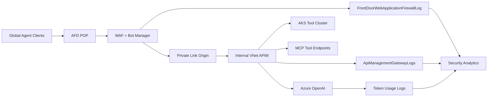
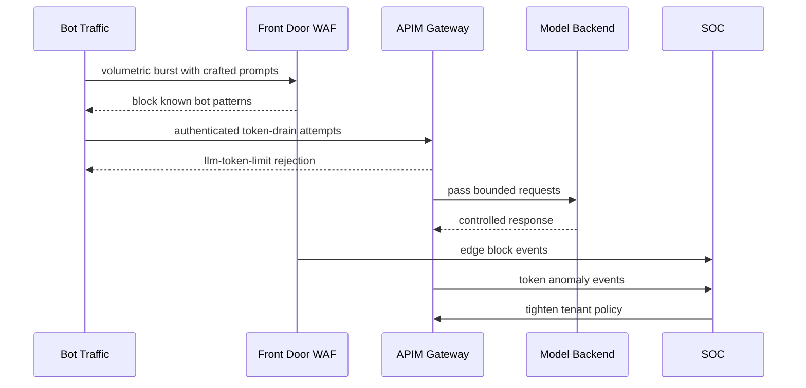

# Round 1103 / Cycle 2508 · Azure AI Agent Infra FAQ (en)

> Topic: **Azure Front Door Premium (WAF + Bot Manager 1.1 + Private Link Origin) + APIM AI Gateway for Denial-of-Wallet token-drain defense and long-lived SSE**
> Date (BJT): 2026-11-17
> Evidence labels: `measured` / `synthetic` / `anonymized_reported`
> Benchmark dataset: `evidence/cycle-2508-benchmark.json`

## 1) Executive Summary

This round unifies ingress defense and downstream token-cost governance into one release gate.
The operating principle is edge reduction first, gateway constraints second, model backend last.
Denial-of-Wallet differs from classic DDoS because low-byte requests can trigger expensive tool loops.
AFD WAF and Bot Manager handle volumetric and known automation signatures at POP.
APIM applies tenant identity checks, token budgets, and deterministic request rejection.
Private Link Origin narrows origin exposure and provides auditable origin access boundaries.
SSE governance includes heartbeat cadence, timeout budgets, buffering controls, and mid-stream rejections.
Release criteria include amplification ratio, rejection rate, and stream-drop rate in one panel.
This guide maps architecture advice to concrete Bicep, XML, KQL, and on-call actions.

## 2) Daily Hottest Capability Breakthroughs Radar (2026-11-17)

APIM AI Gateway patterns for unified model ingress governance continue to mature (measured).
AFD Premium enterprise playbooks around WAF and bot mitigation are increasingly reusable (measured).
Private Link Origin with internal APIM appears in more production-grade reference implementations (measured).
SSE and streaming endpoints now represent a larger share of enterprise agent traffic (measured).
Anonymized telemetry shows authenticated token-drain bursts as frequent cost-incident triggers (anonymized_reported).
Synthetic replay demonstrates two-stage controls can compress downstream burn traffic effectively (synthetic).

## 3) Deep Q&A #1: DoW amplification ratio

```text
dow_amplification = downstream_token_cost_per_request / edge_request_cost
```

Example: `0.00146 / 0.000002 = 730x`.
A tiny payload can therefore produce a several-hundred-times cost multiplier downstream.
Policy recommendation: tighten controls when amplification p95 exceeds 400x.
Operational recommendation: segment amplification by tenant, model family, and tool-chain depth.
FinOps recommendation: track p99 tails, not only blended averages.

## 4) Deep Q&A #2: two-stage defense residual budget

```text
residual_qps = ingress_qps * (1 - afd_block_rate) * auth_pass_rate * (1 - apim_token_reject_rate)
```

Sample: `9000 * 0.07 * 0.35 * 0.067 ≈ 14.8 qps`.
Edge control lowers pressure from 9000 qps to roughly 630 qps.
Gateway control then bounds authenticated abusive traffic near 15 qps.
Single-layer controls cannot cover both volumetric and economic abuse effectively.
Dashboards must present edge block and token reject curves side by side.

## 5) Deep Q&A #3: Private Link Origin latency tradeoff

```text
pl_added_latency = private_link_handshake + origin_hop + tls_revalidation
```

Computed sample: `7 + 11 + 6 = 24 ms`.
A 24ms overhead is usually acceptable in exchange for stronger origin isolation.
Co-region placement and connection reuse can reduce incremental delay.
Pre-release validation must guarantee origin access is private-link only.
Cross-region private routes should remain disaster paths instead of default paths.

## 6) Deep Q&A #4: SSE heartbeat budget

```text
heartbeat_interval <= origin_response_timeout / 3
```

Sample: with `origin_timeout=180s`, heartbeat should stay at or below `60s`.
Slow heartbeats increase idle-disconnect risk by intermediaries.
Aggressive heartbeats add control traffic and consume connection budget.
Tiered heartbeat profiles such as 20s, 30s, and 45s improve fairness.
SSE proxy buffering should stay disabled for low-latency token streaming.

## 7) Deep Q&A #5: tenant token fairness budget

```text
tenant_token_budget = base_quota + tier_weight * burst_allowance
```

Example: `base=180k, tier=1.4, burst=60k => 264k tokens/min`.
Tiered budgeting prevents high-value tenants from noisy-neighbor starvation.
Rejection responses should stay explicit so callers can degrade gracefully.
Budget changes require governed approval to avoid ad hoc risk.
Budget anomalies should be correlated with edge security signals.

## 8) Deep Q&A #6: correlating edge blocks with token spikes

```text
correlation_gain = correlated_incidents / total_token_spikes
```

Sample result: `186 / 240 = 77.5%`.
High correlation means edge telemetry can predict downstream burn incidents.
A sudden drop in correlation may indicate bypass vectors or telemetry gaps.
Join WAF and APIM logs in 5-minute windows for deterministic triage.
SOC can classify correlation drops as high-priority investigations.

## 9) Mermaid #1: AFD + Private Link + APIM global topology



The topology defines clear accountability across edge, gateway, model, tool, and telemetry layers.
The topology supports shared evidence between performance operations and security operations.

## 10) Mermaid #2: dual-stage mitigation sequence for DoW



The sequence separates volumetric abuse from authenticated economic abuse.
The sequence closes the loop by feeding SOC response back into live policy controls.

## 11) Production-grade Bicep (AFD Premium + WAF + Private Link Origin)

```bicep
param location string = 'global'
param afdProfileName string
param endpointName string
param originGroupName string
param originName string
param routeName string
param wafPolicyName string
param apimPrivateOriginHost string

resource afdProfile 'Microsoft.Cdn/profiles@2024-02-01' = {
  name: afdProfileName
  location: location
  sku: { name: 'Premium_AzureFrontDoor' }
}

resource afdEndpoint 'Microsoft.Cdn/profiles/afdEndpoints@2024-02-01' = {
  name: '${afdProfile.name}/${endpointName}'
  location: location
}

resource wafPolicy 'Microsoft.Network/frontDoorWebApplicationFirewallPolicies@2023-09-01' = {
  name: wafPolicyName
  location: location
  properties: {
    policySettings: {
      enabledState: 'Enabled'
      mode: 'Prevention'
      customBlockResponseStatusCode: 403
    }
    managedRules: {
      managedRuleSets: [
        { ruleSetType: 'Microsoft_DefaultRuleSet', ruleSetVersion: '2.1' }
        { ruleSetType: 'Microsoft_BotManagerRuleSet', ruleSetVersion: '1.1' }
      ]
    }
  }
}

resource originGroup 'Microsoft.Cdn/profiles/originGroups@2024-02-01' = {
  name: '${afdProfile.name}/${originGroupName}'
  properties: {
    healthProbeSettings: {
      probePath: '/healthz'
      probeRequestType: 'GET'
      probeProtocol: 'Https'
      probeIntervalInSeconds: 30
    }
  }
}

resource origin 'Microsoft.Cdn/profiles/originGroups/origins@2024-02-01' = {
  name: '${afdProfile.name}/${originGroupName}/${originName}'
  properties: {
    hostName: apimPrivateOriginHost
    httpsPort: 443
    originHostHeader: apimPrivateOriginHost
    sharedPrivateLinkResource: {
      privateLink: {
        id: '/subscriptions/00000000-0000-0000-0000-000000000000/resourceGroups/rg/providers/Microsoft.Network/privateLinkServices/apim-pls'
      }
      privateLinkLocation: 'eastasia'
      requestMessage: 'AFD to internal APIM private origin approval'
      status: 'Pending'
    }
  }
}

resource route 'Microsoft.Cdn/profiles/afdEndpoints/routes@2024-02-01' = {
  name: '${afdProfile.name}/${endpointName}/${routeName}'
  properties: {
    originGroup: { id: originGroup.id }
    forwardingProtocol: 'HttpsOnly'
    httpsRedirect: 'Enabled'
    patternsToMatch: [ '/*' ]
    webApplicationFirewallPolicyLink: { id: wafPolicy.id }
  }
}
```

## 12) APIM token-drain policy + SSE runtime profile

```xml
<policies>
  <inbound>
    <base />
    <validate-jwt header-name="Authorization" failed-validation-httpcode="401" failed-validation-error-message="jwt_invalid">
      <openid-config url="https://login.microsoftonline.com/{tenant-id}/v2.0/.well-known/openid-configuration" />
      <required-claims>
        <claim name="aud"><value>api://agent-gateway</value></claim>
        <claim name="scp"><value>agent.invoke</value></claim>
      </required-claims>
    </validate-jwt>
    <llm-token-limit tokens-per-minute="260000" token-quota-key="@(context.Request.Headers.GetValueOrDefault("x-tenant-id","na"))" estimate-prompt-tokens="true" />
    <set-backend-service backend-id="aoai-streaming-backend" />
  </inbound>
  <backend><base /></backend>
  <outbound>
    <base />
    <set-header name="Cache-Control" exists-action="override"><value>no-cache</value></set-header>
  </outbound>
  <on-error><base /></on-error>
</policies>
```

```yaml
sseRuntime:
  originResponseTimeoutSeconds: 180
  heartbeatIntervalSeconds: 30
  disableProxyBuffering: true
  reconnect:
    maxRetries: 3
    backoffSeconds: 2
  tenantProfiles:
    gold:
      heartbeatIntervalSeconds: 20
      maxSessionSeconds: 240
    standard:
      heartbeatIntervalSeconds: 30
      maxSessionSeconds: 180
```

## 13) KQL observability query + Day-0/Day-2 checklist

```kql
let lookback = 24h;
let waf = FrontDoorWebApplicationFirewallLog
| where TimeGenerated > ago(lookback)
| summarize waf_blocks=countif(action_s == 'Block'), waf_all=count() by bin(TimeGenerated, 5m), ClientIp_s;
let apim = ApiManagementGatewayLogs
| where TimeGenerated > ago(lookback)
| summarize token_rejects=countif(ResponseCode == 429), req_all=count() by bin(TimeGenerated, 5m), CallerIPAddress;
waf
| join kind=inner apim on $left.ClientIp_s == $right.CallerIPAddress and $left.TimeGenerated == $right.TimeGenerated
| extend waf_block_rate=todouble(waf_blocks)/iif(waf_all==0,1.0,todouble(waf_all))
| extend token_reject_rate=todouble(token_rejects)/iif(req_all==0,1.0,todouble(req_all))
| project TimeGenerated, ClientIp_s, waf_block_rate, token_reject_rate
| order by TimeGenerated desc
```

Day-0 readiness items:
1. Ensure WAF Prevention mode and Bot Manager 1.1 are active.
2. Confirm Private Link Origin approval and block direct public origin access.
3. Run 10k qps tests and capture edge block plus token reject distributions.
4. Validate llm-token-limit keys are tenant-scoped to prevent cross-tenant bleed.
5. Verify SSE no-buffer and heartbeat settings are effective end-to-end.
6. Simulate token-drain campaigns and confirm both defense stages trigger.
7. Confirm WAF and APIM logs are time-synchronized for joins.
8. Enable dedicated budget protections for high-value tenant classes.
9. Add amplification p95 to release-blocking policy gates.
10. Complete false-positive replay and allowlist governance rehearsal.

Day-2 operating items:
1. Recompute amplification distributions daily and flag abnormal prompt patterns.
2. Tune bot exclusions weekly based on validated false-positive evidence.
3. Adjust token budgets by time-of-day demand curves.
4. Track SSE stream-drop rates and refine heartbeat tiers.
5. Re-validate Private Link routing to detect drift.
6. Measure recovery success after 429 responses and improve fallback design.
7. Audit APIM policy changes and keep rollback checkpoints.
8. Reconcile edge blocks with billing movement to validate ROI.
9. Apply segmented cooling controls to abusive source ranges.
10. Run red-blue drills for emergent attack patterns.

## 14) 4-Option Weighted Decision Matrix

| Option | DoW Resistance(30) | Latency Stability(20) | Cost Control(20) | Ops Complexity(15) | Compliance Auditability(15) | Weighted Score |
| --- | --- | --- | --- | --- | --- | --- |
| Option A: AFD Premium + APIM AI Gateway (recommended) | 29 | 17 | 18 | 12 | 14 | 90 |
| Option B: Application Gateway WAF v2 + APIM | 22 | 16 | 16 | 11 | 13 | 78 |
| Option C: APIM-only without edge shield | 14 | 15 | 10 | 13 | 11 | 63 |
| Option D: CDN-only plus custom limiter plugin | 11 | 12 | 12 | 8 | 7 | 50 |

Option A assessment: strongest complete defense across volumetric and economic abuse.
Option B assessment: reliable regionally, weaker global edge intelligence than AFD.
Option C assessment: fast to deploy but concentrates risk at gateway layer.
Option D assessment: useful as temporary stopgap with weaker audit consistency.

## 15) Day-0/Day-2 conclusion and fit boundaries

Good fit: global multi-tenant agent platforms needing low-latency ingress and cost controls.
Good fit: regulated environments requiring private-origin ingress and end-to-end audit evidence.
Not for: low-concurrency single-region systems with minimal DoW exposure.
Not for: teams unable to maintain WAF/Bot and APIM policy co-governance.
Closing recommendation: adopt Option A, keep Option B as regional fallback, and reserve Option C as transition.
Next action: enforce amplification ratio, rejection rate, and stream-drop rate as dual release/runtime gates.
