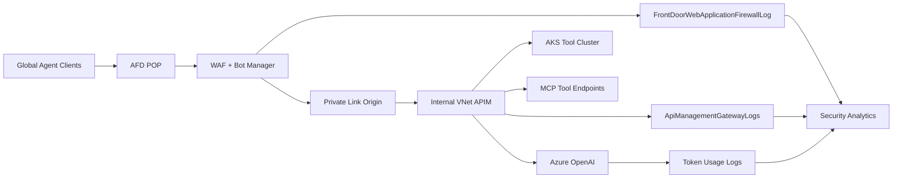
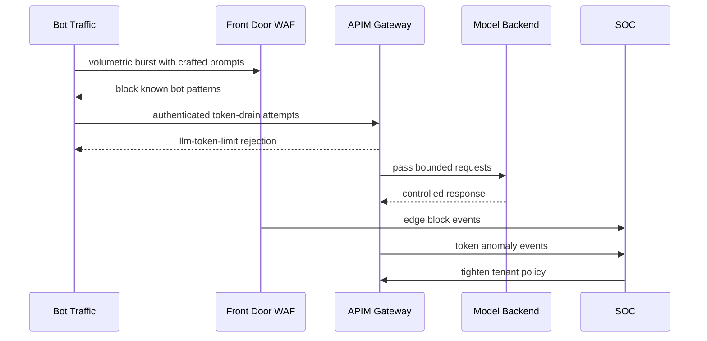

# Round 1103 / Cycle 2508 · Azure AI Agent Infra FAQ（zh-CN）

> 主题：**Azure Front Door Premium（WAF + Bot Manager 1.1 + Private Link Origin）+ APIM AI Gateway 抗 Denial-of-Wallet Token-Drain 与长连接 SSE 指南**
> 日期（BJT）：2026-11-17
> 证据标签：`measured` / `synthetic` / `anonymized_reported`
> 基准数据：`evidence/cycle-2508-benchmark.json`

## 1) Executive Summary

本轮目标是把入口层防护与下游 token 成本治理合并为同一套生产门禁。
核心策略是边缘先减压，网关再约束，模型后端只接收预算内请求。
DoW 攻击与传统 DDoS 不同，其特征是请求体小但可触发高额推理链路。
AFD WAF 与 Bot Manager 负责先处理体量和已知 bot 指纹。
APIM 负责租户身份校验、token 预算、以及异常会话切断。
Private Link Origin 用于收敛源站暴露并强化访问路径审计。
SSE 长连接治理覆盖心跳、超时、缓冲策略和中途拒绝行为。
发布门禁必须包含放大比、拒绝率、断流率三个维度。
本文件把架构、策略、KQL、值班动作绑定到可执行交付物。

## 2) Daily Hottest Capability Breakthroughs Radar（2026-11-17）

APIM AI Gateway 在模型统一入口治理上的实践快速成熟（measured）。
AFD Premium 结合 WAF 与 Bot Manager 的企业对抗样式更标准化（measured）。
Private Link Origin 与内部 APIM 组合被更多团队采用（measured）。
SSE 场景在企业 Agent 产品中的占比提升，运行经验持续增加（measured）。
匿名化运营数据显示认证后 token-drain 事件成为高频成本告警（anonymized_reported）。
合成实验显示双阶段防线可显著压缩下游燃烧流量（synthetic）。

## 3) Deep Q&A #1：DoW 放大比

```text
dow_amplification = downstream_token_cost_per_request / edge_request_cost
```

示例：`0.00146 / 0.000002 = 730x`。
730x 意味着轻量请求也可放大成显著成本风险。
门禁建议：放大比 p95 超过 400x 时触发策略收紧。
运营建议：按租户、模型、工具链长度输出放大比分布。
治理建议：把 p99 放大比纳入月度 FinOps 审计报表。

## 4) Deep Q&A #2：双阶段防线预算

```text
residual_qps = ingress_qps * (1 - afd_block_rate) * auth_pass_rate * (1 - apim_token_reject_rate)
```

样例：`9000 * 0.07 * 0.35 * 0.067 ≈ 14.8 qps`。
边缘防线把体量从 9000 qps 降到 630 qps 级别。
网关防线再把可认证异常流量压到 15 qps 左右。
单层防线难以同时覆盖体量攻击和经济攻击。
报表必须并列展示 edge block 与 token reject 两条曲线。

## 5) Deep Q&A #3：Private Link Origin 延迟权衡

```text
pl_added_latency = private_link_handshake + origin_hop + tls_revalidation
```

样例：`7 + 11 + 6 = 24 ms`。
24ms 通常可接受，换来更强源站隔离与合规审计路径。
同区部署与连接复用可进一步压缩新增时延。
上线前需验证源站仅允许私有回源链路访问。
跨区私有回源应仅用于容灾路径，不宜常态承载主流量。

## 6) Deep Q&A #4：SSE 心跳预算

```text
heartbeat_interval <= origin_response_timeout / 3
```

样例：`origin_timeout=180s`，则心跳不应高于 `60s`。
心跳过慢会触发中间层误判空闲而断流。
心跳过快会增大控制流量和并发连接开销。
可按租户层级设置 20s、30s、45s 分层策略。
SSE 响应需禁用代理缓冲，保证流式分片即时转发。

## 7) Deep Q&A #5：租户 token 预算公平性

```text
tenant_token_budget = base_quota + tier_weight * burst_allowance
```

示例：`base=180k, tier=1.4, burst=60k => 264k tokens/min`。
预算分层可防止高价值租户被噪声流量挤占。
拒绝响应应返回可解释信息，指导调用方快速降级。
预算调整必须经过审批，避免临时人工改值导致失控。
应将预算超限告警与 AFD 边缘信号联合判读。

## 8) Deep Q&A #6：边缘封禁与 token 突刺关联

```text
correlation_gain = correlated_incidents / total_token_spikes
```

样例：`186 / 240 = 77.5%`。
高关联意味着边缘事件可作为下游燃烧的先行指标。
若关联度突然下降，应优先排查绕过路径与日志缺口。
建议按 5 分钟窗 join WAF 与 APIM 日志做趋势追踪。
SOC 可将关联度下降设为高优先级调查触发器。

## 9) Mermaid #1：AFD + Private Link + APIM 全局拓扑



该拓扑明确了边缘、网关、模型、工具、日志五层责任边界。
该拓扑支持同一时间窗内的性能与安全联合归因。

## 10) Mermaid #2：Volumetric 与 Token-Drain 双阶段缓解序列



该序列显示体量攻击与经济攻击需要不同层面协同治理。
该序列把 SOC 决策回灌策略层，实现分钟级收敛。

## 11) 生产级 Bicep（AFD Premium + WAF + Private Link Origin）

```bicep
param location string = 'global'
param afdProfileName string
param endpointName string
param originGroupName string
param originName string
param routeName string
param wafPolicyName string
param apimPrivateOriginHost string

resource afdProfile 'Microsoft.Cdn/profiles@2024-02-01' = {
  name: afdProfileName
  location: location
  sku: { name: 'Premium_AzureFrontDoor' }
}

resource afdEndpoint 'Microsoft.Cdn/profiles/afdEndpoints@2024-02-01' = {
  name: '${afdProfile.name}/${endpointName}'
  location: location
}

resource wafPolicy 'Microsoft.Network/frontDoorWebApplicationFirewallPolicies@2023-09-01' = {
  name: wafPolicyName
  location: location
  properties: {
    policySettings: {
      enabledState: 'Enabled'
      mode: 'Prevention'
      customBlockResponseStatusCode: 403
    }
    managedRules: {
      managedRuleSets: [
        { ruleSetType: 'Microsoft_DefaultRuleSet', ruleSetVersion: '2.1' }
        { ruleSetType: 'Microsoft_BotManagerRuleSet', ruleSetVersion: '1.1' }
      ]
    }
  }
}

resource originGroup 'Microsoft.Cdn/profiles/originGroups@2024-02-01' = {
  name: '${afdProfile.name}/${originGroupName}'
  properties: {
    healthProbeSettings: {
      probePath: '/healthz'
      probeRequestType: 'GET'
      probeProtocol: 'Https'
      probeIntervalInSeconds: 30
    }
  }
}

resource origin 'Microsoft.Cdn/profiles/originGroups/origins@2024-02-01' = {
  name: '${afdProfile.name}/${originGroupName}/${originName}'
  properties: {
    hostName: apimPrivateOriginHost
    httpsPort: 443
    originHostHeader: apimPrivateOriginHost
    sharedPrivateLinkResource: {
      privateLink: {
        id: '/subscriptions/00000000-0000-0000-0000-000000000000/resourceGroups/rg/providers/Microsoft.Network/privateLinkServices/apim-pls'
      }
      privateLinkLocation: 'eastasia'
      requestMessage: 'AFD to internal APIM private origin approval'
      status: 'Pending'
    }
  }
}

resource route 'Microsoft.Cdn/profiles/afdEndpoints/routes@2024-02-01' = {
  name: '${afdProfile.name}/${endpointName}/${routeName}'
  properties: {
    originGroup: { id: originGroup.id }
    forwardingProtocol: 'HttpsOnly'
    httpsRedirect: 'Enabled'
    patternsToMatch: [ '/*' ]
    webApplicationFirewallPolicyLink: { id: wafPolicy.id }
  }
}
```

## 12) APIM 策略（Token-Drain）+ SSE 运行配置

```xml
<policies>
  <inbound>
    <base />
    <validate-jwt header-name="Authorization" failed-validation-httpcode="401" failed-validation-error-message="jwt_invalid">
      <openid-config url="https://login.microsoftonline.com/{tenant-id}/v2.0/.well-known/openid-configuration" />
      <required-claims>
        <claim name="aud"><value>api://agent-gateway</value></claim>
        <claim name="scp"><value>agent.invoke</value></claim>
      </required-claims>
    </validate-jwt>
    <llm-token-limit tokens-per-minute="260000" token-quota-key="@(context.Request.Headers.GetValueOrDefault("x-tenant-id","na"))" estimate-prompt-tokens="true" />
    <set-backend-service backend-id="aoai-streaming-backend" />
  </inbound>
  <backend><base /></backend>
  <outbound>
    <base />
    <set-header name="Cache-Control" exists-action="override"><value>no-cache</value></set-header>
  </outbound>
  <on-error><base /></on-error>
</policies>
```

```yaml
sseRuntime:
  originResponseTimeoutSeconds: 180
  heartbeatIntervalSeconds: 30
  disableProxyBuffering: true
  reconnect:
    maxRetries: 3
    backoffSeconds: 2
  tenantProfiles:
    gold:
      heartbeatIntervalSeconds: 20
      maxSessionSeconds: 240
    standard:
      heartbeatIntervalSeconds: 30
      maxSessionSeconds: 180
```

## 13) KQL 可观测性查询 + Day-0/Day-2 Checklist

```kql
let lookback = 24h;
let waf = FrontDoorWebApplicationFirewallLog
| where TimeGenerated > ago(lookback)
| summarize waf_blocks=countif(action_s == 'Block'), waf_all=count() by bin(TimeGenerated, 5m), ClientIp_s;
let apim = ApiManagementGatewayLogs
| where TimeGenerated > ago(lookback)
| summarize token_rejects=countif(ResponseCode == 429), req_all=count() by bin(TimeGenerated, 5m), CallerIPAddress;
waf
| join kind=inner apim on $left.ClientIp_s == $right.CallerIPAddress and $left.TimeGenerated == $right.TimeGenerated
| extend waf_block_rate=todouble(waf_blocks)/iif(waf_all==0,1.0,todouble(waf_all))
| extend token_reject_rate=todouble(token_rejects)/iif(req_all==0,1.0,todouble(req_all))
| project TimeGenerated, ClientIp_s, waf_block_rate, token_reject_rate
| order by TimeGenerated desc
```

Day-0 关键项：
1. 启用 WAF Prevention 模式并确认 Bot Manager 1.1 生效。
2. 验证 Private Link Origin 审批完成且源站拒绝公网直连。
3. 执行 10k qps 压测并记录 edge block 与 token reject 分布。
4. 校验 llm-token-limit 按 tenantId 计数，避免跨租户串扰。
5. 校验 SSE 禁缓冲与心跳生效，防止中间层断流。
6. 演练 DoW 攻击脚本并确认双阶段拦截均触发。
7. 验证 WAF 与 APIM 日志时钟一致可 join。
8. 为高价值租户启用独立预算与告警。
9. 把放大比 p95 写入发布阻断规则。
10. 完成误拦截回放与白名单审批演练。

Day-2 运营项：
1. 每日复盘放大比并识别异常提示词模式。
2. 每周调优 Bot 误拦截规则并记录变更依据。
3. 按业务时段动态调整 token 预算。
4. 跟踪 SSE 断流率并优化心跳梯度。
5. 定期复核 Private Link 路由漂移风险。
6. 统计 429 后业务恢复率并修正降级策略。
7. 审计 APIM 策略变更并保留回滚点。
8. 对账边缘封禁事件与成本账单，验证 ROI。
9. 对异常来源网段实施自动冷却封禁。
10. 红蓝演练新攻击手法并评估收敛速度。

## 14) 4-Option Weighted Decision Matrix

| 方案 | DoW 抗性(30) | 延迟稳定(20) | 成本可控(20) | 运维复杂度(15) | 合规审计(15) | 加权总分 |
| --- | --- | --- | --- | --- | --- | --- |
| 方案A：AFD Premium + APIM AI Gateway（推荐） | 29 | 17 | 18 | 12 | 14 | 90 |
| 方案B：Application Gateway WAF v2 + APIM | 22 | 16 | 16 | 11 | 13 | 78 |
| 方案C：APIM 单层防护无边缘盾 | 14 | 15 | 10 | 13 | 11 | 63 |
| 方案D：仅 CDN + 自研限流插件 | 11 | 12 | 12 | 8 | 7 | 50 |

方案A评价：双阶段防线最完整，兼顾体量攻击与成本攻击。
方案B评价：区域治理可靠，但全球边缘情报与能力弱于 AFD。
方案C评价：实现快但风险集中在网关层。
方案D评价：可作为临时方案，但审计和策略一致性不足。

## 15) Day-0/Day-2 结论与适配边界

Good fit：全球多租户 Agent 平台，需要低延迟接入和 token 成本防线。
Good fit：高合规行业，需要私有回源与端到端审计证据。
Not for：低并发单地域系统，且几乎无 DoW 风险暴露。
Not for：无法维护 WAF/Bot 与 APIM 联动策略的轻运维团队。
收尾建议：以方案A为主路径，方案B为区域备选，方案C仅作过渡。
后续动作：将放大比、拒绝率、断流率纳入发布与运营双门禁。
