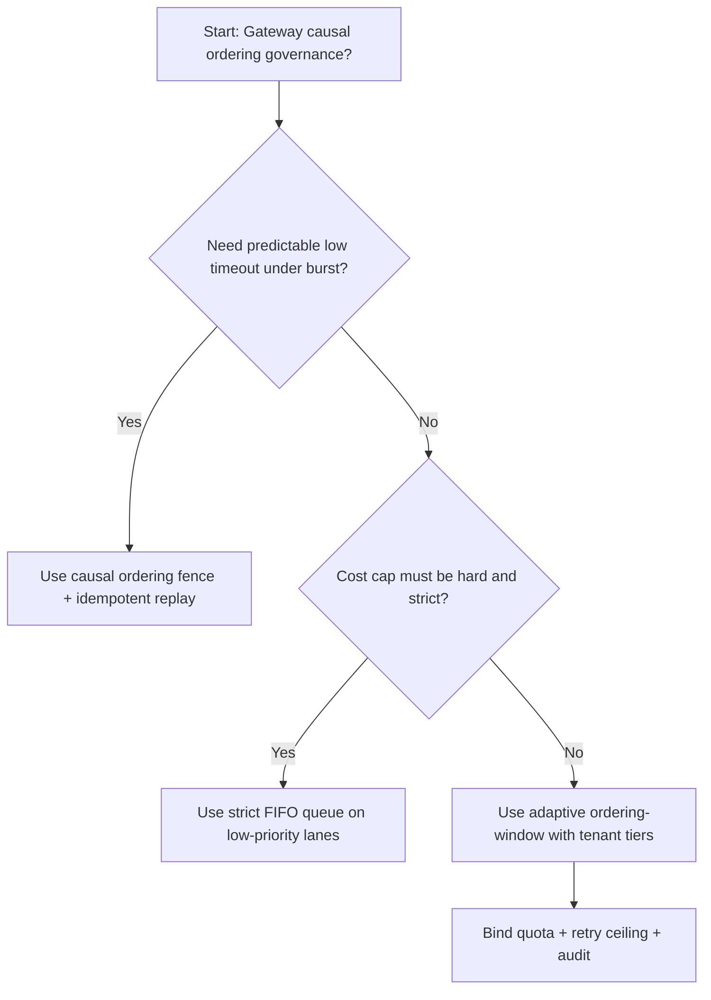
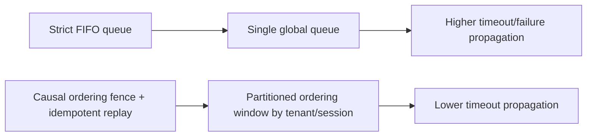
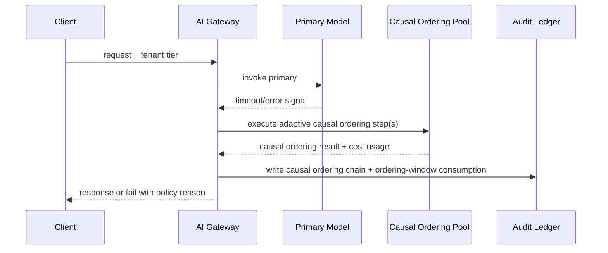

# Agent A2A Causal Ordering Fence Selection FAQ (Strict FIFO Queue vs Causal Ordering Fence + Idempotent Replay)

## 1) Core conclusions (for decision-makers first)
- **For multi-tenant Agent Gateway production, default to causal ordering fence + idempotent replay**, not strict FIFO queue as the baseline.
- **Strict FIFO queueing propagates out-of-order burst pressure into user-visible failures/timeouts** during burst periods.
- **Causal ordering fences must be coupled with tenant quota tiers, retry ceilings, and replay audit**, or the ordering path becomes an uncontrolled cost amplifier.

## 2) Q1 / Q2 / Q3 (plain-language definitions first)
- **Strict FIFO queue**: all requests are serialized through one queue with no partition-aware reordering.
- **Causal ordering fence + idempotent replay**: partition requests by tenant/session causality and recover safely with idempotent replay.

### Q1: Why does strict FIFO queue increase timeout propagation at scale?
First principles: distributed A2A systems naturally receive out-of-order events. A single global FIFO queue lets one slow partition block unrelated traffic, amplifying queue pressure and tail latency.

### Q2: When is strict FIFO queue acceptable?
Low-value traffic lanes with hard cost caps and lower availability requirements.

### Q3: What is the minimum safe control loop?
Request classification -> causality partition assignment -> admission gate -> idempotent replay audit -> ordering-window retuning.

## 3) Mermaid (decision tree / path comparison / sequence)
### 3.1 Selection decision tree

### 3.2 Path comparison

### 3.3 Runtime sequence

## 4) Decision matrix
| Dimension | Strict FIFO queue | Causal ordering fence + idempotent replay |
|---|---|---|
| Implementation complexity | Low | Medium |
| Timeout risk control | Medium-Low | High |
| Cost predictability | High (static) | Medium-High (dynamic) |
| Multi-tenant sustainability | Medium | High |
| Default production fit | Low-priority lane only | Long-term default |

## 5) Evidence contract + recomputable examples (n/denominator/source)
> Percentages in this section are `synthetic_assumed` hypothetical examples for mechanism comparison; production mechanism validation remains `not_measured`.  
> Contract fields: `workshops/azure-agent-infra/evidence/cycle-464-benchmark.json` -> `percentage_contract`.

- Metric A (primary-only timeout rate)  
  - Formula: `n_primary_only_timeout / n_runtime_requests_observed`  
  - Value: `286/2600 = 11.0%` (`synthetic_assumed`)  
  - Path: `percentage_contract.primary_only_timeout_rate`
- Metric B (causal-ordering fence timeout rate)  
  - Formula: `n_adaptive_causal-ordering_timeout / n_runtime_requests_observed`  
  - Value: `146/2600 = 5.6%` (`synthetic_assumed`)  
  - Path: `percentage_contract.adaptive_causal ordering_timeout_rate`
- Metric C (recovery gain, percentage points)  
  - Formula: `(n_recovered_adaptive_causal-ordering - n_recovered_primary_only) / n_runtime_requests_observed`  
  - Value: `(2435-2314)/2600 = 4.7 percentage points` (`synthetic_assumed`)  
  - Path: `percentage_contract.causal ordering_recovery_gain_pts`

## 6) Production checklist
- [ ] Causal ordering fence policy has versioning, rollout, and rollback controls
- [ ] Tenant tiers, ordering-window usage, and retry ceilings are observable and auditable
- [ ] Timeout events, ordering chains, and replay audits are tenant-traceable
- [ ] All metrics are tagged `synthetic_assumed` with denominator/unit; production validation remains `not_measured`
