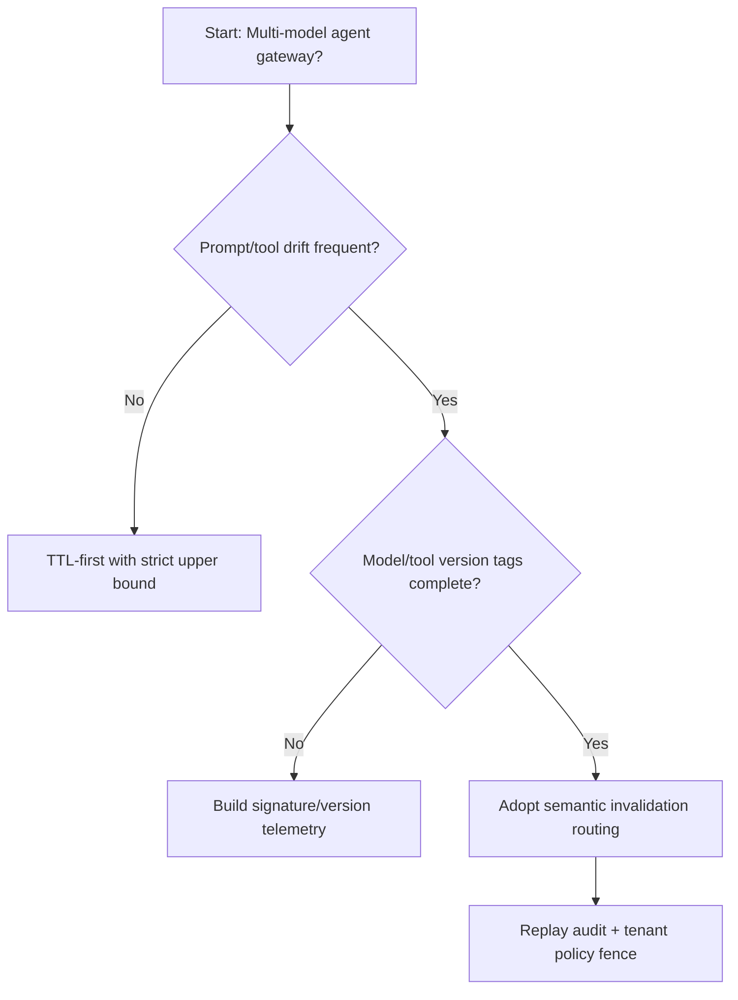
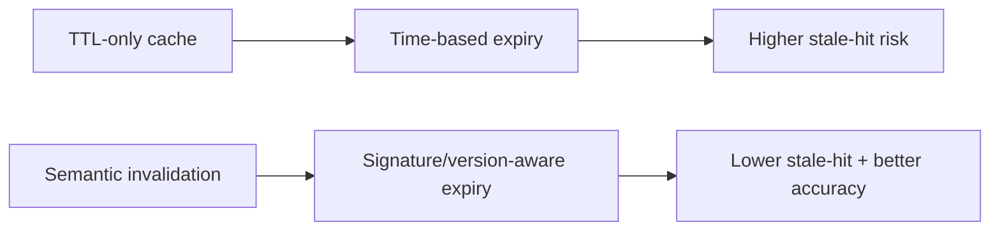
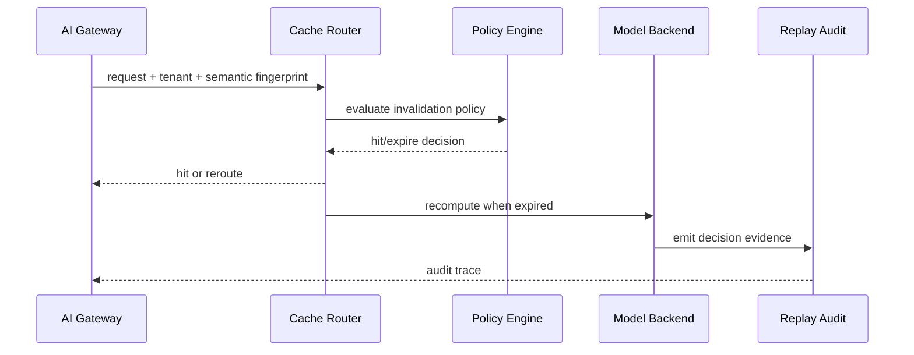

# Agent AI Gateway Semantic Cache Invalidation Selection FAQ (TTL Expiry vs Semantic Invalidation Routing)

## 1) Core conclusions (for decision-makers first)
- **For multi-model, multi-tenant agent gateways, default to semantic invalidation routing with policy-layered cache**, not fixed TTL-only operation.
- **Fixed TTL is prone to stale hits when prompt drift and tool outputs change frequently**, hurting business accuracy and compliance auditability.
- **Semantic invalidation must bind model versions, tool-output signatures, tenant policy, and replay audit**, or cache behavior becomes an opaque black box.

## 2) Q1 / Q2 / Q3 (plain-language definitions first)
- **TTL expiry**: remove cache entries only by elapsed time; simple, but blind to whether semantics already changed.
- **Semantic invalidation routing**: use semantic fingerprints, tool-output signatures, and model versions to decide immediate expiration and reroute.

### Q1: Why can’t fixed TTL cover production-grade agent gateways?
First principles: data change and semantic drift are not clock-uniform. TTL-only keeps wrong cache during turbulence and wastes recompute during steady periods.

### Q2: When is TTL still acceptable?
Single-model deployments, stable prompt templates, low tool-change frequency, and tolerance for short stale-result windows.

### Q3: What is the minimum safe loop?
Request fingerprint -> version/signature check -> invalidation policy verdict -> hit or reroute -> replay audit and policy tuning.

## 3) Mermaid (decision tree / path comparison / sequence)
### 3.1 Selection decision tree

### 3.2 Path comparison

### 3.3 Runtime sequence

## 4) Decision matrix
| Dimension | TTL expiry | Semantic invalidation routing |
|---|---|---|
| Implementation complexity | Low | Medium-High |
| Stale-hit control | Low-Medium | High |
| Cost-accuracy balance | Medium | High |
| Audit explainability | Medium | High |
| Recommended production default | Early-stage transition | Long-term multi-tenant default |

## 5) Quant evidence and reproducible examples (with n/denominator/source)
> Percentages in this section are `synthetic_assumed` hypothetical examples for mechanism comparison; production mechanism certification remains `not_measured`.  
> Contract fields are in `workshops/azure-agent-infra/evidence/cycle-443-benchmark.json` under `percentage_contract`.

- Metric A (TTL stale-hit rate)  
  - Definition: `n_stale_hit_ttl / n_runtime_requests_observed`  
  - Value: `298/2400 = 12.4%` (`synthetic_assumed`)  
  - Path: `percentage_contract.cache_stale_hit_rate`
- Metric B (semantic-invalidation stale-hit rate)  
  - Definition: `n_stale_hit_semantic_invalidation / n_runtime_requests_observed`  
  - Value: `115/2400 = 4.8%` (`synthetic_assumed`)  
  - Path: `percentage_contract.semantic_invalidation_stale_hit_rate`
- Metric C (recovery-success uplift, percentage points)  
  - Definition: `(n_recovery_success_semantic - n_recovery_success_ttl) / n_runtime_requests_observed`  
  - Value: `(2189-2006)/2400 = 7.6` percentage points (`synthetic_assumed`)  
  - Path: `percentage_contract.invalidation_recovery_gain_pts`

### Daily-hot source references (with fetch timestamps)
- APIM / AI Gateway overview (Microsoft Learn): `fetched_at_utc=2026-11-09T15:44:27Z`, `source_label=measured`
- Azure API Management changelog (Unified model API / MCP / A2A): `fetched_at_utc=2026-11-09T15:44:27Z`, `source_label=measured`
- Azure Container Apps Dynamic Sessions: `fetched_at_utc=2026-11-09T15:44:27Z`, `source_label=measured`
- Firecracker / Kata / Wasmtime / E2B releases: `fetched_at_utc=2026-11-09T15:44:27Z`, `source_label=measured`

## 6) Production validation checklist
- [ ] Semantic fingerprints, model versions, and tool signatures are version-governed in policy
- [ ] Cache hit/expire accounting is consistent with gateway budgets and tenant policy lanes
- [ ] Stale-hit rate, recompute rate, recovery-success rate, and audit chain are traceable
- [ ] Every metric explicitly labels `synthetic_assumed` / `not_measured` with denominator, unit, and source path
