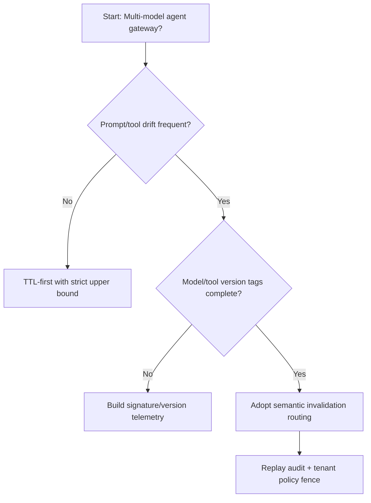
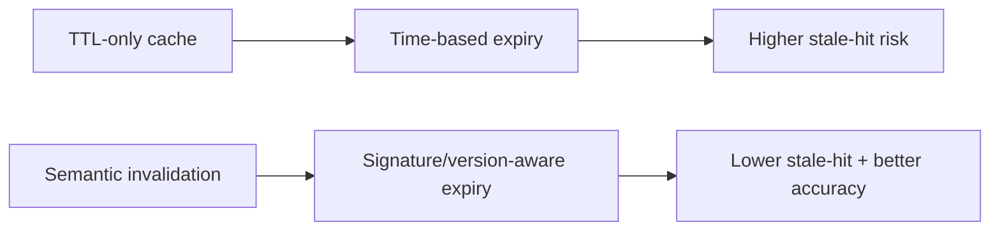
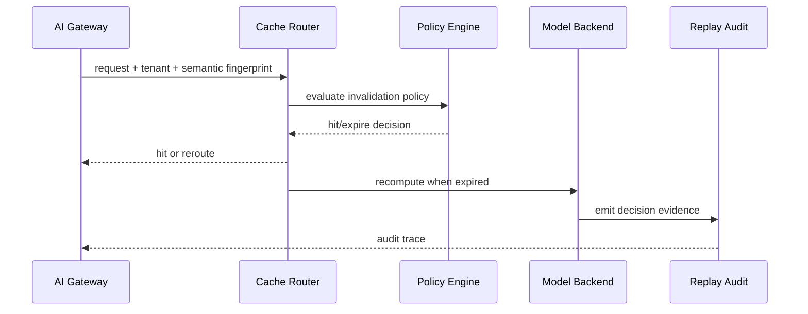

# Agent AI Gateway 语义缓存失效策略选型 FAQ（TTL 定时失效 vs 语义失效路由）

## 1) 核心结论（先给负责人）
- **多模型多租户 Agent 网关默认优先“语义失效路由 + 策略分层缓存”**，不建议长期只用固定 TTL。
- **固定 TTL 在提示词漂移和工具结果频繁变化时更易产生陈旧命中（stale hit）**，影响业务准确率与合规审计。
- **语义失效必须绑定模型版本、工具输出签名、租户策略与回放审计**，否则会变成不可追踪的黑箱缓存。

## 2) Q1 / Q2 / Q3（术语先通俗解释）
- **TTL 定时失效**：缓存到期时间到了就删，简单但不知道内容是否已经“语义过期”。
- **语义失效路由**：根据语义指纹、工具输出签名、模型版本等信号判断是否应立即失效重算。

### Q1：为什么固定 TTL 不能覆盖生产级 Agent 网关？
第一性原理：数据变化与语义漂移不是按时钟均匀发生，固定 TTL 会在变化高峰期保留错误缓存，在低变化期浪费重算成本。

### Q2：什么时候 TTL 仍可接受？
单模型、提示模板稳定、工具链路变更少且业务容忍短暂过期结果时，可作为初期方案。

### Q3：最小安全闭环是什么？
请求语义指纹 -> 版本/签名校验 -> 失效策略裁决 -> 路由重算或命中 -> 回放审计与策略复盘。

## 3) Mermaid（决策树 / 路径对比 / 时序）
### 3.1 选型决策树

### 3.2 路径对比图

### 3.3 运行时序图

## 4) 选型决策矩阵
| 维度 | TTL 定时失效 | 语义失效路由 |
|---|---|---|
| 实现复杂度 | 低 | 中-高 |
| 陈旧命中控制 | 中-低 | 高 |
| 成本-准确率平衡 | 中 | 高 |
| 审计可解释性 | 中 | 高 |
| 生产默认建议 | 早期过渡 | 多租户长期默认 |

## 5) 数据证据与可复算算例（含 n/分母/来源）
> 本节百分比为 `synthetic_assumed` 假设算例（hypothetical），用于机制比较；生产机制认证保持 `not_measured`。  
> 合同字段见：`workshops/azure-agent-infra/evidence/cycle-443-benchmark.json` 的 `percentage_contract`。

- 指标 A（TTL 策略陈旧命中率）  
  - 定义：`n_stale_hit_ttl / n_runtime_requests_observed`  
  - 值：`298/2400 = 12.4%`（`synthetic_assumed`）  
  - 路径：`percentage_contract.cache_stale_hit_rate`
- 指标 B（语义失效陈旧命中率）  
  - 定义：`n_stale_hit_semantic_invalidation / n_runtime_requests_observed`  
  - 值：`115/2400 = 4.8%`（`synthetic_assumed`）  
  - 路径：`percentage_contract.semantic_invalidation_stale_hit_rate`
- 指标 C（恢复成功率提升，百分点）  
  - 定义：`(n_recovery_success_semantic - n_recovery_success_ttl) / n_runtime_requests_observed`  
  - 值：`(2189-2006)/2400 = 7.6` 个百分点（`synthetic_assumed`）  
  - 路径：`percentage_contract.invalidation_recovery_gain_pts`

### 当日热点来源（抓取时间）
- APIM / AI Gateway 概览（Microsoft Learn）：`fetched_at_utc=2026-11-09T15:44:27Z`，`source_label=measured`
- Azure API Management changelog（Unified model API / MCP / A2A）：`fetched_at_utc=2026-11-09T15:44:27Z`，`source_label=measured`
- Azure Container Apps Dynamic Sessions：`fetched_at_utc=2026-11-09T15:44:27Z`，`source_label=measured`
- Firecracker / Kata / Wasmtime / E2B releases：`fetched_at_utc=2026-11-09T15:44:27Z`，`source_label=measured`

## 6) 生产核验 Checklist（上线前必须打勾）
- [ ] 语义指纹、模型版本、工具签名都纳入失效策略版本化管理
- [ ] 缓存命中/失效与网关预算、租户策略统一记账
- [ ] 陈旧命中率、重算率、恢复成功率、审计链可追溯
- [ ] 指标全部标注 `synthetic_assumed` / `not_measured` 与分母、单位、source_path
