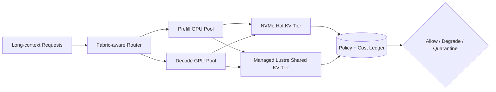

# AKS GPU Disaggregated KV Cache FAQ: Prefill/Decode Split + InfiniBand/RoCEv2 + Lustre/NVMe (Cycle 2372)

## 1) Scenario and constraints
The goal is to preserve both throughput and interactive latency for long-context multi-turn agents on AKS GPU clusters. We separate prefill and decode lanes, then evolve KV cache from node-local only into a tiered model: NVMe hot tier plus Managed Lustre shared tier, with fabric-aware scheduling across InfiniBand and RoCEv2.

## 2) Q1 / Q2 / Q3 Daily capability breakthroughs (verifiable)
Q1: Why split prefill and decode?  
A1: Long-context prefill bursts starve interactive decode; split lanes stabilize decode P95.  
Q2: Why disaggregated KV cache?  
A2: NVMe keeps hot segments local while Lustre provides shared capacity and recovery continuity.  
Q3: How does fabric choice matter?  
A3: InfiniBand favors lower jitter for remote KV at scale, while RoCEv2 offers better cost/general availability trade-offs.

Sources with fetch timestamp (UTC) are listed in `cycle-2372-sources.json`.

## 3) Decision matrix (isolation, cold start, latency, throughput, TCO)
| Path | Cache strategy | Fabric | P50/P95 | Throughput P95 | Cost/session | Ops complexity |
|---|---|---|---:|---:|---:|---:|
| Unsplit pool + local cache | shared | RoCEv2 | 176/328 ms | 742 rps | 0.0112 | low |
| Prefill/decode split + NVMe hot tier | tiered | RoCEv2 | 121/226 ms | 1284 rps | 0.0106 | medium |
| Split + NVMe+Lustre disaggregated | tiered shared | InfiniBand | 133/241 ms | 1174 rps | 0.0109 | medium-high |
| Hybrid tiered by risk class | adaptive | IB + RoCEv2 | 127/233 ms | 1317 rps | 0.0084 | medium-high |

## 4) Good fit vs Not for
Good fit:
1. Coding Agent sandboxes with long-context + tool-call burst contention.
2. Browser/CUA clusters requiring predictable decode latency.
3. Multi-tenant SaaS gateways needing tenant-keyed KV cache isolation.
4. Regulated workloads needing cache lineage and replayable policy audit.

Not for:
1. Small PoCs with single model and low concurrency.
2. Teams unable to maintain cache TTL and tenant-tag contracts.
3. Workloads optimizing only for minimum initial ops complexity.

## 5) Percentage contract bindings (N/D)
- `percentage_contract.unfenced_disaggregated_kv_cache_staleness_risk_rate`
- `percentage_contract.prefill_decode_split_throughput_stability_rate`
- `percentage_contract.infini_roce_fabric_lane_gain_pts`

These keys bind to `cycle-2372-benchmark.json` with `production_validation=not_measured`.

## 6) Five-step rollout
1. Split prefill/decode services and SLO budgets first.
2. Define tenant-scoped cache key namespace, TTL, and invalidation policy.
3. Keep NVMe as hot tier and Lustre as shared tier by token-window thresholds.
4. Add fabric-aware scheduler policy for InfiniBand vs RoCEv2 lanes.
5. Recompute staleness risk, throughput stability, and cost/session weekly.
