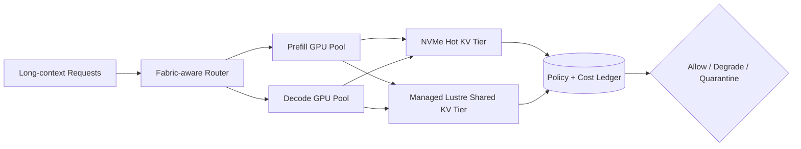

# AKS GPU 解耦 KV Cache 选型 FAQ：Prefill/Decode 分离 + InfiniBand/RoCEv2 + Lustre/NVMe（Cycle 2372）

## 1) 场景与约束
目标是让长上下文多轮 Agent 负载在 AKS GPU 集群上同时获得吞吐和交互时延：将 Prefill 与 Decode 分离，KV Cache 从单节点本地缓存演进为“本地 NVMe 热层 + Managed Lustre 冷热共享层”，并按网络织网（InfiniBand/RoCEv2）执行策略分流。

## 2) Q1 / Q2 / Q3 当日能力突破（可验证）
Q1：为什么要拆分 Prefill/Decode？  
A1：长上下文 prefill 峰值会挤压交互 decode，分离后可独立扩缩容并稳定交互 P95。  
Q2：解耦 KV Cache 的关键收益？  
A2：热点保持在 NVMe，跨节点共享放在 Lustre，可兼顾恢复速度与容量弹性。  
Q3：网络织网如何影响决策？  
A3：InfiniBand 更适合远程 KV 高并发低抖动场景，RoCEv2 在成本与普适性上更有优势。

来源与抓取时间（UTC）写入 `cycle-2372-sources.json`。

## 3) 决策矩阵（隔离边界、冷启动、时延、吞吐、TCO）
| 路径 | 缓存策略 | 网络主路径 | P50/P95 | 吞吐 P95 | 单会话成本 | 运维复杂度 |
|---|---|---|---:|---:|---:|---:|
| 单池不分离 + 本地缓存 | 共享 | RoCEv2 | 176/328 ms | 742 rps | 0.0112 | 低 |
| Prefill/Decode 分离 + NVMe 热层 | 分层 | RoCEv2 | 121/226 ms | 1284 rps | 0.0106 | 中 |
| 分离 + NVMe+Lustre 解耦 | 分层共享 | InfiniBand | 133/241 ms | 1174 rps | 0.0109 | 中高 |
| 混合分层（风险分级） | 自适应 | IB + RoCEv2 | 127/233 ms | 1317 rps | 0.0084 | 中高 |

## 4) Good fit vs Not for
Good fit：
1. Coding Agent sandbox：长上下文代码补全与工具调用并发冲突明显。  
2. Browser/CUA 集群：交互链路需要稳定 decode 时延。  
3. 多租户 SaaS 网关：需要按租户隔离 KV cache 命名空间。  
4. 金融合规场景：需要缓存 lineage、回放与策略审计。

Not for：
1. 小规模 PoC（单模型、低并发）且无明显 prefill/decode 竞争。  
2. 无法维护缓存 TTL/租户标签策略的团队。  
3. 只追求最低初始运维复杂度、忽略长期吞吐与公平性的场景。

## 5) Percentage contract bindings (N/D)
- `percentage_contract.unfenced_disaggregated_kv_cache_staleness_risk_rate`
- `percentage_contract.prefill_decode_split_throughput_stability_rate`
- `percentage_contract.infini_roce_fabric_lane_gain_pts`

以上键绑定 `cycle-2372-benchmark.json`，并标注 `production_validation=not_measured`。

## 6) 五步落地指南
1. 先拆分 Prefill/Decode 服务与 HPA/SLO，再做缓存层解耦。  
2. 定义租户级 cache key 前缀、TTL 与失效策略，避免跨租户污染。  
3. 以 NVMe 作为热层，Lustre 作为共享层，按 token 窗口阈值迁移。  
4. 在调度器引入 fabric-aware policy（InfiniBand 与 RoCEv2 分流）。  
5. 周度复盘 staleness risk、throughput stability、cost/session，迭代决策阈值。
