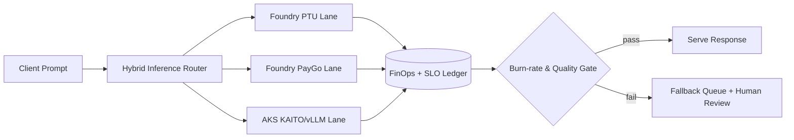

# AKS KAITO/vLLM vs Foundry PTU/PayGo Hybrid Inference Routing & FinOps Break-Even FAQ (Cycle 2369)

## 1) Scenario and constraints
This round focuses on **hybrid GPU inference routing** that combines Foundry PTU (stable baseline), Foundry PayGo (burst overflow), and AKS KAITO/vLLM (elastic throughput) under a joint SLO + cost objective.

## 2) Daily breakthrough signals (verifiable)
- Foundry PTU + elastic combinations continue to mature for low-jitter baseline capacity.
- AKS KAITO + vLLM engineering maturity improves self-hosted model elasticity and observability.
- AI Gateway policy chains enable cost/quality governance at ingress, reducing downstream waste.

## 3) Decision matrix (architecture trade-offs)
| Path | Latency stability | Peak throughput | Cost control | Ops complexity | Best fit |
|---|---:|---:|---:|---:|---|
| PTU only | High | Medium | Medium-high | Low | Stable SLA core workloads |
| PTU + PayGo | High | High | Medium | Low-medium | Bursty production demand |
| PTU + KAITO/vLLM | Medium-high | High | High | Medium-high | Cost-sensitive teams with platform ops |
| Three-lane hybrid | High | Highest | High | High | Multi-tenant high-load SaaS |

## 4) Guidance (Good fit / Not for)
Good fit:
1. Agent platforms with steady daytime load and bursty peak windows.
2. Enterprise apps needing both SLA guarantees and FinOps caps.
3. SaaS platforms requiring tenant/model-version aware routing governance.

Not for:
1. Small PoCs where routing complexity outweighs gains.
2. Teams without GPU platform operations capability.
3. Internal systems that can tolerate single-lane lock-in without cost governance.

## 5) Percentage contract bindings (N/D)
- `percentage_contract.unfenced_hybrid_gpu_route_drift_rate`
- `percentage_contract.ptu_paygo_spillover_consistency_rate`
- `percentage_contract.hybrid_router_finops_breakeven_gain_pts`

These keys bind to `cycle-2369-benchmark.json`; `production_validation=not_measured`.

## 6) Five-step rollout guide
1. Define a dual-objective router (SLO priority + cost threshold).
2. Start with PTU default, PayGo overflow, KAITO/vLLM controlled elasticity.
3. Add burn-rate alerts with automatic lower-cost lane switching.
4. Enforce tenant/model-version quality regression gates.
5. Recompute break-even periodically (token price, GPU utilization, queue wait).
