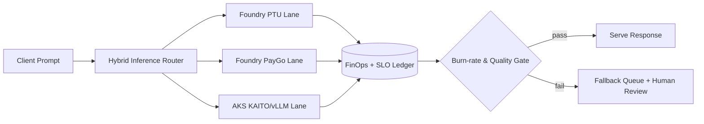

# AKS KAITO/vLLM 与 Foundry PTU/PayGo 混合推理路由与 FinOps 平衡 FAQ（Cycle 2369）

## 1) 场景与约束
本轮聚焦 **混合 GPU 推理路由**：将 Foundry PTU（保底低抖动）+ Foundry PayGo（突发兜底）+ AKS KAITO/vLLM（弹性吞吐）统一到一个 SLO/成本双目标路由器中。

## 2) 当日能力突破信号（可验证）
- Foundry 侧持续强化 PTU/弹性组合能力，适合做低抖动保底。  
- AKS KAITO + vLLM 的工程化能力提升，使自托管大模型弹性与可观察性更适合生产混合路由。  
- AI Gateway 策略链可把成本与质量治理前置到入口，减少后链路无效算力消耗。

## 3) 决策矩阵（架构权衡）
| 路径 | 延迟稳定性 | 峰值吞吐 | 成本可控性 | 运维复杂度 | 适用性 |
|---|---:|---:|---:|---:|---|
| 纯 PTU | 高 | 中 | 中高 | 低 | 稳定 SLA 主业务 |
| PTU + PayGo | 高 | 高 | 中 | 低中 | 具突发峰值业务 |
| PTU + KAITO/vLLM | 中高 | 高 | 高 | 中高 | 成本敏感且可运维团队 |
| 三路混合 | 高 | 最高 | 高 | 高 | 多租户高负载 SaaS |

## 4) 方案建议（Good fit / Not for）
Good fit：
1. 日间负载稳定、夜间峰值突增的 Agent 平台。  
2. 既要 SLA 又要 FinOps 上限控制的企业级生成式应用。  
3. 需要按租户/模型版本进行差异化路由治理的 SaaS 场景。  

Not for：
1. 小流量 PoC（路由复杂度收益不足）。  
2. 无 GPU 运维能力团队（不适合 KAITO/vLLM 路径）。  
3. 无成本约束且可接受单一路径锁定的内部系统。  

## 5) 百分比契约绑定（N/D）
- `percentage_contract.unfenced_hybrid_gpu_route_drift_rate`
- `percentage_contract.ptu_paygo_spillover_consistency_rate`
- `percentage_contract.hybrid_router_finops_breakeven_gain_pts`

以上键绑定 `cycle-2369-benchmark.json` 与本 FAQ，`production_validation=not_measured`。

## 6) 五步落地指南
1. 在路由器中定义 SLO 优先级与成本阈值双目标函数。  
2. 先以 PTU 为默认，PayGo 为峰值兜底，KAITO/vLLM 为可控扩容。  
3. 建立 burn-rate 实时告警，超阈值自动切换低成本路径。  
4. 保留按模型版本与租户的质量回归闸门。  
5. 周期性重算 break-even（按 token 单价、GPU 利用率、队列等待）。  
