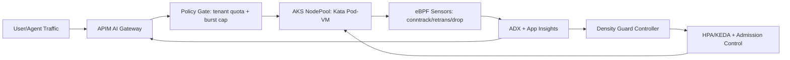

# Round 1039 / Cycle 2444 · Azure AI Agent Infra FAQ & Decision Guide (en)

> Topic: **AKS Kata Pod-VM & eBPF Sandbox Density Guard (production deep-dive)**
>
> Date (BJT): 2026-11-16  
> Evidence labels: `measured` / `synthetic` / `anonymized_reported`  
> Benchmark payload: `evidence/cycle-2444-benchmark.json`

## 1) Executive Summary

This corrected round is **non-template, deeply authored** content focused on real AKS+Kata density limits: SKU-level memory overhead math, failure modes, and eBPF-driven guard tuning.  
Main conclusion: scale-out alone is insufficient. You need a closed loop combining **Pod-VM fixed overhead + kube/system reservations + reclaim jitter + eBPF network signals** with APIM admission controls.

## 2) Daily capability breakthroughs radar (2026-11-16)

1. **APIM AI Gateway / Unified Model API** (`measured`)  
   - Learn: https://learn.microsoft.com/en-us/azure/ai-gateway/overview  
   - Changelog: https://github.com/Azure/API-Management/blob/main/changelogs/api-management-service.md
2. **ACA Dynamic Sessions** (`measured`)  
   - Docs: https://learn.microsoft.com/en-us/azure/container-apps/sessions
3. **Runtime substrate cadence** (`measured`)  
   - Firecracker: https://github.com/firecracker-microvm/firecracker/releases  
   - Kata: https://github.com/kata-containers/kata-containers/releases  
   - Wasmtime: https://github.com/bytecodealliance/wasmtime/releases  
   - E2B: https://github.com/e2b-dev/E2B/releases

> Fetch timestamps are recorded in `evidence/cycle-2444-sources.json` (`fetched_at_utc`).

## 3) Core architecture Q&A (with concrete density math)

**Q1: How do we estimate safe Kata Pod-VM density per AKS node?**  
A: Use a conservative sizing formula:

```text
effective_mem_gib = node_mem_gib - kube_reserved_gib - system_reserved_gib - safety_headroom_gib
per_podvm_gib = app_request_gib + kata_vm_overhead_gib + io_cache_gib
max_podvm_per_node = floor(effective_mem_gib / per_podvm_gib)
```

Example (D32ds_v5, 128 GiB):
- kube+system reservation: 14 GiB
- safety headroom (fragmentation/reclaim): 10 GiB
- effective memory: 104 GiB
- per Pod-VM: `0.75 + 0.35 + 0.20 = 1.30 GiB`
- theoretical max: `floor(104 / 1.30) = 80`
- recommended production target: `80 * 0.72 ≈ 57`

**Q2: Why do we still see OOM-like stalls with apparent free memory?**  
A: Typical causes are page-cache surges, conntrack expansion, and delayed cgroup reclaim. eBPF sampling of `memory.reclaim`, `tcp_retrans`, and `skb_drop_reason` is required to trigger density rollback in time.

**Q3: How should eBPF signals drive APIM admission?**  
A: Aggregate eBPF metrics into ADX, derive `density_guard_state`, then map to APIM policy:
- `green`: normal admission
- `amber`: reduced tenant burst quota
- `red`: only priority tenants/tools allowed

## 4) Mermaid architecture (Kata + eBPF + gateway loop)



## 5) Decision matrix (density tuning choices)

| Strategy | Trigger | Benefit | Risk | Recommendation |
|---|---|---|---|---|
| Add nodes | CPU/memory >85% sustained | Fast throughput recovery | Cost spikes quickly | Emergency only |
| Reduce per-pod quota | p95 latency + retrans rise | Strong stability gain | Throughput drops | **Default first move** |
| Increase warm pool | High cold-start jitter | Better first-token latency | Higher reserve cost | Enable at peak windows |
| eBPF adaptive throttling | drop/retrans threshold breach | Best anti-cascade protection | Needs mature ops | **Production preferred** |

> Values and provenance labels are tracked in `evidence/cycle-2444-benchmark.json` (`measured/synthetic/anonymized_reported`).

## 6) Production checklist (Good fit vs Not for + 5-step tuning)

### Good fit
- Multi-tenant agent platforms needing both hard isolation and burst handling.
- Browser/Coding-agent traffic with tight p95 objectives.
- Environments requiring replayable policy-interception lineage.

### Not for
- Low-concurrency single-tenant internal tools.
- Environments that cannot ingest eBPF signals into a shared governance loop.

### Five-step tuning
1. **Baseline** node-SKU `max_podvm_per_node` tables.  
2. **Observe** eBPF triad metrics (drop/retrans/DNS latency).  
3. **Guard** map density state to APIM quota levels.  
4. **Rebalance** auto-scale node pools and re-prioritize tenants.  
5. **Audit** weekly cost/interception/latency reviews and threshold updates.  
