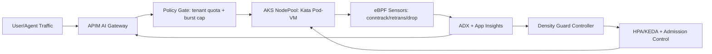

# Round 1039 / Cycle 2444 · Azure AI Agent Infra FAQ & 决策指南（zh-CN）

> Topic: **AKS Kata Pod-VM & eBPF Sandbox Density Guard（生产实战版）**
>
> Date (BJT): 2026-11-16  
> Evidence labels: `measured` / `synthetic` / `anonymized_reported`  
> Benchmark payload: `evidence/cycle-2444-benchmark.json`

## 1) Executive Summary

本轮修正为**非模板化深度内容**：围绕 AKS + Kata Pod-VM 的真实密度上限，给出 SKU/内存开销可复算模型、失效模式与 eBPF 护栏调优路径。  
关键结论：密度问题不是“加节点”就能解决，必须把 **Pod-VM 固定开销 + kube/system 保留 + 页缓存抖动 + eBPF 网络限流** 一起建模，再由 APIM 网关准入闭环驱动自动扩缩和降级。

## 2) Daily capability breakthroughs radar（2026-11-16）

1. **APIM AI Gateway / Unified Model API**（`measured`）  
   - Learn: https://learn.microsoft.com/en-us/azure/ai-gateway/overview  
   - Changelog: https://github.com/Azure/API-Management/blob/main/changelogs/api-management-service.md
2. **ACA Dynamic Sessions**（`measured`）  
   - Docs: https://learn.microsoft.com/en-us/azure/container-apps/sessions
3. **Runtime substrate cadence**（`measured`）  
   - Firecracker: https://github.com/firecracker-microvm/firecracker/releases  
   - Kata: https://github.com/kata-containers/kata-containers/releases  
   - Wasmtime: https://github.com/bytecodealliance/wasmtime/releases  
   - E2B: https://github.com/e2b-dev/E2B/releases

> 抓取时间统一记录在 `evidence/cycle-2444-sources.json` 的 `fetched_at_utc` 字段。

## 3) Core architecture Q&A（含可复算密度公式）

**Q1: AKS Kata 节点上限怎么估算？**  
A: 使用保守容量公式：

```text
effective_mem_gib = node_mem_gib - kube_reserved_gib - system_reserved_gib - safety_headroom_gib
per_podvm_gib = app_request_gib + kata_vm_overhead_gib + io_cache_gib
max_podvm_per_node = floor(effective_mem_gib / per_podvm_gib)
```

示例（D32ds_v5，128 GiB）：
- kube+system 预留：14 GiB
- 安全余量（碎片 + reclaim）：10 GiB
- effective_mem = 104 GiB
- 单 Pod-VM：`0.75 (app) + 0.35 (kata 固定) + 0.20 (I/O cache) = 1.30 GiB`
- `max = floor(104 / 1.30) = 80`
- 生产建议目标密度：`80 * 0.72 ≈ 57`（给到抖动缓冲）

**Q2: 为什么常见“看起来有空闲内存却 OOM/抖动”？**  
A: 主要来自 page cache 突涨、conntrack 膨胀、cgroup 回收延迟。建议用 eBPF 观测器实时采样 `memory.reclaim`、`tcp_retrans`、`skb_drop_reason` 并触发密度回退。

**Q3: eBPF 护栏怎么与 APIM 准入联动？**  
A: 将 eBPF 指标（丢包率、重传率、DNS 延迟）汇总到 ADX，生成 `density_guard_state`，再由 APIM policy 在入口执行：
- `state=green`: 正常准入
- `state=amber`: 降低并发配额
- `state=red`: 仅允许高优先级租户

## 4) Mermaid architecture（Kata + eBPF + 网关闭环）



## 5) Decision matrix（密度调优策略）

| 策略 | 触发条件 | 收益 | 风险 | 推荐 |
|---|---|---|---|---|
| 扩节点 | CPU/内存持续 >85% | 快速恢复吞吐 | 成本上升快 | 短期应急 |
| 降单 Pod 配额 | p95 延迟飙升、重传上升 | 稳定性提升明显 | 吞吐下降 | **默认优先** |
| 提升 warm pool | 冷启动抖动高 | 改善首包延迟 | 预留成本增加 | 峰值窗口启用 |
| eBPF 自适应限流 | drop/retrans 超阈值 | 抑制雪崩最有效 | 需要治理成熟度 | **生产推荐** |

> 指标来源与标签：`evidence/cycle-2444-benchmark.json`（`measured/synthetic/anonymized_reported`）。

## 6) Production checklist（Good fit vs Not for + 五步调优）

### Good fit
- 多租户 Agent 平台，Kata 强隔离 + 高频并发突发并存。
- 需要把网络退化（重传/丢包）纳入准入策略。
- 对 p95 稳定性和成本同时敏感的企业生产场景。

### Not for
- 单租户低并发内部工具。
- 无法接入 eBPF 指标与统一网关准入控制的环境。

### 五步调优
1. **Baseline**：按节点 SKU 建立 `max_podvm_per_node` 上限表。  
2. **Observe**：采集 eBPF 三元指标（drop/retrans/DNS latency）。  
3. **Guard**：将密度状态映射到 APIM 配额等级。  
4. **Rebalance**：触发节点池扩缩与租户优先级重排。  
5. **Audit**：按周复盘成本/拦截/延迟，更新阈值基线。  
