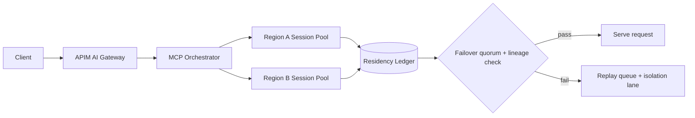

# Azure Agent Infra Cross-Region Session Residency & Failover Governance FAQ (Cycle 2367)

## 1) Scenario and constraints
This round focuses on **cross-region session residency + failover governance** across APIM AI Gateway, MCP orchestration, and Dynamic Sessions. The hard constraint is preserving residency compliance, deterministic failover, and continuity of replay evidence.

## 2) Daily breakthrough signals (verifiable)
- APIM AI Gateway provides a unified model entry + policy chain for routing and governance enforcement (official Learn + changelog).
- ACA Dynamic Sessions improves warm-restore behavior for session pools under failover pressure (official Learn).
- Firecracker/Kata releases continue improving runtime isolation/recovery characteristics for sandbox baselines (official releases).

## 3) Decision matrix (architecture trade-offs)
| Option | Isolation boundary | Failover latency | Ops complexity | Cost | Best fit |
|---|---|---:|---:|---:|---|
| APIM + ACA (primary path) | Medium-high | Low | Medium | Medium | Multi-tenant SaaS with regional DR |
| APIM + AKS Kata | High | Medium | High | Medium-high | Highly regulated finance workloads |
| APIM + Firecracker managed pool | High | Low | Medium-high | Medium | Coding Agent sandbox clusters |
| Wasm control plane + external sandbox | Medium | Very low | Medium | Low | Short control-flow task chains |

## 4) Solution guidance (Good fit / Not for)
Good fit:
1. Multi-tenant SaaS Agent Gateway requiring active-active resilience.
2. Browser/CUA clusters requiring lineage continuity after failover.
3. Zero-trust finance lanes requiring auditable residency + replay controls.

Not for:
1. Single-region ephemeral experiments.
2. Internal prototypes with no residency constraints.
3. Short-lived workloads with no replay/accountability requirement.

## 5) Percentage contract bindings (N/D)
- `percentage_contract.unfenced_crossregion_residency_drift_rate`
- `percentage_contract.failover_quorum_variance_rate`
- `percentage_contract.active_active_recovery_gain_pts`

These keys bind directly to `cycle-2367-benchmark.json`; `production_validation=not_measured`.

## 6) Five-step rollout checklist
1. Emit region_id, tenant_id, and policy_bundle_version at APIM policy boundaries.
2. MCP orchestration must emit session_lineage_id and failover_reason.
3. Session pool switchover requires quorum + lineage verification.
4. Failed traffic enters replay queues with immutable audit evidence.
5. Keep measured/synthetic/anonymized_reported labels consistent across report/cards/evidence.
