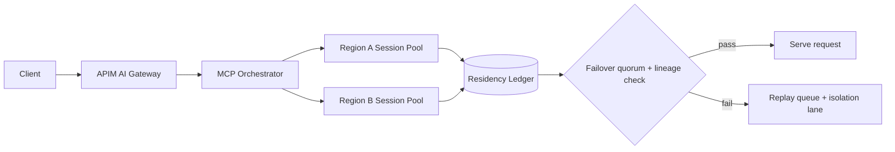

# Azure Agent Infra 跨区域会话驻留与故障切换治理 FAQ（Cycle 2367）

## 1) 场景与约束
本轮研究主题：**跨区域会话驻留 + 故障切换治理**（APIM AI Gateway + MCP + Dynamic Sessions）。核心约束是“驻留合规不破、故障切换可追、恢复后证据链连续”。

## 2) 当日能力突破信号（可验证来源）
- APIM AI Gateway 的统一模型入口与策略链能力，支持在网关层做多模型路由、策略拦截和治理编排（官方 Learn + changelog）。
- ACA Dynamic Sessions 在会话池恢复和弹性调度上提供更可控的 warm restore 行为（官方 Learn）。
- Firecracker/Kata 版本演进持续改善隔离与恢复路径，适合作为跨区域沙箱基线对照（官方 releases）。

## 3) 决策矩阵（架构权衡）
| 方案 | 隔离边界 | 切换延迟 | 运维复杂度 | 成本 | 适用性 |
|---|---|---:|---:|---:|---|
| APIM + ACA（主路径） | 中高 | 低 | 中 | 中 | 多租户 SaaS、区域容灾 |
| APIM + AKS Kata | 高 | 中 | 高 | 中高 | 高合规、强隔离金融场景 |
| APIM + Firecracker 托管池 | 高 | 低 | 中高 | 中 | Coding Agent 沙箱集群 |
| Wasm 控制面 + 外置沙箱 | 中 | 很低 | 中 | 低 | 控制流优先、工具任务短链路 |

## 4) 业务方案建议（Good fit / Not for）
Good fit：
1. 多租户 SaaS Agent Gateway 需要跨区域高可用。  
2. Browser/CUA 集群要求故障切换后继续追溯会话 lineage。  
3. 金融零信任环境要求驻留策略与回放链路双重可审计。  

Not for：
1. 单区域一次性实验环境。  
2. 没有驻留合规要求的内部原型。  
3. 不需要会话回放与责任归因的短生命周期任务。  

## 5) 百分比契约绑定（N/D）
- `percentage_contract.unfenced_crossregion_residency_drift_rate`
- `percentage_contract.failover_quorum_variance_rate`
- `percentage_contract.active_active_recovery_gain_pts`

上述键严格绑定 `cycle-2367-benchmark.json` 与本 FAQ；`production_validation=not_measured`。

## 6) 五步落地清单
1. 在 APIM 策略层写入 region_id、tenant_id、policy_bundle_version。  
2. MCP 编排输出 session_lineage_id 和 failover_reason。  
3. 会话池切换必须经过 quorum + lineage 双校验。  
4. 失败请求进入 replay 队列并保留审计证据。  
5. 日报/卡组/证据三处统一 measured/synthetic/anonymized_reported 标签。  
