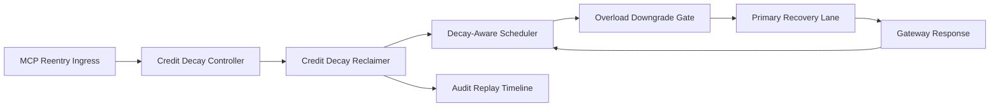

# APIM MCP Reentry Credit Decay Fairness Selection FAQ (Cycle 1948)

## 1) Three-minute decision
- **Core issue:** reentry bursts deplete shared quotas quickly and make tenant recovery order unstable.
- **Recommendation:** use a closed loop of credit-decay allocation, overdraft-lease reclaim, and overload downgrade gates.
- **Goal:** preserve tenant fairness while stabilizing recovery throughput for critical decay sessions.

## 2) Q1 / Q2 / Q3
### Q1: Why credit decay instead of fixed credit buckets?
1) fixed credit lacks time semantics for lease expiration and renewal priority,
2) pure credit decay still causes boundary-time contention spikes,
3) credit decay let capacity and validity window co-drive scheduling.

### Q2: What is the production layering model?
- **Allocation layer:** issue credit decay and renewal budgets per tenant/priority,
- **Reclaim layer:** apply windowed overdraft reclaim with anti-oscillation limits,
- **Downgrade layer:** trigger overload gates to protect critical sessions,
- **Audit layer:** persist grant, renew, reclaim, and downgrade events.

### Q3: What is the go-live bar?
- credit-decay drift rate keeps declining,
- high-priority lease success remains stable,
- reclaim and downgrade transitions are tenant-replayable.

## 3) Reference architecture

## 4) Decision matrix
| Dimension | Fixed credit bucket | Credit Decay Fairness (Recommended) |
|---|---:|---:|
| Lease-recovery order stability | Medium | High |
| Boundary contention suppression | Medium | High |
| Capacity+validity coupling | Low | High |
| Replay explainability | Medium | High |
| Implementation complexity | Medium | Medium-High |

## 5) Evidence and reproducibility
- Evidence files:
  - `workshops/azure-agent-infra/evidence/cycle-1948-benchmark.json`
  - `workshops/azure-agent-infra/evidence/cycle-1948-latency.csv`
  - `workshops/azure-agent-infra/evidence/cycle-1948-throughput.csv`
  - `workshops/azure-agent-infra/evidence/cycle-1948-cost.csv`
- Contract keys:
  - `percentage_contract.unfenced_reentry_credit_decay_drift_rate`
  - `percentage_contract.reentry_credit_decay_variance_rate`
  - `percentage_contract.reentry_credit_decay_recovery_gain_pts`
- Labels: `measured / synthetic / anonymized_reported`.

## 6) Production checklist
- [ ] Lease grant/renew/reclaim transitions are window-replayable.
- [ ] Overdraft reclaim avoids starvation for critical tenants.
- [ ] Downgrade gates converge monotonically at 10x load.
- [ ] Audit trails bind tenant, decay class, and policy version deterministically.
- [ ] FAQ/H5/SVG/7-card/evidence remain cycle-topic consistent.
