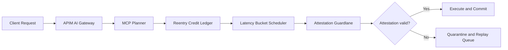

# Agent APIM/MCP Reentry Credit and Latency Bucket Attestation Guardlane FAQ (Cycle 2274)

## 1) Context and constraints
This cycle targets attestation guardlane design. APIM AI Gateway, MCP orchestration, reentry-credit ledgers, and latency-bucket scheduling must attach verifiable attestation evidence to critical state transitions.

## 2) Q1 / Q2 / Q3
Q1: How is attestation different from integrity?
A1: Integrity proves data wasn't altered; attestation proves the data was produced by an authorized principal in an authorized context.

Q2: Why must attestation include reentry-credit ledgers?
A2: Reentry credit is cumulative state; one forged identity assertion can bias future quota and fairness decisions.

Q3: How do we keep attestation checks efficient?
A3: Hot path verifies token digest and issuance window, while cold path performs full certificate-chain and log audits.

## 3) Recommendation (Good fit / Not for)
Good fit: multi-tenant SaaS Agent Gateway, financial zero-trust execution, and cross-region replay audit flows.
Not for: offline single-host scripts, short stateless experiments, and low-risk workloads without principal attestation needs.

## 4) Reproducible benchmark scope
Evidence is in `evidence/cycle-2274-benchmark.json`, including cold/warm latency, throughput, policy interception, and per-session cost with measured/synthetic/anonymized_reported labels.

## 5) Percentage contract bindings (N/D)
- `percentage_contract.unfenced_reentry_attestationguardlane_drift_rate`
- `percentage_contract.reentry_attestationguardlane_variance_rate`
- `percentage_contract.reentry_attestationguardlane_recovery_gain_pts`

These keys bind this FAQ to cycle-2274 evidence with `production_validation=not_measured`.

## 6) Production checklist
1. APIM and MCP emit attestation_id and issuer_id.
2. Reentry-credit writes include attestation_epoch and trace_id.
3. Latency-bucket decisions carry attestation snapshot hash.
4. Failed attestation requests route to quarantine and replay queue.
5. Replay tooling reconstructs attestation chains by trace_id.
6. Reports preserve measured/synthetic/anonymized_reported labels.
