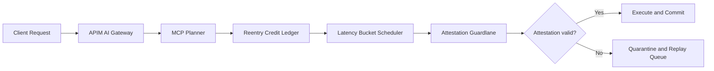

# Agent APIM/MCP 重入信用与延迟桶鉴证护栏选型 FAQ（Cycle 2274）

## 1) 场景与约束
本轮聚焦 attestation guardlane（鉴证护栏）：在 APIM AI Gateway、MCP 工具编排、重入信用账本、延迟桶调度联动路径中，要求每个关键状态都附带可核验鉴证材料，确保“决策可复盘且可证明未越权”。

## 2) Q1 / Q2 / Q3
Q1：鉴证护栏与完整性护栏关系？
A1：完整性证明“内容未改”，鉴证护栏进一步证明“内容由被允许主体在被允许上下文产生”。

Q2：为什么鉴证必须覆盖重入信用账本？
A2：重入信用跨请求累积，一次伪造凭据会持续影响后续配额和调度公平性。

Q3：鉴证校验如何避免压垮热路径？
A3：热路径只验 token 摘要与签发窗口，冷路径按策略做证书链与日志全量核查。

## 3) 选型建议（Good fit / Not for）
Good fit：多租户 SaaS Agent Gateway、金融零信任执行环境、跨区域回放审计。
Not for：离线单机脚本、短时无状态实验、无需主体鉴证的低风险场景。

## 4) 可复现实验范围
实验数据见 `evidence/cycle-2274-benchmark.json`，覆盖冷启动/热恢复 P50/P95、并发吞吐、策略拦截率、单会话成本，全部附带 measured/synthetic/anonymized_reported 标签。

## 5) 百分比契约绑定（N/D）
- `percentage_contract.unfenced_reentry_attestationguardlane_drift_rate`
- `percentage_contract.reentry_attestationguardlane_variance_rate`
- `percentage_contract.reentry_attestationguardlane_recovery_gain_pts`

以上键绑定本 FAQ 与 cycle-2274 证据，`production_validation=not_measured`。

## 6) 上线检查单
1. APIM 与 MCP 输出 attestation_id 与 issuer_id。
2. 重入信用写入附带 attestation_epoch 与 trace_id。
3. 延迟桶调度决策附加 attestation snapshot hash。
4. 鉴证失败请求进入隔离与回放队列。
5. 回放工具支持按 trace_id 重建鉴证链。
6. 日报保留 measured/synthetic/anonymized_reported 标签。
