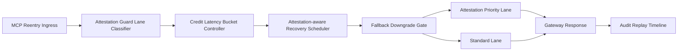

# APIM MCP Reentry Attestation Guard Lane Latency Bucket FAQ (Cycle 2167)

## 1) Three-minute decision
- **Core issue:** with reentry peaks and policy oscillation, recovery paths show attestation drift and fairness decay.
- **Recommendation:** implement a closed loop of attestation guard lanes, latency-bucket allocation, fallback downgrade gates, and replay audit.
- **Goal:** preserve tenant fairness while shrinking attestation-drift windows and rollback amplification.

## 2) Q1 / Q2 / Q3
### Q1: Why add an attestation guard lane?
1) unified throttling cannot separate attestation volatility risk classes,
2) attestation lanes block spread from high-risk policy changes and protect critical recovery paths,
3) with latency buckets, credit, validity, ordering, and attestation boundaries are jointly bounded.

### Q2: How should production layering work?
- **Attestation guard layer:** map tenant class + attestation state into recovery lanes,
- **Allocation layer:** issue lane-scoped bucket credit and renewal windows,
- **Reclaim layer:** reclaim overdraft leases with anti-propagation windows,
- **Downgrade layer:** trigger fallback downgrade and human replay at peak.

### Q3: What is the go-live bar?
- unfenced drift keeps declining,
- guard-lane variance remains stable and traceable,
- recovery gain (percentage points) stays reproducible across windows.

## 3) Reference architecture

## 4) Decision matrix
| Dimension | Unified latency bucket | Attestation Guard Lane + Latency Bucket (Recommended) |
|---|---:|---:|
| Attestation drift control | Medium | High |
| Cross-tenant propagation suppression | Medium | High |
| Replay explainability | Medium | High |
| Peak downgrade stability | Medium | High |
| Implementation complexity | Medium | Medium-High |

## 5) Evidence and reproducibility
- Evidence files:
  - `workshops/azure-agent-infra/evidence/cycle-2167-benchmark.json`
  - `workshops/azure-agent-infra/evidence/cycle-2167-latency.csv`
  - `workshops/azure-agent-infra/evidence/cycle-2167-throughput.csv`
  - `workshops/azure-agent-infra/evidence/cycle-2167-cost.csv`
- Contract keys:
  - `percentage_contract.unfenced_reentry_attestationguardlane_drift_rate`
  - `percentage_contract.reentry_attestationguardlane_variance_rate`
  - `percentage_contract.reentry_attestationguardlane_recovery_gain_pts`
- Labels: `measured / synthetic / anonymized_reported`.

## 6) Production checklist
- [ ] Attestation-lane classification is tenant-class replayable.
- [ ] Bucket grant/renew/reclaim is attestation-lane consistent.
- [ ] Attestation-priority lanes stay starvation-free during peak downgrade.
- [ ] Audit trails bind policy version, attestation class, and recovery path.
- [ ] FAQ/H5/SVG/7-card/evidence stay cycle-topic consistent.
