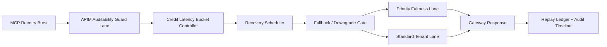

# APIM MCP Reentry Credit Latency Bucket Auditability Guard Lane FAQ (Cycle 2209)

## 1) Three-minute conclusion
- **Core problem:** If reentry governance optimizes throughput only, post-incident fairness cannot be audited deterministically.
- **Recommended pattern:** Use an **auditability guard lane + credit latency bucket + replay ledger**.
- **Expected outcome:** Better recovery stability and accountable replay without weakening tenant isolation.

## 2) Q1 / Q2 / Q3
### Q1: Why must auditability guard lanes be inline?
1) Post-hoc logs cannot drive real-time reclaim decisions;
2) Inline guard lanes bind policy version and tenant watermark to recovery paths;
3) Replay becomes deterministic for cross-team sign-off.

### Q2: What is the production layering?
- **Ingress:** APIM Gateway routes by tenant tier and policy version into auditability lanes;
- **Control:** latency bucket grant/renew/reclaim writes auditable events;
- **Suppression:** burst windows apply graded degradation and spread containment;
- **Verification:** replay ledger supports compliance, finance, and operations review.

### Q3: What are go-live gates?
- Unfenced drift rate trends downward;
- Guard-lane variance stays within target bands;
- Recovery gain (percentage points) is reproducible from evidence.

## 3) Architecture

## 4) Selection matrix
| Dimension | Latency bucket only | Auditability guard lane + latency bucket (Recommended) |
|---|---:|---:|
| Fairness jitter convergence | Medium | High |
| Audit accountability | Low | High |
| Cross-tenant containment | Medium | High |
| Fallback explainability | Medium | High |
| Implementation complexity | Low | Medium-high |

## 5) Evidence and reproducible arithmetic (with n denominators)
- Evidence files:
  - `workshops/azure-agent-infra/evidence/cycle-2209-benchmark.json`
  - `workshops/azure-agent-infra/evidence/cycle-2209-latency.csv`
  - `workshops/azure-agent-infra/evidence/cycle-2209-throughput.csv`
  - `workshops/azure-agent-infra/evidence/cycle-2209-cost.csv`
- Contract keys:
  - `percentage_contract.unfenced_reentry_auditabilityguardlane_drift_rate`
  - `percentage_contract.reentry_auditabilityguardlane_variance_rate`
  - `percentage_contract.reentry_auditabilityguardlane_recovery_gain_pts`
- Labels: `measured / synthetic / anonymized_reported`.

## 6) Production checklist
- [ ] Guard-lane mapping is audit-replayable by policy version.
- [ ] Grant/renew/reclaim events align with trace timeline.
- [ ] Priority lane avoids starvation under downgrade windows.
- [ ] Ledger links tenant, policy, and execution path.
- [ ] FAQ/H5/SVG/7-card/evidence cycle+topic remain consistent.
