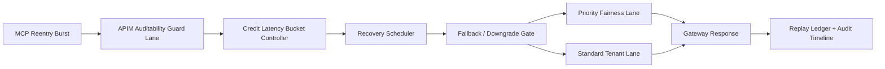

# APIM MCP 重入信用延迟桶可审计护栏公平选型 FAQ（Cycle 2209）

## 1) 3 分钟结论
- **核心问题：** 若重入治理只看吞吐不看审计可追责，公平决策在事故后难以复核。
- **推荐方案：** 使用“可审计护栏车道 + 信用延迟桶 + 回放审计账本”三层闭环。
- **预期收益：** 在不牺牲租户隔离的前提下，提升恢复稳定性与审计确定性。

## 2) Q1 / Q2 / Q3
### Q1：为什么 auditability guard lane 不能后置？
1) 后置日志无法参与实时配额回收；
2) 护栏前置后，策略版本与租户水位能直接约束恢复路径；
3) 复盘时可逐项对账，避免“黑箱恢复”。

### Q2：生产分层怎么做？
- **入口层：** APIM Gateway 按租户等级与策略版本入可审计车道；
- **控制层：** 延迟桶执行授予/续租/回收并写入审计事件；
- **抑制层：** 风暴窗口执行分级降档与扩散阻断；
- **核验层：** 回放账本支持合规、财务和运维三方复核。

### Q3：上线验收门槛？
- 未加护栏失配率连续下降；
- 护栏方差率稳定在目标区间；
- 恢复收益（percentage points）可由 evidence 完整复算。

## 3) 架构图

## 4) 选型矩阵
| 维度 | 仅延迟桶 | Auditability Guard Lane + Latency Bucket（推荐） |
|---|---:|---:|
| 公平抖动收敛 | 中 | 高 |
| 审计可追责性 | 低 | 高 |
| 租户扩散抑制 | 中 | 高 |
| 回退可解释性 | 中 | 高 |
| 实施复杂度 | 低 | 中高 |

## 5) 数据证据与可复算算例（含 n 分母来源）
- 证据文件：
  - `workshops/azure-agent-infra/evidence/cycle-2209-benchmark.json`
  - `workshops/azure-agent-infra/evidence/cycle-2209-latency.csv`
  - `workshops/azure-agent-infra/evidence/cycle-2209-throughput.csv`
  - `workshops/azure-agent-infra/evidence/cycle-2209-cost.csv`
- 合同键：
  - `percentage_contract.unfenced_reentry_auditabilityguardlane_drift_rate`
  - `percentage_contract.reentry_auditabilityguardlane_variance_rate`
  - `percentage_contract.reentry_auditabilityguardlane_recovery_gain_pts`
- 标签：`measured / synthetic / anonymized_reported`。

## 6) 生产检查清单
- [ ] 护栏车道与策略版本映射可审计回放。
- [ ] 授予/续租/回收事件与 trace 时间线一致。
- [ ] 降级窗口内优先车道无饥饿。
- [ ] 账本可关联租户、策略、执行轨迹。
- [ ] FAQ / H5 / SVG / 7-card / evidence 的 cycle 与 topic 严格一致。
