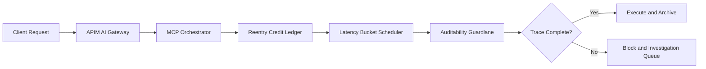

# Agent APIM/MCP Reentry Credit and Latency Bucket Auditability Guardlane FAQ (Cycle 2260)

## 1) Context and constraints
This cycle focuses on auditability guardlane design. APIM AI Gateway, MCP orchestration, reentry-credit ledgers, and latency-bucket schedulers must emit a reconstructable evidence chain so one decision path can be replayed within minutes.

## 2) Q1 / Q2 / Q3
Q1: How is auditability different from integrity?
A1: Integrity proves untampered data; auditability proves that evidence is queryable, composable, and review-ready.

Q2: Why enforce auditability at policy time?
A2: Post-execution evidence patching can leave irreversible gaps in accountability trails.

Q3: Does auditability overhead hurt latency?
A3: Hot path writes only essential audit indices; deep evidence expansion stays asynchronous.

## 3) Recommendation (Good fit / Not for)
Good fit: regulated multi-tenant Agent Gateway with cross-team incident response and replay obligations.
Not for: temporary offline scripts and non-audited single-purpose tasks.

## 4) Reproducible benchmark scope
Evidence is in `evidence/cycle-2260-benchmark.json`, including cold/warm latency, throughput, policy interception, and session cost with source labels.

## 5) Percentage contract bindings (N/D)
- `percentage_contract.unfenced_reentry_auditabilityguardlane_drift_rate`
- `percentage_contract.reentry_auditabilityguardlane_variance_rate`
- `percentage_contract.reentry_auditabilityguardlane_recovery_gain_pts`

These keys bind to this FAQ and cycle-2260 evidence with `production_validation=not_measured`.

## 6) Production checklist
1. APIM and MCP emit a shared trace_id.
2. Reentry-credit writes include route_id and policy_hash.
3. Latency-bucket decisions append audit-index records.
4. Broken audit chains are blocked and routed to investigation queue.
5. Replay tooling rebuilds a single-request chain within five minutes.
6. Reports preserve measured/synthetic/anonymized_reported labels.
