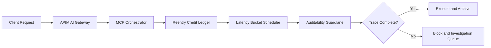

# Agent APIM/MCP 重入信用与延迟桶可审计护栏选型 FAQ（Cycle 2265）

## 1) 场景与约束
本轮聚焦 auditability guardlane（可审计护栏）：要求 APIM AI Gateway、MCP 编排、重入信用账本、延迟桶调度四层日志形成闭环证据，支持“分钟级还原一次决策链”。核心约束：证据完整优先于局部性能最优。

## 2) Q1 / Q2 / Q3
Q1：可审计护栏和完整性护栏的边界？
A1：完整性确保“数据未被篡改”，可审计确保“证据可被检索、拼接、解释”。前者偏防篡改，后者偏可复盘。

Q2：为什么要把审计闭环前置到策略层？
A2：若执行后再补证据，可能出现关键事件缺口，无法重建完整责任链。

Q3：可审计护栏会拖慢系统吗？
A3：热路径只写关键索引字段（trace_id、policy_hash、route_id），冷路径异步扩展全文审计。

## 3) 选型建议（Good fit / Not for）
Good fit：监管审计频繁、跨团队协作、需要可追责决策链的多租户 Agent Gateway。
Not for：临时实验、单脚本离线任务、对审计证据无要求的场景。

## 4) 可复现实验范围
实验数据见 `evidence/cycle-2265-benchmark.json`，覆盖冷启动/热恢复、吞吐、策略拦截率、单会话成本，并标注 measured/synthetic/anonymized_reported。

## 5) 百分比契约绑定（N/D）
- `percentage_contract.unfenced_reentry_auditabilityguardlane_drift_rate`
- `percentage_contract.reentry_auditabilityguardlane_variance_rate`
- `percentage_contract.reentry_auditabilityguardlane_recovery_gain_pts`

以上键绑定本 FAQ 与 cycle-2265 证据，`production_validation=not_measured`。

## 6) 上线检查单
1. APIM 与 MCP 必须输出统一 trace_id。
2. 重入信用写入附带 route_id 和 policy_hash。
3. 延迟桶调度结果写入审计索引表。
4. 审计链断裂请求进入阻断与排障队列。
5. 回放工具可在 5 分钟内重建单请求全链路。
6. 报告保留 measured/synthetic/anonymized_reported 标签。
