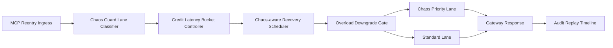

# APIM MCP 重入混沌护栏延迟桶公平选型 FAQ（Cycle 2147）

## 1) 3 分钟结论
- **核心问题：** 重入高峰叠加故障注入时，延迟桶恢复顺序会出现混沌漂移。
- **推荐方案：** “混沌护栏车道 + 延迟桶配给 + 峰值降档 + 回放审计”闭环治理。
- **目标：** 在租户公平前提下，将故障注入窗口内的恢复抖振控制在可回放范围。

## 2) Q1 / Q2 / Q3
### Q1：为什么要引入 chaos guard lane？
1) 常规限流无法覆盖故障注入造成的突发偏斜；
2) 混沌护栏可隔离高风险恢复路径并限制扩散；
3) 与延迟桶联动后可同时约束额度、时效、顺序与故障域。

### Q2：生产分层怎么设计？
- **混沌护栏层：** 按租户与故障等级映射恢复车道；
- **配给层：** 车道内分发延迟桶额度与续租窗口；
- **回收层：** 对超额租约执行窗口化回收与抖振抑制；
- **降档层：** 峰值触发分级降档与人工干预队列。

### Q3：上线判据是什么？
- 无护栏漂移率持续下降；
- 混沌车道方差率稳定且可追踪；
- 恢复收益（percentage points）跨窗口可复现。

## 3) 架构图

## 4) 选型矩阵
| 维度 | 统一延迟桶 | Chaos Guard Lane + Latency Bucket（推荐） |
|---|---:|---:|
| 故障扩散控制 | 中 | 高 |
| 跨租户抖振抑制 | 中 | 高 |
| 混沌回放可解释性 | 中 | 高 |
| 峰值降档稳定性 | 中 | 高 |
| 实施复杂度 | 中 | 中高 |

## 5) 数据证据与可复算算例（含 n 分母来源）
- 证据文件：
  - `workshops/azure-agent-infra/evidence/cycle-2147-benchmark.json`
  - `workshops/azure-agent-infra/evidence/cycle-2147-latency.csv`
  - `workshops/azure-agent-infra/evidence/cycle-2147-throughput.csv`
  - `workshops/azure-agent-infra/evidence/cycle-2147-cost.csv`
- 合同键：
  - `percentage_contract.unfenced_reentry_chaosguardlane_drift_rate`
  - `percentage_contract.reentry_chaosguardlane_variance_rate`
  - `percentage_contract.reentry_chaosguardlane_recovery_gain_pts`
- 标签：`measured / synthetic / anonymized_reported`。

## 6) 生产检查清单
- [ ] chaos 护栏映射规则可按租户等级重放。
- [ ] 延迟桶授予/续租/回收与混沌护栏一致。
- [ ] 峰值降档时混沌优先车道无饥饿。
- [ ] 审计链路可关联策略版本、故障等级与恢复轨迹。
- [ ] FAQ/H5/SVG/7-card/evidence 的 cycle/topic 一致。
