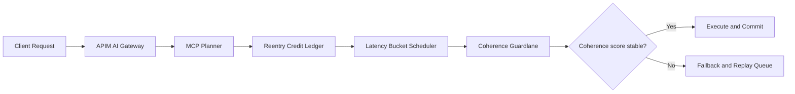

# Agent APIM/MCP Reentry Credit and Latency Bucket Coherence Guardlane FAQ (Cycle 2282)

## 1) Context and constraints
This cycle focuses on coherence guardlane design. APIM AI Gateway, MCP orchestration, reentry-credit ledgers, and latency-bucket scheduling must preserve cross-path decision coherence under burst and retry pressure.

## 2) Q1 / Q2 / Q3
Q1: How is coherence guardlane different from quorum-proof guardlane?
A1: Quorum-proof emphasizes vote verifiability; coherence guardlane emphasizes cross-path consistency under replay.

Q2: Why must coherence checks include reentry-credit ledgers?
A2: Reentry credit controls budget and priority, so missing coherence checks causes tenant fairness jitter and replay drift.

Q3: How can coherence checks remain efficient?
A3: Hot path checks coherence_hash and drift_score, while cold path replays full coherence trajectories offline.

## 3) Recommendation (Good fit / Not for)
Good fit: multi-tenant SaaS Agent Gateway, Browser/CUA clusters, and high-compliance zero-trust execution.
Not for: one-off scripts, temporary experiments without cross-path coherence requirements, and single-node flows without tenant fairness constraints.

## 4) Reproducible benchmark scope
Evidence is in `evidence/cycle-2282-benchmark.json`, including cold/warm latency, throughput, policy interception, and per-session cost with measured/synthetic/anonymized_reported labels.

## 5) Percentage contract bindings (N/D)
- `percentage_contract.unfenced_reentry_coherenceguardlane_drift_rate`
- `percentage_contract.reentry_coherenceguardlane_variance_rate`
- `percentage_contract.reentry_coherenceguardlane_recovery_gain_pts`

These keys bind this FAQ to cycle-2282 evidence with `production_validation=not_measured`.

## 6) Production checklist
1. APIM and MCP emit coherence_hash and fallback_reason.
2. Reentry-credit writes include drift_score and trace_id.
3. Latency-bucket decisions carry coherence-vote hash.
4. Budget-exhausted requests route to fallback and replay queues.
5. Replay tooling reconstructs coherence sequences by trace_id.
6. Reports preserve measured/synthetic/anonymized_reported labels.
