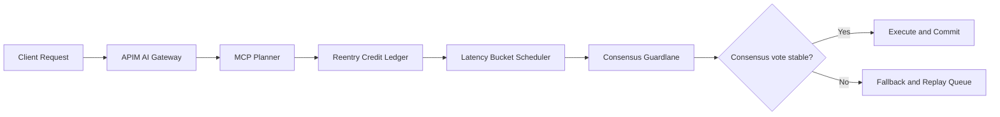

# Agent APIM/MCP Reentry Credit and Latency Bucket Consensus Guardlane FAQ (Cycle 2280)

## 1) Context and constraints
This cycle focuses on consensus guardlane design. APIM AI Gateway, MCP orchestration, reentry-credit ledgers, and latency-bucket scheduling must preserve multi-path decision consistency under burst and retry pressure.

## 2) Q1 / Q2 / Q3
Q1: How is consensus guardlane different from attestation-proof guardlane?
A1: Attestation-proof focuses on verifiable evidence; consensus guardlane focuses on stable multi-path decisions during replay and recovery.

Q2: Why must consensus checks include reentry-credit ledgers?
A2: Reentry credit controls priority and budget allocation, so missing consensus checks causes tenant-level scheduling drift.

Q3: How can consensus checks remain efficient?
A3: Hot path checks consensus_hash and vote_quorum, while cold path replays full vote trajectories offline.

## 3) Recommendation (Good fit / Not for)
Good fit: multi-tenant SaaS Agent Gateway, Browser/CUA clusters, and high-compliance zero-trust execution.
Not for: one-off scripts, temporary experiments without cross-path consistency needs, and single-node flows without tenant fairness constraints.

## 4) Reproducible benchmark scope
Evidence is in `evidence/cycle-2280-benchmark.json`, including cold/warm latency, throughput, policy interception, and per-session cost with measured/synthetic/anonymized_reported labels.

## 5) Percentage contract bindings (N/D)
- `percentage_contract.unfenced_reentry_consensusguardlane_drift_rate`
- `percentage_contract.reentry_consensusguardlane_variance_rate`
- `percentage_contract.reentry_consensusguardlane_recovery_gain_pts`

These keys bind this FAQ to cycle-2280 evidence with `production_validation=not_measured`.

## 6) Production checklist
1. APIM and MCP emit consensus_hash and fallback_reason.
2. Reentry-credit writes include vote_quorum and trace_id.
3. Latency-bucket decisions carry consensus-vote hash.
4. Budget-exhausted requests route to fallback and replay queues.
5. Replay tooling reconstructs vote sequences by trace_id.
6. Reports preserve measured/synthetic/anonymized_reported labels.
