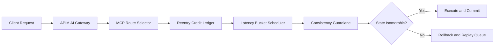

# Agent APIM/MCP Reentry Credit and Latency Bucket Consistency Guardlane FAQ (Cycle 2254)

## 1) Context and constraints
This cycle focuses on consistency guardlane design. APIM AI Gateway and MCP orchestration must keep reentry-credit ledger state, latency-bucket allocation state, and tool execution results isomorphic within each decision window.

## 2) Q1 / Q2 / Q3
Q1: How is consistency different from integrity?
A1: Integrity ensures data is untampered; consistency ensures distributed stages converge to equivalent state.

Q2: Why validate consistency both pre and post execution?
A2: Pre-check blocks stale state admission, post-check catches cross-component divergence after commit.

Q3: How do we control consistency-check overhead?
A3: Use summary-field verification on the hot path and sampled full reconciliation on the cold path.

## 3) Recommendation (Good fit / Not for)
Good fit: multi-tenant SaaS Agent Gateway, cross-region replay pipelines, regulated financial workloads.
Not for: single-instance temporary scripts without shared state.

## 4) Reproducible benchmark scope
Evidence is in `evidence/cycle-2254-benchmark.json`, including cold and warm latency, throughput, policy interception, and per-session cost with N/D-derived percentages.

## 5) Percentage contract bindings (N/D)
- `percentage_contract.unfenced_reentry_consistencyguardlane_drift_rate`
- `percentage_contract.reentry_consistencyguardlane_variance_rate`
- `percentage_contract.reentry_consistencyguardlane_recovery_gain_pts`

These keys bind to this FAQ and cycle-2254 evidence with `production_validation=not_measured`.

## 6) Production checklist
1. APIM and MCP emit state_hash and version_tag.
2. Reentry-credit and latency-bucket writes share trace_id.
3. Failed checks route to rollback and replay queue.
4. Multi-tenant cache keys include tenant and version dimensions.
5. Cycle reviews publish consistency-drift distribution.
6. Preserve measured/synthetic/anonymized_reported labels.
