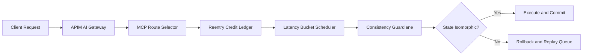

# Agent APIM/MCP 重入信用与延迟桶一致性护栏选型 FAQ（Cycle 2254）

## 1) 场景与约束
本轮聚焦 consistency guardlane（一致性护栏）：在 APIM AI Gateway 与 MCP 编排中，要求重入信用账本、延迟桶分配状态、工具执行结果在单窗口内保持同构，避免“部分成功导致全局状态分裂”。

## 2) Q1 / Q2 / Q3
Q1：一致性护栏与完整性护栏的核心差异？
A1：完整性保证“数据未被篡改”，一致性保证“多副本与多阶段结果保持同构”。

Q2：为什么一致性在执行前后都要校验？
A2：执行前防止脏状态放行，执行后防止跨组件提交结果不一致。

Q3：如何控制一致性校验成本？
A3：热路径只校验关键摘要字段，冷路径按采样做全量对账。

## 3) 选型建议（Good fit / Not for）
Good fit：多租户 SaaS Agent Gateway、跨区域回放、需要强一致审计的金融业务。
Not for：单实例临时任务、无共享状态的脚本执行场景。

## 4) 可复现实验范围
实验数据见 `evidence/cycle-2254-benchmark.json`，覆盖冷启动/热恢复、吞吐、策略拦截率、单会话成本；百分比均按 N/D 复算。

## 5) 百分比契约绑定（N/D）
- `percentage_contract.unfenced_reentry_consistencyguardlane_drift_rate`
- `percentage_contract.reentry_consistencyguardlane_variance_rate`
- `percentage_contract.reentry_consistencyguardlane_recovery_gain_pts`

以上键绑定本 FAQ 与 cycle-2254 证据，`production_validation=not_measured`。

## 6) 上线检查单
1. APIM 与 MCP 均输出 state_hash 与 version_tag。
2. 重入信用与延迟桶写入采用同一 trace_id。
3. 校验失败统一进入回滚与重放队列。
4. 多租户缓存键包含租户与版本双维度。
5. 每轮复盘输出一致性偏差分布。
6. 保留 measured/synthetic/anonymized_reported 标签。
