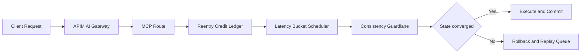

# Agent APIM/MCP Reentry Credit and Latency Bucket Consistency Guardlane FAQ (Cycle 2259)

## 1) Context and constraints
This cycle targets consistency guardlane design. APIM AI Gateway and MCP orchestration require converged state across reentry-credit ledgers, latency-bucket scheduling, and tool execution outcomes.

## 2) Q1 / Q2 / Q3
Q1: Difference between consistency and integrity?
A1: Integrity checks tamper resistance; consistency checks cross-stage state convergence.

Q2: Why verify before and after execution?
A2: Pre-check blocks dirty admission, post-check catches cross-component commit drift.

Q3: How do we limit consistency-check overhead?
A3: Hot path validates key summaries, cold path runs sampled full reconciliation.

## 3) Recommendation (Good fit / Not for)
Good fit: multi-tenant SaaS Agent Gateway, cross-region replay, strong-consistency audit workloads.
Not for: one-off offline scripts without shared-state or audit requirements.

## 4) Reproducible benchmark scope
Evidence is in `evidence/cycle-2259-benchmark.json`, including cold/warm latency, throughput, policy interception, and per-session cost with N/D-based percentages.

## 5) Percentage contract bindings (N/D)
- `percentage_contract.unfenced_reentry_consistencyguardlane_drift_rate`
- `percentage_contract.reentry_consistencyguardlane_variance_rate`
- `percentage_contract.reentry_consistencyguardlane_recovery_gain_pts`

These keys bind to this FAQ and cycle-2259 evidence with `production_validation=not_measured`.

## 6) Production checklist
1. APIM and MCP emit state_hash and version_tag.
2. Reentry-credit and latency-bucket writes share trace_id.
3. Failed checks route to rollback and replay queue.
4. Cache keys include tenant and version dimensions.
5. Replay tooling reconstructs consistency-drift paths.
6. Reports preserve measured/synthetic/anonymized_reported labels.
