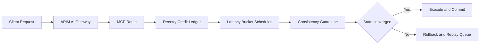

# Agent APIM/MCP 重入信用与延迟桶一致性护栏选型 FAQ（Cycle 2264）

## 1) 场景与约束
本轮聚焦 consistency guardlane：在 APIM AI Gateway 与 MCP 编排链路中，要求重入信用账本、延迟桶调度和工具执行结果在同一窗口内保持状态同构，避免“局部成功造成全局分裂”。

## 2) Q1 / Q2 / Q3
Q1：一致性护栏与完整性护栏差异？
A1：完整性关注数据未被篡改，一致性关注多阶段结果是否收敛到同一状态。

Q2：为什么一致性要前后双校验？
A2：前校验阻断脏状态准入，后校验防止跨组件提交偏差。

Q3：如何控制一致性校验成本？
A3：热路径校验关键摘要，冷路径按采样做全量对账。

## 3) 选型建议（Good fit / Not for）
Good fit：多租户 SaaS Agent Gateway、跨区域回放、强一致审计场景。
Not for：无共享状态的单机临时脚本与离线一次性任务。

## 4) 可复现实验范围
实验口径见 `evidence/cycle-2264-benchmark.json`，覆盖冷启动/热恢复、吞吐、策略拦截率、单会话成本；百分比按 N/D 复算并带来源标签。

## 5) 百分比契约绑定（N/D）
- `percentage_contract.unfenced_reentry_consistencyguardlane_drift_rate`
- `percentage_contract.reentry_consistencyguardlane_variance_rate`
- `percentage_contract.reentry_consistencyguardlane_recovery_gain_pts`

以上键绑定本 FAQ 与 cycle-2264 证据，`production_validation=not_measured`。

## 6) 上线检查单
1. APIM 与 MCP 输出 state_hash 与 version_tag。
2. 重入信用写入与延迟桶决策共用 trace_id。
3. 校验失败统一进入回滚重放队列。
4. 缓存键包含租户与版本双维度。
5. 回放工具可还原一致性偏差路径。
6. 报告保留 measured/synthetic/anonymized_reported 标签。
