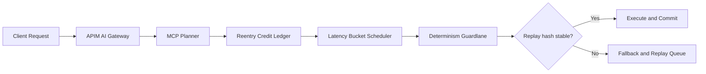

# Agent APIM/MCP Reentry Credit and Latency Bucket Determinism Guardlane FAQ (Cycle 2276)

## 1) Context and constraints
This cycle focuses on determinism guardlane design. APIM AI Gateway, MCP orchestration, reentry-credit ledgers, and latency-bucket scheduling must keep replayable and auditable decision traces under burst and retry pressure.

## 2) Q1 / Q2 / Q3
Q1: How is determinism different from resilience?
A1: Resilience targets recovery continuity; determinism targets replayable and auditable output trajectories during recovery.

Q2: Why must determinism checks include reentry-credit ledgers?
A2: Reentry credit governs retry budgets and priorities, so weak replayability increases tenant fairness disputes and audit costs.

Q3: How can determinism checks remain efficient?
A3: Hot path checks replay_hash and budget_fingerprint, while cold path runs full differential replay offline.

## 3) Recommendation (Good fit / Not for)
Good fit: multi-tenant SaaS Agent Gateway, Browser/CUA clusters, and high-compliance zero-trust execution.
Not for: one-off scripts, temporary experiments without replay audit, and single-node flows without tenant fairness constraints.

## 4) Reproducible benchmark scope
Evidence is in `evidence/cycle-2276-benchmark.json`, including cold/warm latency, throughput, policy interception, and per-session cost with measured/synthetic/anonymized_reported labels.

## 5) Percentage contract bindings (N/D)
- `percentage_contract.unfenced_reentry_determinismguardlane_drift_rate`
- `percentage_contract.reentry_determinismguardlane_variance_rate`
- `percentage_contract.reentry_determinismguardlane_recovery_gain_pts`

These keys bind this FAQ to cycle-2276 evidence with `production_validation=not_measured`.

## 6) Production checklist
1. APIM and MCP emit replay_hash and fallback_reason.
2. Reentry-credit writes include budget_fingerprint and trace_id.
3. Latency-bucket decisions carry deterministic decision hash.
4. Budget-exhausted requests route to fallback and replay queues.
5. Replay tooling reconstructs decision sequences by trace_id.
6. Reports preserve measured/synthetic/anonymized_reported labels.
