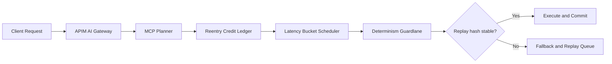

# Agent APIM/MCP 重入信用与延迟桶确定性护栏选型 FAQ（Cycle 2276）

## 1) 场景与约束
本轮聚焦 determinism guardlane（确定性护栏）：在 APIM AI Gateway、MCP 工具编排、重入信用账本与延迟桶调度链路中，要求系统在突发、重试与回放阶段维持可复算与可审计的一致决策轨迹。

## 2) Q1 / Q2 / Q3
Q1：确定性护栏与韧性护栏差异？
A1：韧性强调故障恢复能力，确定性强调在恢复和重放过程中输出轨迹可复算、可比对、可审计。

Q2：为什么确定性必须覆盖重入信用账本？
A2：重入信用决定重试预算与优先级，若账本记录不可重放，会放大租户间公平争议与审计成本。

Q3：如何控制确定性校验热路径开销？
A3：热路径仅校验 replay_hash 与 budget_fingerprint，冷路径离线执行全链路差分回放。

## 3) 选型建议（Good fit / Not for）
Good fit：多租户 SaaS Agent Gateway、Browser/CUA 集群、高合规零信任执行环境。
Not for：一次性脚本任务、无需回放审计的临时实验、无租户公平约束的单机流程。

## 4) 可复现实验范围
实验数据见 `evidence/cycle-2276-benchmark.json`，覆盖冷启动/热恢复 P50/P95、并发吞吐、策略拦截率、单会话成本，并标注 measured/synthetic/anonymized_reported。

## 5) 百分比契约绑定（N/D）
- `percentage_contract.unfenced_reentry_determinismguardlane_drift_rate`
- `percentage_contract.reentry_determinismguardlane_variance_rate`
- `percentage_contract.reentry_determinismguardlane_recovery_gain_pts`

以上键绑定本 FAQ 与 cycle-2276 证据，`production_validation=not_measured`。

## 6) 上线检查单
1. APIM 与 MCP 输出 replay_hash 与 fallback_reason。
2. 重入信用写入记录 budget_fingerprint 与 trace_id。
3. 延迟桶调度结果附加决策哈希。
4. 预算耗尽请求进入降级与回放队列。
5. 回放工具支持按 trace_id 重建决策序列。
6. 日报保留 measured/synthetic/anonymized_reported 标签。
